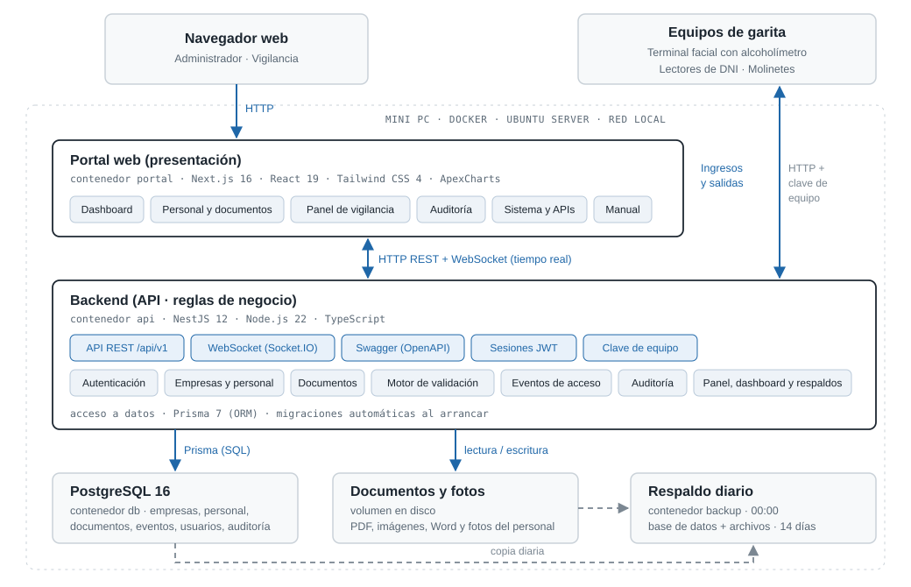

# Documento funcional - Sistema de Control de Accesos

**Terminal Monte Azul Mollendo (TMAM) · Alcance base**

Versión final · 30 de septiembre de 2026

| Versión | Fecha | Descripción |
|---|---|---|
| Final | 30/09/2026 | Versión final. |

## Contenido

1. [Introducción](#1-introducción)
2. [Descripción general del sistema](#2-descripción-general-del-sistema)
3. [Usuarios y roles](#3-usuarios-y-roles)
4. [Funcionalidades](#4-funcionalidades)
5. [Reglas de negocio](#5-reglas-de-negocio)
6. [Integración con los equipos de garita](#6-integración-con-los-equipos-de-garita)
7. [Modelo de datos](#7-modelo-de-datos)
8. [Interfaces (API)](#8-interfaces-api)
9. [Seguridad](#9-seguridad)
10. [Instalación, operación y respaldos](#10-instalación-operación-y-respaldos)
11. [Requisitos no funcionales](#11-requisitos-no-funcionales)
- [Anexo A. Glosario](#anexo-a-glosario)

---

## 1. Introducción

### 1.1. Propósito del documento

Este documento describe el funcionamiento del Sistema de Control de Accesos desarrollado para el Terminal Monte Azul Mollendo (TMAM): qué hace cada módulo, quién lo usa, las reglas de negocio que aplica, cómo se integra con los equipos de garita y cómo se instala y opera. Está dirigido al cliente, a los usuarios clave (administración y vigilancia) y a quien brinde soporte técnico.

### 1.2. Alcance

Corresponde al **alcance base** acordado: una aplicación web en la que el **administrador** registra a las empresas, a su personal (con foto) y los documentos de cada persona, y un **panel de vigilancia** que muestra en tiempo real cada ingreso y salida por los molinetes, con el motivo cuando se deniega.

**Incluido en el alcance base:**

- Registro de empresas, personal (con foto) y documentos, en un solo formulario.
- Documentos sin flujo de aprobación: tienen validez desde su carga y se pueden agregar, renovar y eliminar.
- Validación del ingreso: persona no dada de baja, al menos un documento, ninguno vencido y prueba de alcohol conforme.
- Panel de vigilancia en tiempo real, Auditoría, Sistema y APIs, y Manual de uso.
- Dos tipos de cuenta: Administrador y Vigilancia.
- Instalación en un servidor local (mini PC) en la garita, con operación independiente de internet y respaldos diarios.

**Desarrollos adicionales al alcance base, solicitados por el cliente:**

- Dashboard con indicadores (KPI) y gráficos (sección 4.4).
- Reportes en Excel o PDF (sección 4.5).

**Fuera del alcance base:**

- Autoservicio de empresas contratistas: registro, invitación y activación por correo, y carga de su propio personal y documentos.
- Aprobación de documentos como paso aparte, con observaciones y subsanación.
- Perfiles, puestos, zonas o actividades con requisitos de documentos distintos (matriz configurable de requisitos).
- Roles de usuario adicionales (por ejemplo, Auditor), pantalla de gestión de usuarios y recuperación de contraseña por correo.
- Solicitud y agenda de visitas, invitaciones de visita y control de equipos personales y materiales (pase y guía de remisión).
- Antipassback: impedir una salida sin ingreso previo o un segundo ingreso sin salida (el Dashboard solo informa quiénes están dentro).
- Auditoría detallada (valor anterior y nuevo, historial de aprobaciones).
- Activos (vehículos, maquinaria y equipos), operadores y checklists.
- Sanciones y restricciones con niveles.
- Credencial digital con QR y colores de fotocheck.
- Panel de garita avanzado y modo contingencia sin conexión.
- Alertas y notificaciones por correo.
- Autenticación de doble factor (MFA).

---

## 2. Descripción general del sistema

### 2.1. Objetivo

Controlar que solo ingrese al terminal el personal habilitado: registrado, no dado de baja, con su documentación vigente y con prueba de alcohol conforme; y dejar registro de cada ingreso, salida y cambio de datos.

### 2.2. Componentes

| Componente | Descripción |
|---|---|
| Portal web | Aplicación web para computadora, tablet y celular. Utilizada por el administrador y el personal de vigilancia desde el navegador. |
| Backend (API) | Aplica las reglas de negocio, almacena la información, recibe los eventos de los equipos y envía los eventos en tiempo real al Panel de vigilancia. |
| Base de datos | PostgreSQL 16. Almacena empresas, personal, documentos, eventos de acceso, usuarios y auditoría. |
| Almacenamiento de archivos | Documentos (PDF, imágenes, Word) y fotos del personal. |
| Respaldos | Copia diaria automática de la base de datos y de los archivos. |
| Equipos de garita | Terminal facial ZKTeco G4 Pro con alcoholímetro DT1700, dos lectores de DNI Syble XB-7705H, dos molinetes ZKTeco TS2000 Plus. |

### 2.3. Arquitectura

El sistema se ejecuta en un servidor local (**mini PC ubicada junto a los molinetes**), dentro de la red local del terminal, de modo que su operación no depende de la conexión a internet. Cada componente se despliega en un **contenedor Docker**, lo que mantiene los servicios aislados entre sí y del sistema operativo del servidor.

La arquitectura es de tres capas: el **portal web** (presentación), el **backend** (reglas de negocio y API REST) y la **base de datos**. El portal se comunica con el backend por HTTP y recibe los eventos de ingreso y salida en tiempo real por WebSocket. Los equipos de garita envían los eventos al backend por su API, autenticados con una clave de equipo.

| Contenedor | Función | Acceso |
|---|---|---|
| `portal` | Portal web | Puerto 3000 (navegador) |
| `api` | Backend. Aplica las migraciones de la base de datos al arrancar | Puerto 3001 (equipos y documentación de la API) |
| `db` | Base de datos PostgreSQL | Solo red interna |
| `backup` | Respaldo diario a las 00:00 (base de datos y archivos) | Solo red interna |

Los contenedores se reinician automáticamente ante una falla y se inician junto con el servidor. Acceso: por la red local (`http://192.168.0.165:3000`) o por Tailscale (`http://100.78.153.33:3000`).

### 2.4. Tecnologías

| Capa | Tecnología |
|---|---|
| Lenguaje | TypeScript (portal y backend) |
| Portal web | Next.js 16, React 19, Tailwind CSS 4, cliente Socket.IO, ApexCharts (gráficos del Dashboard) |
| Reportes | ExcelJS (Excel), pdfmake (PDF) y archiver (ZIP con los archivos de documentos), generados en el backend |
| Backend | NestJS 12 sobre Node.js 22, API REST versionada (`/api/v1`) |
| Tiempo real | Socket.IO 4 (WebSocket) |
| Acceso a datos | Prisma 7 (ORM y migraciones versionadas) |
| Base de datos | PostgreSQL 16 |
| Seguridad | JWT (Passport), contraseñas cifradas con bcrypt, validación de datos con class-validator, clave de equipo para las APIs de integración |
| Documentación de la API | OpenAPI / Swagger |
| Instalación | Docker y Docker Compose en Ubuntu Server 26.04 |

---

## 3. Usuarios y roles

El sistema tiene dos tipos de cuenta. Las empresas contratistas no tienen cuenta propia: el administrador registra su información.

| Rol | Quién es | Qué hace |
|---|---|---|
| Administrador | Personal de administración de OTP/MAS | Registra empresas, personal y documentos; da de baja o reactiva; consulta el Panel de vigilancia, la Auditoría y el estado del sistema. |
| Vigilancia | Personal de garita | Visualiza en tiempo real cada ingreso y salida y el motivo de las denegaciones; consulta los documentos de una persona. No puede modificar información. |

### 3.1. Permisos por módulo

| Módulo | Administrador | Vigilancia |
|---|---|---|
| Personal y documentos | Ver y modificar | — |
| Dashboard | Ver | — |
| Reportes (Excel y PDF) | Descargar | — |
| Panel de vigilancia | Ver | Ver |
| Documentos de una persona (desde el Panel) | Ver | Ver |
| Auditoría | Ver | — |
| Sistema y APIs | Ver | — |
| Manual | Ver | Ver |
| Cambiar su propia contraseña | Sí | Sí |

### 3.2. Cuentas

- Al instalar el sistema se crean dos cuentas: **admin@mollendo.local** (Administrador) y **vigilancia@mollendo.local** (Vigilancia), con contraseñas iniciales generadas en la instalación.
- El alcance base no incluye una pantalla de gestión de usuarios: la creación de cuentas adicionales y el restablecimiento de contraseñas los realiza el soporte técnico mediante la API (sección 8).

---

## 4. Funcionalidades

### 4.1. Acceso al sistema y cuenta

**Inicio de sesión**

- El acceso se realiza con correo electrónico y contraseña. Si las credenciales son incorrectas o la cuenta está dada de baja, se informa el motivo.
- La sesión tiene una duración de 1 hora y se renueva automáticamente mientras esté en uso, hasta un máximo de 7 días. Al expirar, el portal redirige al inicio de sesión.
- Al iniciar sesión, el Administrador accede a "Personal y documentos" y Vigilancia al "Panel de vigilancia".

**Cambio de contraseña**

- Desde el menú de usuario (esquina superior derecha), opción "Cambiar contraseña": se ingresa la contraseña actual y la nueva por duplicado (mínimo 8 caracteres, distinta de la actual). Cada campo permite mostrar u ocultar el texto ingresado.
- Al cambiarla, **se cierran las sesiones abiertas en otros equipos**; la sesión actual se mantiene.
- El cambio queda registrado en la Auditoría.

**Otros**

- Cierre de sesión desde el menú de usuario.
- Modo claro u oscuro, a elección de cada usuario.

### 4.2. Personal y documentos (Administrador)

Pantalla principal del administrador. Muestra a la izquierda la lista del personal de todas las empresas y a la derecha (debajo, en dispositivos móviles) la ficha de la persona seleccionada.

**Lista del personal**

- Cada persona muestra un **✔** si está habilitada para ingresar en la fecha o un **✖** con el motivo (dado de baja, sin documentos, documento vencido).
- Búsqueda por nombre, número de documento o empresa; filtro por empresa; pestañas "Todos", "No pueden" y "Pueden", con la cantidad de cada una. Dentro de "No pueden" se puede separar "Documentos" (personal activo con documentos sin cargar o vencidos; podrá ingresar al regularizarlos) de "De baja".

**Registrar personal ("+ Nuevo personal")**

Un único formulario permite registrar a la persona y sus documentos:

1. **Empresa:** se elige de la lista o se crea en el mismo formulario ("+ Nueva empresa…": RUC de 11 dígitos, razón social y correo de contacto).
2. **Datos del personal:** tipo de documento (DNI, carné de extranjería o pasaporte), número, nombres y apellidos.
3. **Foto** (obligatoria): de frente y con buena luz; JPG, PNG o WEBP de hasta 5 MB. El sistema la envía al terminal facial, que la usa para reconocer a la persona; no es necesario registrar el rostro en el equipo.
4. **Documentos** (al menos uno): nombre del documento (texto libre, por ejemplo "SCTR"), fecha de vencimiento (en blanco si no tiene vencimiento) y archivo (PDF, JPG, PNG, WEBP o Word, hasta 20 MB). Se pueden agregar varios.

Si ocurre un error durante el registro (por ejemplo, un archivo no válido), la información ya guardada no se duplica al corregir y volver a guardar.

**Ficha de la persona**

- Datos, empresa y foto ("Cambiar foto"). Si no tiene foto, se advierte que no podrá identificarse en el terminal.
- Recuadro de estado: "Puede ingresar hoy (sujeto a la prueba de alcohol en garita)" o "No puede ingresar" con los motivos.
- **Documentos actuales:** nombre, vencimiento y estado (Vigente / Vencido), con las acciones:
  - **Ver:** abre el archivo cargado en una pestaña nueva (PDF o imagen); si es Word, lo descarga.
  - **Renovar:** registra una nueva versión del documento (nuevo vencimiento y archivo); la anterior pasa al historial.
  - **Eliminar:** elimina el documento con todas sus versiones y archivos, previa confirmación.
  - **+ Agregar documento:** agrega un documento que la persona no tenía.
- **Historial de documentos:** todas las versiones cargadas, con la marca "Reemplazado" en las anteriores; cada versión se puede ver ("Ver").
- **Dar de baja / Reactivar:** la persona dada de baja no puede ingresar, sin importar sus documentos (sí puede salir). Al dar de baja se puede escribir el **motivo** (opcional, hasta 300 caracteres); queda registrado con la fecha y se muestra en la ficha, en la lista ("Dado de baja: …") y en el reporte de personal; al reactivar, el motivo se borra. Los dos piden confirmación; al reactivar, si tiene documentos vencidos o ninguno cargado, se avisa que aun así no podrá ingresar hasta regularizarlos. Sus datos, documentos e historial se conservan.

### 4.3. Panel de vigilancia (Administrador y Vigilancia)

- **Tiempo real:** cada ingreso o salida se muestra en la tabla en el momento en que ocurre, sin recargar la página; la fila del último evento se resalta durante unos segundos.
- **Contadores:** "Denegaciones hoy", "Alcohol no conforme hoy" y "Documentos vencidos" (documentos del personal activo que ya vencieron). Se actualizan automáticamente.
- **Historial:** hora, documento, persona, movimiento (ingreso o salida), resultado (autorizado o denegado) y motivo, paginado de 10 registros por página.
- **Filtros:** por día (por defecto **hoy**; "Hoy" y "Todos los días"; no se pueden elegir días futuros) y búsqueda por nombre, apellido o número de documento en todo el historial.
- **Motivos:** No registrado, Dado de baja, Sin documentos, Documentos, Alcohol, No completó rostro y alcohol (se muestran todos los que apliquen). Al hacer clic en "Documentos ›" se abre una ventana con los documentos de la persona, indicando cuáles debe regularizar; cada uno se puede ver ("Ver").
- Los intentos con un documento **no registrado** también quedan en el historial.
- **En espera en el terminal facial:** cuando una persona pasa un DNI en regla, aparece al instante en la primera fila del historial con resultado **"en espera"**, su **foto** (para compararla con quien está frente al terminal), el motivo "Esperando rostro y alcohol", el tiempo que le queda para completar el ingreso (1 minuto) y una barra que se va vaciando. Si otra persona está en su turno, figura **"en cola"** ("Esperando su turno en el terminal facial"). Al llegar el resultado del terminal facial, la fila pasa a ser el ingreso autorizado o denegado; si vence el tiempo, queda denegado con "No completó rostro y alcohol".
- **Aviso de servidor fuera de servicio:** si el servidor deja de responder, se muestra "El servidor no responde — no se están validando ingresos" (verificación cada 15 segundos).

### 4.4. Dashboard (Administrador)

Pantalla de indicadores y gráficos, calculados a partir de los ingresos y salidas registrados. Cada ingreso autorizado de una persona cuenta como una **visita**. Se actualiza en tiempo real con cada ingreso o salida, y cada minuto.

| Indicador | Cálculo |
|---|---|
| Presentes actualmente | Personas cuyo último movimiento autorizado es un ingreso, sin importar cuándo entraron. Se indica cuántas ingresaron en el periodo y cuántas antes (por ejemplo, las de permanencia mayor a 24 horas). |
| Visitas finalizadas | Visitas del periodo que ya registraron su salida. |
| Total de visitas | Ingresos autorizados en el periodo. |
| Permanencia mayor a 24 horas | Personas que ingresaron hace más de 24 horas y no registran salida. |

- **Periodo:** hoy, últimos 7 días, este mes o un rango personalizado (hasta 366 días).
- **Gráficos:** comparativa de visitas presentes (aún sin salida) y finalizadas; distribución de presentes frente a finalizadas; ingresos autorizados, denegados y salidas por día; motivos de denegación; documentos del personal activo (vigentes, por vencer en los próximos 30 días y vencidos) y personal activo por empresa.
- **Personal registrado:** total de personas, barra con la proporción de activos y dados de baja (con sus porcentajes) y cuántas personas del personal activo están en el terminal en ese momento.
- **Lista de permanencia mayor a 24 horas:** persona, documento, empresa, fecha de ingreso y tiempo dentro; de mayor a menor permanencia, paginada de 10 registros por página.

- **Acceso:** solo el Administrador, desde la opción "Dashboard" del menú.
- **Interfaces:** `GET /panel/dashboard` (indicadores y gráficos del periodo) y `GET /panel/dashboard/permanencia` (lista paginada de la permanencia mayor a 24 horas).

Los indicadores de presencia dependen de que cada persona registre su salida en el molinete. Si una persona sale sin registrarla (por ejemplo, durante una emergencia con los brazos del molinete liberados), seguirá figurando como presente hasta que registre su salida.

### 4.5. Reportes (Administrador)

Descarga de la información del sistema en **Excel** o **PDF**. Se elige el reporte, sus filtros y el formato.

| Reporte | Contenido | Filtros |
|---|---|---|
| Personal y empresas | Apellidos, nombres, documento de identidad, empresa y RUC, estado, si puede ingresar (con el motivo si no puede), cantidad de documentos y fecha de registro. | Empresa; activos o dados de baja. |
| Documentos por persona | Última versión de cada documento: persona, empresa, documento, versión, fecha de carga, vencimiento, días para vencer y estado (vigente, por vencer en 30 días o vencido). Primero los más urgentes. | Empresa; estado del documento. |
| Ingresos y salidas | Historial en orden cronológico: fecha y hora, movimiento, resultado, documento, persona, empresa, motivo de denegación y molinete. | Periodo; ingresos o salidas; autorizados o denegados. |
| Visitas del periodo | Cada ingreso autorizado con su salida, duración y estado (finalizada o presente). | Periodo. |
| Personal presente | Personas dentro del terminal en el momento de la descarga, con hora de ingreso, tiempo dentro y si superan las 24 horas. | — |
| Auditoría | Fecha y hora, usuario, acción (crear, modificar o eliminar), dato y número de registro. | Periodo. |

- **Periodo:** hoy, últimos 7 días, este mes o un rango personalizado (hasta 366 días).
- **Excel:** título, filtros y fecha de generación arriba; cabecera fija con filtros de Excel; fechas como fechas (se pueden ordenar y filtrar); totales al final.
- **PDF:** A4 horizontal, con la cabecera de la tabla repetida en cada página, número de página y totales al final.
- **Documentos con archivos (ZIP):** el reporte de documentos también se descarga en un ZIP con el mismo Excel y los archivos de cada documento, en carpetas por empresa y persona (por ejemplo `archivos/DEMO_Transportes_del_Sur_S.A.C/Apaza_Condori_Jorge_Luis_99010001/SCTR_Salud_v1.pdf`; nombres sin espacios, tildes ni ñ para que los enlaces no fallen). Cada fila del Excel tiene un enlace "Abrir" que abre su archivo, sin conexión ni sesión, **después de descomprimir el ZIP** (clic derecho → Extraer todo) y abrir el Excel desde la carpeta extraída. Opcionalmente incluye también los documentos anteriores que fueron renovados (en el Excel figuran como "Reemplazado"). Respeta los filtros de empresa y estado; hasta 2 GB de archivos por descarga.
- Hasta 100 000 filas por reporte en Excel (alcanza para un mes de movimientos con miles de personas) y hasta 20 000 en PDF y en el ZIP de documentos; si se supera, se pide acotar el periodo o los filtros.
- **Interfaz:** `GET /reportes/:tipo?formato=xlsx|pdf` con los filtros de cada reporte; `formato=zip` (y `incluirAnteriores=true`) solo en documentos.

### 4.6. Auditoría (Administrador)

- Registro de solo lectura que indica qué usuario creó, modificó o eliminó cada dato y en qué fecha: personal, empresas, documentos, tipos de documento y usuarios.
- Búsqueda por usuario o por tipo de dato ("personal", "documento"…) y filtro por rango de fechas ("Desde" / "Hasta"), paginado de 15 registros por página.

### 4.7. Sistema y APIs (Administrador)

- **Estado:** backend y base de datos ("En línea" / "Sin conexión"), clave de los equipos ("Configurado"), **respaldos** (fecha y tamaño del último; "Al día" o "Atrasado" si transcurren más de 26 horas), **equipos** (cada terminal G4 Pro "En línea" o "Desconectado", con su última actividad) y **lectores de DNI** de ingreso y salida ("Cable conectado", "Cable desconectado" o "Sin configurar", con la hora de su última lectura; el estado corresponde al cable de datos, ya que el lector solo envía información al leer un DNI) y **relés de los molinetes** ("Conectado" o "No conectado" para ingreso y salida, con la última apertura). Se actualiza cada 15 segundos.
- **Sincronización con el terminal facial:** si la revisión diaria está activa, el resultado de la última (personas agregadas, usuarios borrados, permisos quitados y usuarios del terminal que el sistema no conoce) y los botones **Simular** y **Sincronizar ahora** (con confirmación). La tarjeta del terminal muestra cuántos usuarios y rostros tiene.
- **Documentación de las APIs de integración** con ejemplos de uso y su estado ("Disponible", "Simulado" o "Por programar"), y enlace a la documentación interactiva (Swagger).

### 4.8. Manual

Guía de uso dentro del portal, con secciones para cada rol: introducción, personal y documentos, panel de vigilancia, dashboard, reportes, cuenta y contraseña, auditoría y sistema. Se muestra una sección a la vez, elegida en el índice (o con "Anterior" y "Siguiente"); cada sección tiene su propio enlace (por ejemplo `/manual#reportes`).

### 4.9. Características generales del portal

- Fechas en formato día-mes-año y hora de Lima.
- Diseño adaptable a computadora, tablet y celular (menú desplegable, tablas desplazables, tarjetas).
- Selector de fechas con semanas de lunes a domingo: la fecha se puede escribir (los separadores se insertan automáticamente) o seleccionar en el calendario, que se abre desde el ícono.
- Mensajes de error claros con la opción "Reintentar" cuando no se puede cargar la información.

---

## 5. Reglas de negocio

| Código | Regla |
|---|---|
| RN-01 | **Ingreso autorizado** solo si la persona está registrada, no está dada de baja, tiene al menos un documento cargado, ninguno de sus documentos está vencido y la prueba de alcohol es conforme. |
| RN-02 | Una persona **dada de baja** se deniega de inmediato, sin evaluar las demás condiciones. |
| RN-03 | El ingreso se valida **en dos pasos**. Al pasar el DNI: si la persona está activa, se revisan sus documentos; sin documentos o con alguno vencido se deniega de inmediato, informando todos los motivos de documentos. Si están en regla, el sistema **habilita en el terminal facial solo a esa persona**, por 1 minuto: el terminal reconoce su rostro y toma la prueba de alcohol, y rechaza el rostro de cualquier otra persona. Si ambos son conformes, el sistema abre el molinete (autorizado); si el alcohol no es conforme, se deniega por alcohol. Al terminar, se le retira la habilitación. |
| RN-03a | Se habilita **a una sola persona a la vez** en el terminal facial. Si otra persona pasa un DNI en regla mientras tanto, queda **en cola** y su minuto empieza cuando termina la anterior (puede esperar en cola hasta 3 minutos). Si la misma persona vuelve a pasar su DNI mientras espera, conserva su lugar. |
| RN-03b | Si la persona habilitada **no completa rostro y alcohol en el minuto** (o espera en cola más de 3 minutos), el ingreso se deniega con el motivo **"No completó rostro y alcohol"** y queda en el historial. |
| RN-04 | Un documento está **vigente** si no tiene fecha de vencimiento o si vence hoy o después: el día de su vencimiento sigue siendo válido todo el día. |
| RN-05 | De cada documento **cuenta solo la última versión**. Renovar crea una versión nueva y la anterior queda en el historial. |
| RN-06 | Los documentos **no requieren aprobación**: tienen validez desde su carga. Verificar que correspondan a cada persona es responsabilidad del administrador. |
| RN-07 | **Eliminar** un documento borra todas sus versiones y archivos. Si era el único, la persona queda "sin documentos" y no puede ingresar. |
| RN-08 | **Salida:** se autoriza a toda persona registrada, **incluso dada de baja** (para no impedir la salida del personal). No se exige haber registrado un ingreso (sin antipassback). |
| RN-09 | Un documento de identidad **no registrado** se deniega, tanto en el ingreso como en la salida, y el intento queda en el historial. |
| RN-10 | **Documento de identidad:** el DNI tiene 8 dígitos; el carné de extranjería y el pasaporte, letras y números. Se guarda sin espacios y en mayúsculas. No puede haber dos personas con el mismo tipo y número. |
| RN-11 | Los **nombres de documento** no distinguen mayúsculas: "sctr" y "SCTR" son el mismo tipo de documento. |
| RN-12 | **Foto** obligatoria al registrar al personal: JPG, PNG o WEBP de hasta 5 MB. **Archivos de documentos:** PDF, JPG, PNG, WEBP o Word, hasta 20 MB. |
| RN-13 | **Contraseñas** de al menos 8 caracteres. Al cambiarla se cierran las demás sesiones de esa cuenta. |
| RN-14 | Toda creación, modificación o eliminación de datos queda en la **Auditoría** con el usuario y la fecha. |
| RN-15 | "Hoy" y los vencimientos se calculan con la **hora de Lima**, independientemente de la configuración del servidor. |

---

## 6. Integración con los equipos de garita

| Parte | Descripción |
|---|---|
| API de ingreso y salida (con clave de equipo) | Aplica las reglas, guarda el evento y lo muestra en tiempo real. |
| Apertura de los molinetes | Un módulo de relés USB por molinete, conectado al servidor: al autorizar una salida, o un ingreso aprobado por el terminal facial, el sistema activa el relé del molinete durante 1 segundo. |
| Aviso de ingreso denegado | Un relé adicional (contacto seco) que se activa cada vez que se deniega un ingreso, por cualquier motivo: no registrado, dado de baja, documentos, alcohol o no completó la verificación facial (incluido el rostro no reconocido). Permite conectar una luz, una sirena o un tablero de garita. |
| Aviso de salida denegada | Otro relé (contacto seco) que se activa cuando se pasa por la salida un DNI no registrado, también si la garita está sin conexión a internet. |
| Lectores de DNI | Dos lectores de código de barras (ingreso y salida) conectados al servidor por RS232. Leen el código de barras del reverso del DNI; el sistema registra el ingreso o la salida según el lector. |
| Registro del personal en el terminal facial | Al registrar o editar a una persona, el sistema la carga en el terminal con su número de documento y su nombre; al cargar o cambiar su foto, se la envía y el terminal la usa para reconocerla. Se registran con el número de su documento (DNI, carné de extranjería o pasaporte). Todos los días el sistema revisa el terminal y lo deja igual al registro: borra a quien no está registrado en el sistema y agrega a quien falte. El personal no debe registrarse directamente en el terminal. |
| Habilitación en el terminal facial | Durante su minuto de espera, solo la persona del DNI tiene permiso de paso en el terminal; se le retira al terminar. |
| Prueba de alcohol | La realiza el terminal facial con el alcoholímetro, después del rostro. El terminal informa si la persona supera el **umbral de alcohol** configurado en el propio equipo (valor definido por el cliente); en ese caso el ingreso se deniega por alcohol. |

---

## 7. Modelo de datos

| Entidad | Contenido principal |
|---|---|
| Empresa | RUC (único), razón social, correo y teléfono de contacto, estado (activa / inactiva). |
| Persona (personal) | Empresa, tipo y número de documento de identidad (únicos juntos), nombres, apellidos, foto, estado (activo / dado de baja). |
| Tipo de documento | Nombre (único, sin distinguir mayúsculas), por ejemplo "SCTR Salud". |
| Documento de la persona | Persona, tipo de documento, fecha de vencimiento (opcional), archivo y número de versión. |
| Evento de acceso | Persona (vacía si no está registrada), documento leído, ingreso o salida, resultado, motivos de denegación (incluido "No completó rostro y alcohol"), fecha y hora, molinete. |
| Usuario | Correo (único), rol, estado de la cuenta, contraseña cifrada y fecha del último cambio de contraseña. |
| Auditoría | Usuario, dato afectado, identificador del registro, acción (crear / modificar / eliminar), fecha y hora. |

---

## 8. Interfaces (API)

Todas las rutas empiezan con `/api/v1`. El portal se autentica con un token de sesión (JWT) y los equipos con la clave de equipo en la cabecera `X-API-Key`. La documentación interactiva está en `/api/docs`.

| Método y ruta | Uso | Acceso |
|---|---|---|
| `POST /auth/login` · `/auth/refresh-token` | Iniciar sesión y renovarla | Público |
| `PATCH /cuenta/password` | Cambiar la propia contraseña | Con sesión |
| `GET` · `POST /empresas` · `GET` · `PATCH /empresas/:id` | Empresas: listar, registrar, ver y modificar | Administrador |
| `GET /personas` · `/personas/:id` | Personal con su estado de cumplimiento | Administrador y Vigilancia |
| `POST /personas` · `PATCH /personas/:id` · `PATCH /personas/:id/estado` | Registrar, modificar, dar de baja o reactivar | Administrador |
| `POST` · `GET /personas/:id/foto` | Subir y ver la foto | Subir: Administrador; ver: ambos |
| `POST` · `GET /personas/:id/documentos` | Subir un documento (o su renovación) y ver el historial | Subir: Administrador; ver: ambos |
| `GET /personas/:id/documentos/:documentoId/archivo` | Archivo de una versión del documento (PDF e imagen se abren en el navegador; Word se descarga) | Administrador y Vigilancia |
| `DELETE /personas/:id/documentos/:tipoDocumentoId` | Eliminar un documento con todas sus versiones | Administrador |
| `GET` · `POST /tipos-documento` | Nombres de documento | Crear: Administrador |
| `POST /eventos-acceso/ingreso` · `/salida` | Registrar un ingreso o una salida | Equipos (`X-API-Key`) |
| `POST /integraciones/torniquete/comando` | Orden manual de apertura de un molinete (`ingreso` o `salida`): activa su relé durante 1 segundo | Administrador y Vigilancia |
| `POST /integraciones/g4pro/sincronizar` | Deja el terminal facial igual al sistema: borra a quien el sistema no conoce, quita permisos sueltos y registra con foto al personal activo que falta (también se ejecuta todos los días a medianoche) | Administrador |
| `GET /eventos-acceso/en-espera` | Personas en espera del terminal facial (en su turno o en cola), para el Panel | Administrador y Vigilancia |
| `/iclock/*` | Protocolo PUSH del terminal facial: registro, órdenes, resultados y consultas | Terminal facial |
| `GET /eventos-acceso` | Historial paginado, con búsqueda y fechas | Administrador y Vigilancia |
| `GET /panel/resumen` | Contadores del Panel | Administrador y Vigilancia |
| `GET /panel/dashboard` | Indicadores y gráficos del Dashboard, por periodo | Administrador |
| `GET /panel/dashboard/permanencia` | Personas con permanencia mayor a 24 horas, paginado | Administrador |
| `GET /reportes/:tipo` | Reporte en Excel o PDF (`personal`, `documentos`, `movimientos`, `visitas`, `presentes`, `auditoria`); documentos también en ZIP con sus archivos | Administrador |
| `GET /panel/estado-sistema` · `/health` | Estado del sistema y de los respaldos | Administrador · público |
| `GET /auditoria` | Auditoría paginada, con búsqueda y fechas | Administrador |
| `GET` · `POST` · `PATCH /usuarios` | Cuentas de usuario (sin pantalla en el alcance base) | Administrador |
| Socket.IO `/ws/eventos` | Eventos en tiempo real para el Panel | Con sesión |

---

## 9. Seguridad

- **Autenticación** con correo y contraseña; las contraseñas se guardan cifradas (bcrypt), nunca en texto plano.
- **Sesiones** firmadas (JWT) de 1 hora, renovables hasta 7 días; se invalidan al cambiar la contraseña o al dar de baja la cuenta.
- **Permisos por rol** aplicados en el backend, no solo en las pantallas.
- **Equipos** autenticados con una clave propia (`X-API-Key`), distinta de las cuentas de usuario.
- **Archivos:** solo formatos y tamaños permitidos; se guardan con nombres generados por el sistema y solo después de validar la petición.
- **Datos de entrada** validados en el backend (formatos, longitudes, fechas).
- **Auditoría** de todos los cambios de datos.
- **Red:** el sistema solo es accesible desde la red local del terminal o mediante la VPN Tailscale. Las credenciales de producción se almacenan únicamente en el servidor.

---

## 10. Instalación, operación y respaldos

### 10.1. Instalación

El sistema se encuentra instalado en la mini PC (Ubuntu Server 26.04) mediante contenedores Docker. Se dispone de una guía de despliegue que detalla la instalación desde cero, las actualizaciones, la operación diaria y la solución de problemas.

### 10.2. Actualizaciones

Antes de cada actualización se genera un respaldo de la base de datos; luego se reemplaza el código, se reconstruyen los contenedores y se aplican automáticamente las migraciones de la base de datos. La información existente se conserva.

### 10.3. Respaldos

- **Diarios a las 00:00**, automáticos: base de datos completa y archivos (documentos y fotos) en un solo paquete.
- Se conservan **14 días**. Si al iniciar el servidor no existe un respaldo de las últimas 24 horas, se genera uno en ese momento.
- También se genera un respaldo antes de cada actualización, y es posible generar uno completo en cualquier momento.
- El estado del último respaldo se muestra en Sistema y APIs. La restauración está documentada y probada.

### 10.4. Comportamiento ante fallas

| Situación | Comportamiento |
|---|---|
| Corte de luz o reinicio | El sistema se inicia automáticamente al encender la mini PC. Los datos guardados se conservan. |
| Falla del backend | Se reinicia automáticamente. El Panel avisa "El servidor no responde". |
| Emergencia o corte de luz en los molinetes | Los brazos de los molinetes se liberan automáticamente (función propia del equipo). |

---

## 11. Requisitos no funcionales

| Aspecto | Cómo se cumple |
|---|---|
| Disponibilidad | Contenedores con reinicio automático; arranque automático con el equipo; respaldos diarios. |
| Rendimiento | Historial y auditoría paginados en el servidor e indexados por fecha: mantienen tiempos de respuesta estables con miles de registros. |
| Tiempo real | Los eventos llegan al Panel al instante, sin recargar la página. |
| Usabilidad | Interfaz adaptable a celular, modo claro y oscuro, manual integrado. |
| Operación sin internet | El sistema opera íntegramente dentro de la red local del terminal. |
| Mantenibilidad | Pruebas automáticas del backend (reglas de ingreso, paginación, respaldos) y guía de despliegue. |

---

## Anexo A. Glosario

| Término | Significado |
|---|---|
| Alcance base | Versión del sistema acordada: el administrador registra empresas, personal y documentos; vigilancia consulta el panel. |
| Dado de baja | Persona inactiva en el sistema (por ejemplo, porque ya no labora en el terminal); no puede ingresar. |
| Documento vigente / vencido | Según su fecha de vencimiento respecto de hoy (RN-04). |
| Evento de acceso | Registro de un intento de ingreso o salida, autorizado o denegado. |
| Mini PC | Servidor local, ubicado junto a los molinetes, donde se ejecuta el sistema. |
| Molinete | Torniquete de paso (ZKTeco TS2000 Plus). |
| Protocolo PUSH | Protocolo de comunicación del fabricante ZKTeco entre el terminal facial y el sistema. |
| Permiso de paso | Autorización que el terminal facial guarda para dejar pasar a una persona. Sin ella, el terminal la reconoce pero la rechaza. El sistema no se la da a nadie de forma permanente: solo durante la habilitación. |
| Habilitación | Permiso de paso que el sistema da en el terminal facial solo a la persona que pasó su DNI en regla, durante su minuto de espera (RN-03). |
| En cola | Persona con DNI en regla que espera su turno porque otra está habilitada en el terminal facial (RN-03a). |
| Visita | Cada ingreso autorizado de una persona al terminal; se usa en los indicadores del Dashboard. |
| Respaldo | Copia de la base de datos y de los archivos para recuperar la información. |
| Tailscale | Red privada virtual (VPN) que permite acceder a la mini PC desde fuera del terminal sin exponerla a internet. |
| X-API-Key | Clave con la que se identifican los equipos ante el sistema. |
