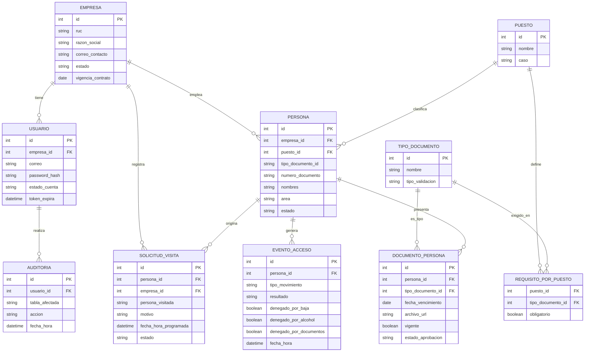

# Especificación de desarrollo — Sistema de Control de Acceso, Terminal de Mollendo

## 1. Resumen del proyecto

Sistema que controla el ingreso y salida de personas al Terminal de Mollendo, validando en tiempo real dos condiciones antes de autorizar el paso:

1. **Prueba de alcohol** (alcoholímetro con reconocimiento facial).
2. **Documentación vigente**, según el puesto y caso de la persona (SCTR, CAMO, inducción SSMA, etc.).

Si ambas condiciones se cumplen → **AUTORIZADO**, se abre el torniquete. Si falla alguna → **DENEGADO**, con el motivo específico visible en pantalla y en el panel de vigilancia.

---

## 2. Stack tecnológico

| Capa | Tecnología |
|---|---|
| Backend / API | NestJS (Node.js) con TypeScript |
| Frontend (portal web + panel administrativo) | Next.js (React) con TypeScript |
| Base de datos | PostgreSQL |
| ORM | Prisma |
| Contenedores | Docker (despliegue reproducible en Azure/Hostinger y en el servidor local de contingencia) |
| Sistema operativo del servidor | Ubuntu Server LTS |
| Autenticación | JWT |
| Comunicación con equipos físicos | API REST / SDK del fabricante (lector DNI, alcoholímetro, torniquete) |
| Almacenamiento de documentos | Disco del propio servidor (no se usa object storage externo tipo Blob/S3) |

---

## 3. Arquitectura general

```
Portal web (empresas)  ──┐
                          ├─→ Backend (NestJS, Docker) ──→ PostgreSQL
PC de vigilancia (panel) ─┘         │
                                     ├─→ API alcoholímetro (webservice del proveedor)
                                     └─→ API/SDK torniquete
```

- **Punto de ingreso:** 3 equipos independientes conectados directo a la red (sin PC local): lector de código de barras (DNI), alcoholímetro con reconocimiento facial, torniquete bidireccional.
- **Servidor central:** backend + base de datos en Azure o Hostinger (ver presupuesto de infraestructura aparte).
- **Servidor local de contingencia:** réplica del mismo entorno Docker, para operar sin internet (copia local de DNIs/estado documental, cola de eventos offline, sincroniza al recuperar conexión).
- **PC de vigilancia:** panel administrativo en tiempo real (denegaciones, alcohol no conforme, documentos vencidos) + modo contingencia.

---

## 3.1. Roles y permisos

| Rol | Quién lo usa | Permisos principales |
|---|---|---|
| **Administración del sistema** | Personal del cliente (Terminal) | Alta de empresas proveedoras, gestión del catálogo de puestos y requisitos, gestión de tipos de documento, panel de auditoría completo |
| **Empresa proveedora/cliente** | Invitada y registrada por Administración | Carga y gestión de su propio personal, carga de documentos de sus trabajadores, **aprobación/rechazo de los documentos de su propio personal**, registro de solicitudes de visita |
| **Vigilancia** | Personal en caseta | Panel en tiempo real de accesos (visualización de denegaciones, alcohol no conforme, documentos vencidos), operación en modo contingencia |

Flujo de registro: **Administración registra a las empresas proveedoras → cada empresa proveedora registra y administra a su propio personal** (incluida la aprobación de sus documentos). Administración no aprueba documentos de terceros — solo supervisa vía el panel de auditoría.

Una persona pertenece a **una sola empresa a la vez** (no puede estar registrada simultáneamente en dos empresas distintas). Cuando la empresa da de baja a un trabajador (`PATCH /personas/:id/estado`), la persona queda con estado `inactivo` y se le impide el ingreso de inmediato: el lector muestra el mensaje **"Dado de baja"**, sin necesidad de evaluar alcohol o documentos — es un motivo de denegación independiente y con prioridad sobre los demás.

---

## 4. Flujos funcionales

### 4.1. Alta de empresa (preparación previa)
1. Administración registra RUC y correo de contacto de la empresa proveedora/cliente.
2. El sistema genera un enlace único de activación.
3. Se envía invitación por correo al representante de la empresa.
4. El representante abre el enlace, activa su cuenta (crea contraseña) e inicia sesión en el portal.
5. Carga la lista de su personal junto con sus documentos.
6. Validación automática: el sistema compara la fecha de cada documento con la fecha de hoy → estado **Vigente** o **Vencido**.

### 4.2. Registro de visitas
- La visita **no carga nada por sí misma** — la registra la empresa proveedora en el mismo portal, junto con el resto de su personal.
- Debe registrarse antes de un horario límite definido (a confirmar con el cliente).

### 4.3. Ingreso (flujo físico diario)
1. La persona se identifica (DNI) y hace la prueba de alcohol en el mismo punto.
2. El sistema verifica primero si la persona está **activa**. Si fue dada de baja por su empresa → **DENEGADO de inmediato**, mensaje "Dado de baja" (no se evalúan alcohol ni documentos).
3. Si está activa, el servidor de aplicación valida el resultado del alcohol y consulta el expediente digital de la persona.
4. El motor de validación aplica las reglas (documentos obligatorios según puesto) y decide el resultado.
5. Resultado: **AUTORIZADO** (abre torniquete) o **DENEGADO** (bloquea, muestra el/los motivo(s): alcohol, documentos, o **ambos si coinciden** — si a la persona le falta un documento y además da positivo en la prueba de alcohol, se muestran los dos motivos a la vez, no solo uno).
6. Se registra el evento en auditoría (resultado, hora, responsable).

### 4.4. Salida
1. La persona presenta su DNI en el mismo torniquete.
2. El sistema valida si existe un registro de ingreso previo (**control anti-passback**).
3. Si existe → abre y cierra el ciclo de acceso. Si no existe → no abre y alerta al personal de seguridad.
4. Se registra el evento en auditoría.

### 4.5. Modo contingencia (sin internet)
- El servidor local mantiene copia de DNIs y estado documental, y una cola de eventos offline.
- Al recuperar conexión, sincroniza con el servidor central (Azure/Hostinger).

---

## 5. Modelo de datos



Resumen de entidades y script SQL completo a continuación:

| Entidad | Propósito |
|---|---|
| `empresa` | Proveedor/cliente (incluye OTP/MAS como una empresa más del portal) |
| `usuario` | Acceso al portal web, pertenece a una empresa |
| `puesto` | Catálogo de puestos por caso (visita / personal_propio / contratista / tercero) — **pendiente de poblar con el cliente** |
| `persona` | Trabajador, visita, contratista o tercero, ligado a una empresa y un puesto |
| `tipo_documento` | Catálogo de documentos (SCTR, CAMO, inducción SSMA, PETS, IPERC, etc.), con su tipo de validación |
| `requisito_por_puesto` | Matriz puesto × documento obligatorio — **pendiente de poblar con el cliente** |
| `documento_persona` | Documento cargado por persona, con historial completo (nunca se borra) |
| `solicitud_visita` | Visita agendada por la empresa proveedora (persona visitada, motivo, fecha/hora) |
| `evento_acceso` | Cada ingreso/salida, con resultado y motivo de denegación |
| `auditoria` | Quién creó/modificó/aprobó cada registro |

**Tipos de validación de documento:** fecha de vencimiento / sí-no / vigente por actividad (detalle por tipo de documento en la tabla ya definida).

**Ajuste ya aplicado al esquema SQL:** `evento_acceso` usa tres columnas booleanas (`denegado_por_baja`, `denegado_por_alcohol`, `denegado_por_documentos`) en vez de un solo motivo — porque un evento puede denegarse por alcohol y documentos a la vez, y porque una persona dada de baja se deniega de inmediato sin evaluar lo demás.

### 5.1. Script SQL (PostgreSQL)

```sql
-- =====================================================================
-- Modelo de datos — Sistema de Control de Acceso, Terminal de Mollendo
-- PostgreSQL
--
-- Nota: las tablas `puesto` y `requisito_por_puesto` quedan creadas
-- pero sin datos (seed) hasta contar con el listado real de puestos
-- por caso y los documentos exigidos a cada uno, pendiente de
-- confirmar con el cliente. El resto del modelo no depende de eso.
-- =====================================================================

-- ---------------------------------------------------------------------
-- EMPRESA (proveedor / cliente, incluye OTP/MAS como una empresa más)
-- ---------------------------------------------------------------------
CREATE TABLE empresa (
    id                          SERIAL PRIMARY KEY,
    ruc                         VARCHAR(11) NOT NULL UNIQUE,
    razon_social                VARCHAR(200) NOT NULL,
    correo_contacto             VARCHAR(150) NOT NULL,
    telefono_contacto           VARCHAR(20),
    estado                      VARCHAR(20) NOT NULL DEFAULT 'activa'
                                    CHECK (estado IN ('activa', 'inactiva')),
    contrato_vigencia_inicio    DATE,
    contrato_vigencia_fin       DATE,
    creado_en                   TIMESTAMP NOT NULL DEFAULT now(),
    actualizado_en              TIMESTAMP NOT NULL DEFAULT now()
);

-- ---------------------------------------------------------------------
-- USUARIO (acceso al portal web, pertenece a una empresa)
-- ---------------------------------------------------------------------
CREATE TABLE usuario (
    id                  SERIAL PRIMARY KEY,
    empresa_id          INTEGER NOT NULL REFERENCES empresa(id),
    correo              VARCHAR(150) NOT NULL UNIQUE,
    password_hash       VARCHAR(255),
    estado_cuenta       VARCHAR(20) NOT NULL DEFAULT 'invitado'
                            CHECK (estado_cuenta IN ('invitado', 'activo', 'baja')),
    token_invitacion    VARCHAR(255),
    token_expira        TIMESTAMP,
    creado_en           TIMESTAMP NOT NULL DEFAULT now()
);

CREATE INDEX idx_usuario_empresa ON usuario(empresa_id);

-- ---------------------------------------------------------------------
-- PUESTO (catálogo por caso — PENDIENTE DE POBLAR CON EL CLIENTE)
-- caso: visita | personal_propio | contratista | tercero
-- ---------------------------------------------------------------------
CREATE TABLE puesto (
    id      SERIAL PRIMARY KEY,
    nombre  VARCHAR(100) NOT NULL,
    caso    VARCHAR(30) NOT NULL
                CHECK (caso IN ('visita', 'personal_propio', 'contratista', 'tercero')),
    UNIQUE (nombre, caso)
);

-- ---------------------------------------------------------------------
-- PERSONA
-- puesto_id es NULLABLE por ahora: se vuelve obligatorio (NOT NULL)
-- una vez que el catálogo de puestos esté poblado y en uso.
-- ---------------------------------------------------------------------
CREATE TABLE persona (
    id                          SERIAL PRIMARY KEY,
    empresa_id                  INTEGER NOT NULL REFERENCES empresa(id),
    puesto_id                   INTEGER REFERENCES puesto(id),
    tipo_documento_identidad    VARCHAR(10) NOT NULL
                                    CHECK (tipo_documento_identidad IN ('DNI', 'CE', 'PASAPORTE')),
    numero_documento            VARCHAR(20) NOT NULL,
    nombres                     VARCHAR(150) NOT NULL,
    apellidos                   VARCHAR(150) NOT NULL,
    area                        VARCHAR(100), -- texto libre (acordado, sin catálogo)
    estado                      VARCHAR(20) NOT NULL DEFAULT 'activo'
                                    CHECK (estado IN ('activo', 'inactivo')),
    creado_en                   TIMESTAMP NOT NULL DEFAULT now(),
    UNIQUE (tipo_documento_identidad, numero_documento) -- global: una persona pertenece a una sola empresa a la vez
);

CREATE INDEX idx_persona_empresa ON persona(empresa_id);
CREATE INDEX idx_persona_puesto ON persona(puesto_id);
CREATE INDEX idx_persona_documento ON persona(numero_documento);

-- ---------------------------------------------------------------------
-- TIPO_DOCUMENTO (catálogo de documentos posibles: SCTR, CAMO, etc.)
-- tipo_validacion: fecha_vencimiento | si_no | vigente_por_actividad
-- ---------------------------------------------------------------------
CREATE TABLE tipo_documento (
    id                  SERIAL PRIMARY KEY,
    nombre              VARCHAR(100) NOT NULL UNIQUE,
    tipo_validacion     VARCHAR(30) NOT NULL
                            CHECK (tipo_validacion IN ('fecha_vencimiento', 'si_no', 'vigente_por_actividad'))
);

-- ---------------------------------------------------------------------
-- REQUISITO_POR_PUESTO (matriz puesto × documento — PENDIENTE DE POBLAR)
-- ---------------------------------------------------------------------
CREATE TABLE requisito_por_puesto (
    puesto_id           INTEGER NOT NULL REFERENCES puesto(id),
    tipo_documento_id   INTEGER NOT NULL REFERENCES tipo_documento(id),
    obligatorio         BOOLEAN NOT NULL DEFAULT true,
    PRIMARY KEY (puesto_id, tipo_documento_id)
);

-- ---------------------------------------------------------------------
-- DOCUMENTO_PERSONA (historial completo, nunca se borra)
-- ---------------------------------------------------------------------
CREATE TABLE documento_persona (
    id                  SERIAL PRIMARY KEY,
    persona_id          INTEGER NOT NULL REFERENCES persona(id),
    tipo_documento_id   INTEGER NOT NULL REFERENCES tipo_documento(id),
    fecha_emision       DATE,
    fecha_vencimiento   DATE,
    archivo_url         VARCHAR(500),
    vigente             BOOLEAN NOT NULL DEFAULT true,
    estado_aprobacion   VARCHAR(20) NOT NULL DEFAULT 'pendiente'
                            CHECK (estado_aprobacion IN ('pendiente', 'aprobado', 'rechazado')),
    version             INTEGER NOT NULL DEFAULT 1,
    creado_en           TIMESTAMP NOT NULL DEFAULT now()
);

CREATE INDEX idx_documento_persona_persona ON documento_persona(persona_id);
CREATE INDEX idx_documento_persona_vigente
    ON documento_persona(persona_id, tipo_documento_id, vigente);

-- ---------------------------------------------------------------------
-- SOLICITUD_VISITA (la registra la empresa proveedora, no la persona)
-- ---------------------------------------------------------------------
CREATE TABLE solicitud_visita (
    id                      SERIAL PRIMARY KEY,
    persona_id              INTEGER NOT NULL REFERENCES persona(id),
    empresa_id              INTEGER NOT NULL REFERENCES empresa(id),
    persona_visitada        VARCHAR(150) NOT NULL,
    motivo                  VARCHAR(300) NOT NULL,
    fecha_hora_programada   TIMESTAMP NOT NULL,
    estado                  VARCHAR(20) NOT NULL DEFAULT 'programada' -- autoaprobada al crearse
                                CHECK (estado IN ('programada', 'completada', 'cancelada')),
    creado_en                TIMESTAMP NOT NULL DEFAULT now()
);

CREATE INDEX idx_solicitud_visita_persona ON solicitud_visita(persona_id);
CREATE INDEX idx_solicitud_visita_fecha ON solicitud_visita(fecha_hora_programada);

-- ---------------------------------------------------------------------
-- EVENTO_ACCESO (ingreso / salida por torniquete)
-- ---------------------------------------------------------------------
CREATE TABLE evento_acceso (
    id                  SERIAL PRIMARY KEY,
    persona_id          INTEGER NOT NULL REFERENCES persona(id),
    tipo_movimiento     VARCHAR(10) NOT NULL
                            CHECK (tipo_movimiento IN ('ingreso', 'salida')),
    resultado           VARCHAR(20) NOT NULL
                            CHECK (resultado IN ('autorizado', 'denegado')),
    denegado_por_baja           BOOLEAN NOT NULL DEFAULT false, -- persona inactiva: deniega de inmediato, sin evaluar alcohol/documentos
    denegado_por_alcohol        BOOLEAN NOT NULL DEFAULT false,
    denegado_por_documentos     BOOLEAN NOT NULL DEFAULT false,
    denegado_sin_ingreso_previo BOOLEAN NOT NULL DEFAULT false, -- solo aplica a salida
    fecha_hora          TIMESTAMP NOT NULL DEFAULT now(),
    torniquete_id       VARCHAR(50)
);

CREATE INDEX idx_evento_acceso_persona_fecha ON evento_acceso(persona_id, fecha_hora);

-- ---------------------------------------------------------------------
-- AUDITORIA (quién creó/modificó/aprobó cada registro)
-- ---------------------------------------------------------------------
CREATE TABLE auditoria (
    id                  SERIAL PRIMARY KEY,
    usuario_id          INTEGER REFERENCES usuario(id),
    tabla_afectada      VARCHAR(50) NOT NULL,
    registro_id         INTEGER NOT NULL,
    accion              VARCHAR(20) NOT NULL
                            CHECK (accion IN ('crear', 'modificar', 'aprobar', 'eliminar')),
    fecha_hora          TIMESTAMP NOT NULL DEFAULT now()
);

CREATE INDEX idx_auditoria_tabla_registro ON auditoria(tabla_afectada, registro_id);
```


---

## 6. Módulos a construir

- [ ] **Alta y gestión de empresas** (Administración): registro, invitación, activación de cuenta.
- [ ] **Portal de empresas proveedoras/clientes**: carga de personal, carga de documentos, registro de solicitudes de visita.
- [ ] **Motor de validación**: reglas de autorización/denegación (alcohol + documentos según puesto).
- [ ] **Integración con alcoholímetro**: consumo del webservice del proveedor (pendiente de definir proveedor).
- [ ] **Integración con torniquete**: apertura/cierre vía API/SDK del fabricante (pendiente de definir equipo).
- [ ] **Integración con lector de DNI**: lectura de código de barras.
- [ ] **Flujo de ingreso y salida**, incluyendo control anti-passback.
- [ ] **Panel de vigilancia/administración**: vista en tiempo real de denegaciones, alcohol no conforme, documentos vencidos.
- [ ] **Modo contingencia**: copia local, cola de eventos offline, sincronización al recuperar conexión.
- [ ] **Auditoría y trazabilidad**: registro de creación/modificación/aprobación de cada dato.
- [ ] **Envío de correos**: invitaciones de activación y recuperación de contraseña (SMTP o proveedor equivalente).
- [ ] **Backups**: copia en el mismo servidor + disco externo + copia en la nube (3 niveles).

---

## 7. Modelo de seguridad

- Comunicación bajo HTTPS/TLS en todos los canales.
- Credenciales de integración (alcoholímetro, controlador) almacenadas cifradas.
- Contraseñas del portal almacenadas con hash (nunca en texto plano), bloqueo tras intentos fallidos, recuperación de contraseña.
- Autenticación por JWT.
- Cada registro (creación, modificación, aprobación o rechazo) queda asociado al usuario que lo realizó, con fecha y hora.

---

## 8. Infraestructura (ver presupuesto aparte)

- Servidor: Azure VM (B2s, 2 vCPU/4GB) o VPS Hostinger (KVM 2, 2 vCPU/8GB) — comparativo y costos en `Presupuesto_Infraestructura_Control_Acceso_Mollendo.docx`.
- Servidor local de contingencia: mínimo 4 núcleos/8GB, recomendado 6-8 núcleos/16GB, con UPS.
- Dominio propio para HTTPS del portal.
- Dos enlaces de internet (fibra + 4G/LTE de respaldo).

---

## 9. APIs planteadas (endpoints)

Todas bajo prefijo `/api/v1`. Documentación interactiva generada con Swagger/OpenAPI (NestJS la genera automáticamente a partir de los decoradores del código).

### 9.1. Autenticación
| Método | Endpoint | Descripción |
|---|---|---|
| POST | `/auth/login` | Login del portal (empresa) o panel (administración/vigilancia) |
| POST | `/auth/activar-cuenta` | Activación de cuenta desde el enlace de invitación |
| POST | `/auth/recuperar-password` | Solicita enlace de recuperación |
| POST | `/auth/reset-password` | Define nueva contraseña con el token recibido |
| POST | `/auth/refresh-token` | Renueva el token JWT |

### 9.2. Empresas
| Método | Endpoint | Descripción |
|---|---|---|
| POST | `/empresas` | Alta de empresa (Administración) |
| GET | `/empresas` | Listado con filtros (estado, búsqueda) |
| GET | `/empresas/:id` | Detalle de una empresa |
| PATCH | `/empresas/:id` | Editar datos / cambiar estado |
| POST | `/empresas/:id/invitar` | Genera y envía el enlace de invitación |

### 9.3. Personas
| Método | Endpoint | Descripción |
|---|---|---|
| POST | `/personas` | Alta de persona (la carga la empresa proveedora) |
| GET | `/personas` | Listado, filtrable por empresa, puesto, estado |
| GET | `/personas/:id` | Detalle con su expediente digital |
| PATCH | `/personas/:id` | Editar datos / cambiar puesto |
| PATCH | `/personas/:id/estado` | Dar de baja / reactivar |

### 9.4. Documentos
| Método | Endpoint | Descripción |
|---|---|---|
| GET | `/tipos-documento` | Catálogo de tipos de documento |
| POST | `/tipos-documento` | Crear tipo de documento (admin) |
| POST | `/personas/:id/documentos` | Subir/renovar un documento (crea nueva versión) |
| GET | `/personas/:id/documentos` | Historial de documentos de la persona |
| PATCH | `/documentos/:id` | Aprobar / rechazar documento — realizado por la propia empresa proveedora sobre su personal, no por Administración |

### 9.5. Puestos y requisitos
| Método | Endpoint | Descripción |
|---|---|---|
| GET | `/puestos` | Catálogo de puestos por caso |
| POST | `/puestos` | Crear puesto (admin) |
| GET | `/puestos/:id/requisitos` | Documentos obligatorios para ese puesto |
| POST | `/puestos/:id/requisitos` | Definir/editar la matriz de requisitos (admin) |

### 9.6. Solicitudes de visita
| Método | Endpoint | Descripción |
|---|---|---|
| POST | `/solicitudes-visita` | La registra la empresa proveedora — **queda autoaprobada al crearse**, no requiere un paso de aprobación aparte |
| GET | `/solicitudes-visita` | Listado, filtrable por fecha/empresa |
| PATCH | `/solicitudes-visita/:id` | Reprogramar / cancelar |

### 9.7. Eventos de acceso (consumidos por los equipos físicos)
| Método | Endpoint | Descripción |
|---|---|---|
| POST | `/eventos-acceso/ingreso` | Recibe DNI leído + resultado de alcohol, aplica el motor de validación y responde AUTORIZADO/DENEGADO |
| POST | `/eventos-acceso/salida` | Valida anti-passback y responde apertura/no apertura |
| GET | `/eventos-acceso` | Historial, filtrable por persona/fecha/resultado |

### 9.8. Integraciones externas
| Método | Endpoint | Descripción |
|---|---|---|
| POST | `/integraciones/alcoholimetro/webhook` | Recibe el resultado del proveedor del alcoholímetro |
| POST | `/integraciones/torniquete/comando` | Envía la orden de apertura al controlador del torniquete |

*(Rutas exactas y payloads a ajustar según el SDK/documentación real del proveedor que se adquiera — quedan como contrato provisional para poder programar contra un mock mientras tanto.)*

### 9.9. Panel de vigilancia / auditoría
| Método | Endpoint | Descripción |
|---|---|---|
| GET | `/panel/resumen` | Denegaciones del día, alcohol no conforme, documentos vencidos |
| GET | `/auditoria` | Filtrable por tabla afectada / registro |
| WS | `/ws/eventos` | Canal en tiempo real (WebSocket) para que el panel de vigilancia vea ingresos/denegaciones sin refrescar |
| GET | `/health` | Estado del servidor — usado por el servidor local/PC de vigilancia para detectar automáticamente cuándo el servidor central no responde y activar el modo contingencia |

---

## 10. Configuración inicial del proyecto

- **Repositorio y ramas:** Git, con estrategia trunk-based o Git flow simplificado (`main` + `develop` + ramas de feature).
- **Entornos:** desarrollo / staging / producción, cada uno con su propio `.env` (nunca credenciales en el repositorio — usar `.env.example` como plantilla).
- **Documentación de API:** Swagger/OpenAPI autogenerado por NestJS, expuesto en `/api/docs` en desarrollo/staging.
- **Pruebas:** unitarias (Jest, incluido con NestJS) para el motor de validación en particular — es la lógica más crítica del sistema. Pruebas e2e para los flujos de ingreso/salida.
- **Logs y monitoreo:** registro de errores en producción (ej. Sentry o equivalente) para detectar fallas de integración con los equipos físicos apenas ocurran.
- **Migraciones de base de datos:** gestionadas con Prisma Migrate, versionadas en el repositorio junto con el código.
- **Correo (SMTP):** el cliente aún no tiene proveedor definido — usar uno de prueba durante el desarrollo (ej. Mailtrap o Ethereal), configurable por variable de entorno para cambiarlo a producción sin tocar código.

---

## 11. Fuera de alcance de esta fase (backlog)

- **Carga masiva de trabajadores por Excel** (por parte de la empresa proveedora), incluyendo idealmente la carga de sus documentos en el mismo archivo/proceso. Queda pendiente para una fase de desarrollo posterior — no bloquea el arranque de esta primera etapa, donde la carga es individual vía el portal.

---

## 12. Puntos pendientes de confirmar con el cliente

1. **Catálogo de puestos por caso** y qué documentos exige cada uno (bloquea poblar `puesto` y `requisito_por_puesto`).
2. Proveedor del alcoholímetro (para integrar su webservice).
3. Equipo/marca del torniquete (para su API/SDK).
4. Horario límite para registrar una solicitud de visita.
5. Confirmación final del proveedor de infraestructura (Azure vs. Hostinger) y su región/ubicación de servidor.
