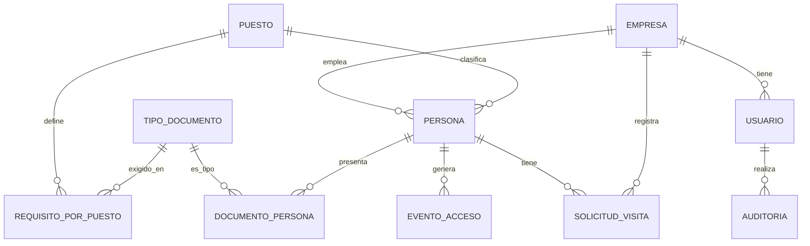

# Especificación de desarrollo — Sistema de Control de Accesos, Terminal Monte Azul Mollendo (TMAM) · ALCANCE BASE

> **Versión base.** Este documento parte de `Especificacion_Desarrollo_Control_Acceso_Mollendo_final.md` y lo recorta al **alcance base** definido en `Costo_y_Plazo_por_Alcance_TMAM.docx` (S/ 2,500 · 5 días). Todo lo que no figura aquí **no se desarrolla** en esta etapa (ver §11, "Fuera del alcance base").
>
> **Qué es el alcance base:** es lo mínimo para que el sistema funcione en campo. Un **administrador único** carga la empresa, el personal y sus documentos, que quedan **ya válidos** (no hay autoservicio ni aprobación). En el ingreso, el sistema valida **documentos vigentes + prueba de alcohol**, con la integración física conectada (terminal ZKTeco G4 Pro, alcoholímetro y molinete).

---

## 1. Stack tecnológico

| Capa | Tecnología |
|---|---|
| Backend / API | NestJS (Node.js) con TypeScript |
| Frontend (vista de administración + pantalla de garita) | Next.js (React) con TypeScript |
| Base de datos | PostgreSQL |
| ORM | Prisma |
| Contenedores | Docker (Azure/Hostinger) |
| Sistema operativo del servidor | Ubuntu Server LTS |
| Autenticación | JWT (sin MFA) |
| Comunicación con equipos físicos | API/webhook de ZKBio CVSecurity (terminal + alcoholímetro) y API/SDK del molinete |
| Almacenamiento de documentos | Disco del propio servidor |
| Pruebas | Pruebas unitarias sobre el motor de validación |
| Migraciones | Prisma Migrate, versionadas junto con el código |
| Repositorio | Git |
| Entornos | desarrollo / producción, cada uno con su propio `.env` (nunca credenciales en el repositorio) |

---

## 2. Principios de la solución (alcance base)

- **Carga centralizada:** un único administrador ingresa empresas, personal, documentos y visitas. No hay portal para proveedores.
- **Documento cargado = documento válido:** el administrador sube el documento ya revisado; no existe un paso de aprobación, observación ni rechazo.
- **Revalidación en garita:** en cada ingreso se revisa de nuevo que los documentos estén vigentes a la fecha; que un documento haya sido válido al cargarlo no basta.
- **Bloqueo automático:** si falta un documento obligatorio o está vencido, si la prueba de alcohol no es conforme o si la persona está dada de baja, el molinete no abre, sin intervención manual.
- **Trazabilidad básica:** queda registrado quién cargó o modificó cada dato, y cada ingreso y salida.

---

## 3. Roles y permisos

| Rol | Quién lo usa | Permisos |
|---|---|---|
| **Administrador** | Una persona designada por OTP (administrador único) | Todo: gestiona empresas, puestos, tipos de documento, requisitos por puesto, personal, documentos y visitas; consulta el historial de accesos y la auditoría básica |
| **Vigilancia** | Personal en garita | Solo lectura: ve en pantalla el resultado de cada ingreso/salida y el motivo si se deniega; consulta el historial de accesos |

- **Ambos roles inician sesión** en el mismo login (`/auth/login`) con correo y contraseña. Al entrar, cada uno ve solo su vista: el Administrador, la vista de administración; Vigilancia, la pantalla de garita.
- El nombre del rol en el sistema es `administrador` (reemplaza al `administracion` del código actual).
- No existen roles de empresa, SSMA, Operaciones, Atención al Cliente, OPIP, Auditor ni Sistemas.
- No hay invitación ni activación de cuentas por correo. Las cuentas se crean por seed o las crea el administrador desde **Usuarios**, donde también restablece contraseñas (no hay recuperación por correo).

---

## 4. Personas y requisitos

### 4.1. Puesto genérico

- Cada persona tiene un **puesto** que se toma de un catálogo fijo (por ejemplo: Personal propio, Contratista, Visita, Conductor, Cliente).
- El catálogo de puestos, el de tipos de documento y la tabla de **qué documentos exige cada puesto** se cargan **una sola vez** (por seed o desde la vista de administración). No hay matriz configurable por actividad, zona ni nivel de riesgo.
- Al registrar a una persona, el sistema muestra qué documentos exige su puesto.

### 4.2. Qué no se modela

- Los 13 perfiles de la matriz de casos del cliente, las autoridades, las zonas y los colores de fotocheck.
- Activos (vehículos, maquinaria, equipos), operadores y checklists. Un conductor se valida solo como persona, no su unidad.

---

## 5. Arquitectura general

### 5.1. Componentes

| Componente | Función | Responsable |
|---|---|---|
| **Vista de administración** | Aplicación web (Next.js). Pantalla principal **Personal y documentos**: lista del personal con ✔/✖ de si hoy puede ingresar y, al elegir a alguien, sus documentos exigidos para subirlos o renovarlos (más puesto, baja y visitas). Menú: Personal y documentos, Panel de vigilancia, Configuración (empresas, puestos y requisitos, tipos de documento, usuarios), Auditoría, Sistema y APIs y Manual | Este desarrollo |
| **Pantalla de garita** | Vista simple (Next.js) para Vigilancia: último evento en tiempo real con su resultado y motivo, más el historial del día. No incluye ocupación de planta ni modo contingencia | Este desarrollo |
| **Backend / API** | NestJS: API REST, motor de validación y adaptadores de integración física | Este desarrollo |
| **Base de datos** | PostgreSQL: empresas, personas, documentos, eventos y auditoría | Este desarrollo |
| **Terminal ZKTeco G4 Pro + alcoholímetro** | Identifica a la persona por reconocimiento facial (enrolada y vinculada a su `numero_documento`) y ejecuta la prueba de alcohol en el mismo punto. El evento llega a **ZKBio CVSecurity**, que el backend consume | Proveedor (ZKTeco) / integrador |
| **Molinete** | Recibe la orden de apertura solo cuando el ingreso es autorizado | Proveedor / integrador (marca a definir) |

### 5.2. Vista en capas

```
┌───────────────────────────────────────────────────────────────┐
│  Presentación   Vista de administración · Pantalla de garita  │
│                              (Next.js / React)                 │
├───────────────────────────────────────────────────────────────┤
│  API            REST /api/v1 + canal WS /ws/eventos            │
├───────────────────────────────────────────────────────────────┤
│  Aplicación     Motor de validación · Gestión de personal y   │
│                 documentos               (NestJS / TypeScript) │
├───────────────────────────────────────────────────────────────┤
│  Integración    Adaptador ZKBio CVSecurity · Adaptador molinete│
├───────────────────────────────────────────────────────────────┤
│  Datos          PostgreSQL (Prisma) + documentos en disco      │
└───────────────────────────────────────────────────────────────┘
```

### 5.3. Comunicación entre componentes

- **Vista de administración y pantalla de garita → Backend:** REST sobre HTTPS, autenticado con JWT.
- **Pantalla de garita ↔ Backend:** canal WebSocket (`/ws/eventos`) para mostrar cada ingreso o denegación sin recargar la página.
- **ZKBio CVSecurity → Backend:** webhook con la identificación facial y el resultado de alcohol ya vinculados, sin que Vigilancia digite nada. Si ZKBio no expone un webhook nativo, se usa un adaptador que consulta su API periódicamente (polling). **Queda pendiente confirmarlo con el proveedor.**
- **Backend → Molinete:** API o SDK del fabricante, para la orden de apertura. **La marca y el modelo están pendientes.**
- **Equipos → Backend:** autenticados con una API key de dispositivo (`DEVICE_API_KEY`), no con JWT.

---

## 6. Flujos funcionales

**6.1. Alta de empresa, personal y documentos (administrador)**
1. El administrador registra la empresa (RUC, razón social, correo de contacto). No se envía invitación.
2. Registra a la persona (tipo y número de documento, nombres, apellidos, empresa, puesto). El sistema muestra los documentos que exige su puesto.
3. Sube cada documento con su fecha de emisión y de vencimiento. El documento queda **válido desde que se carga**.
4. Para renovar un documento, sube una versión nueva. La versión anterior se conserva en el historial y **solo cuenta la más reciente**.
5. Puede dar de baja o reactivar a una persona.
6. Cada alta o modificación queda en la auditoría básica.

**6.2. Ingreso (flujo físico diario)**
1. La persona se identifica en el terminal ZKTeco G4 Pro (rostro) y hace la prueba de alcohol en el mismo punto.
2. ZKBio CVSecurity envía al backend el número de documento y el resultado de alcohol.
3. El motor de validación evalúa, en este orden:
   - **Persona no registrada:** se deniega y se muestra en la pantalla de garita, pero no se guarda un evento (no hay persona a quien vincularlo).
   - **Persona dada de baja:** se deniega de inmediato con un mensaje específico, sin evaluar nada más.
   - **Puesto:** la persona debe tener un puesto asignado.
   - **Documentos:** cada documento obligatorio del puesto debe existir y su última versión debe estar vigente a la fecha actual.
   - **Alcohol:** el resultado debe ser `conforme`.
4. Si todo es conforme, el ingreso se **AUTORIZA** y se envía la orden de apertura al molinete.
5. Si algo falla, el ingreso se **DENIEGA** y se muestran **todos los motivos a la vez** (documentos y/o alcohol).
6. Se registra el evento de acceso (resultado, motivos, fecha y hora, molinete) y se publica en la pantalla de garita.

**6.3. Salida (registro básico)**
1. La persona se identifica en el terminal o molinete de salida.
2. El sistema registra la salida y abre el molinete.
3. **No hay antipassback:** no se exige un ingreso previo ni se bloquea un segundo ingreso sin salida.

**6.4. Visitas**
1. El administrador registra a la visita como persona (con puesto "Visita" y los documentos que ese puesto exige) y agenda la visita con su motivo, fecha y hora.
2. La visita no pasa por invitación ni aprobación. Queda registrada como información para Vigilancia.
3. En garita, la visita se valida igual que cualquier otra persona (§6.2).

---

## 7. Motor de validación (reglas)

Es una función pura, sin I/O, con pruebas unitarias.

| Entrada | Regla | Resultado si falla |
|---|---|---|
| Persona inexistente | Denegar | `persona_no_registrada` (termina aquí) |
| `persona.estado = baja` | Denegar con prioridad sobre todo lo demás | `persona_de_baja` (termina aquí) |
| Documentos obligatorios del puesto | Cada uno debe existir, en su última versión, con `fecha_vencimiento >= hoy` (o sin fecha de vencimiento) | `documentos_faltantes_o_vencidos` (con la lista de documentos) |
| Persona sin puesto asignado | Denegar (no hay requisitos contra los cuales validarla) | `sin_puesto_asignado` |
| Resultado de alcohol | Debe ser `conforme` | `alcohol_no_conforme` |

Puesto, documentos y alcohol se evalúan juntos y se informan todos los motivos a la vez. Un documento que vence hoy sigue vigente todo el día.

---

## 8. Modelo de datos

### 8.1. Entidades

| Entidad | Propósito |
|---|---|
| `empresa` | Proveedor o cliente (incluye OTP/MAS) |
| `usuario` | Acceso al sistema, con `rol` (`administrador` \| `vigilancia`); pertenece a la empresa interna OTP/MAS |
| `puesto` | Catálogo fijo de puestos genéricos |
| `tipo_documento` | Catálogo de documentos (SCTR, inducción, etc.) |
| `requisito_por_puesto` | Documentos que exige cada puesto |
| `persona` | Trabajador, contratista, visita o conductor |
| `documento_persona` | Documento cargado, con historial de versiones |
| `solicitud_visita` | Visita agendada por el administrador |
| `evento_acceso` | Cada ingreso o salida |
| `auditoria` | Registro básico de quién cargó o modificó qué |

### 8.2. Diagrama entidad-relación



### 8.3. Script SQL (PostgreSQL)

Equivale al esquema Prisma (`mollendo-api/prisma/schema.prisma`) después de la migración `20260926120000_alcance_base`.

```sql
-- =====================================================================
-- Modelo de datos — Control de Accesos TMAM · ALCANCE BASE. PostgreSQL.
-- =====================================================================

CREATE TYPE estado_empresa            AS ENUM ('activa', 'inactiva');
CREATE TYPE rol_usuario               AS ENUM ('administrador', 'vigilancia');
CREATE TYPE estado_cuenta             AS ENUM ('activo', 'baja');
CREATE TYPE caso_puesto               AS ENUM ('visita', 'personal_propio', 'contratista', 'tercero');
CREATE TYPE tipo_documento_identidad  AS ENUM ('DNI', 'CE', 'PASAPORTE');
CREATE TYPE estado_persona            AS ENUM ('activo', 'inactivo');   -- inactivo = dado de baja
CREATE TYPE tipo_validacion_documento AS ENUM ('fecha_vencimiento', 'si_no', 'vigente_por_actividad');
CREATE TYPE estado_solicitud_visita   AS ENUM ('programada', 'completada', 'cancelada');
CREATE TYPE tipo_movimiento           AS ENUM ('ingreso', 'salida');
CREATE TYPE resultado_acceso          AS ENUM ('autorizado', 'denegado');
CREATE TYPE accion_auditoria          AS ENUM ('crear', 'modificar', 'eliminar');

CREATE TABLE empresa (
    id                          SERIAL PRIMARY KEY,
    ruc                         VARCHAR(11) NOT NULL UNIQUE,
    razon_social                VARCHAR(200) NOT NULL,
    correo_contacto             VARCHAR(150) NOT NULL,
    telefono_contacto           VARCHAR(20),
    estado                      estado_empresa NOT NULL DEFAULT 'activa',
    contrato_vigencia_inicio    DATE,
    contrato_vigencia_fin       DATE,
    creado_en                   TIMESTAMP NOT NULL DEFAULT now(),
    actualizado_en              TIMESTAMP NOT NULL DEFAULT now()
);

-- Cuentas del administrador y de Vigilancia (personal interno: empresa_id
-- apunta a la empresa OTP/MAS). Sin invitación ni recuperación por correo.
CREATE TABLE usuario (
    id              SERIAL PRIMARY KEY,
    empresa_id      INTEGER NOT NULL REFERENCES empresa(id),
    rol             rol_usuario NOT NULL,
    correo          VARCHAR(150) NOT NULL UNIQUE,
    password_hash   VARCHAR(255) NOT NULL,
    estado_cuenta   estado_cuenta NOT NULL DEFAULT 'activo',
    creado_en       TIMESTAMP NOT NULL DEFAULT now()
);

CREATE TABLE puesto (
    id      SERIAL PRIMARY KEY,
    nombre  VARCHAR(100) NOT NULL,
    caso    caso_puesto NOT NULL,
    UNIQUE (nombre, caso)
);

-- 'si_no' y 'vigente_por_actividad' no vencen salvo que se cargue una fecha.
CREATE TABLE tipo_documento (
    id                  SERIAL PRIMARY KEY,
    nombre              VARCHAR(100) NOT NULL UNIQUE,
    tipo_validacion     tipo_validacion_documento NOT NULL
);

CREATE TABLE requisito_por_puesto (
    puesto_id           INTEGER NOT NULL REFERENCES puesto(id),
    tipo_documento_id   INTEGER NOT NULL REFERENCES tipo_documento(id),
    obligatorio         BOOLEAN NOT NULL DEFAULT true,
    PRIMARY KEY (puesto_id, tipo_documento_id)
);

CREATE TABLE persona (
    id                          SERIAL PRIMARY KEY,
    empresa_id                  INTEGER NOT NULL REFERENCES empresa(id),
    puesto_id                   INTEGER REFERENCES puesto(id),  -- NULL = sin puesto: el ingreso se deniega
    tipo_documento_identidad    tipo_documento_identidad NOT NULL,
    numero_documento            VARCHAR(20) NOT NULL,
    nombres                     VARCHAR(150) NOT NULL,
    apellidos                   VARCHAR(150) NOT NULL,
    area                        VARCHAR(100),
    estado                      estado_persona NOT NULL DEFAULT 'activo',
    creado_en                   TIMESTAMP NOT NULL DEFAULT now(),
    UNIQUE (tipo_documento_identidad, numero_documento)
);

CREATE INDEX ON persona(empresa_id);
CREATE INDEX ON persona(puesto_id);
CREATE INDEX ON persona(numero_documento);

-- Sin estado de aprobación: todo documento cargado es válido. La vigencia se
-- calcula contra fecha_vencimiento y cuenta solo la última versión de cada
-- tipo. Quién lo cargó queda en auditoria.
CREATE TABLE documento_persona (
    id                  SERIAL PRIMARY KEY,
    persona_id          INTEGER NOT NULL REFERENCES persona(id),
    tipo_documento_id   INTEGER NOT NULL REFERENCES tipo_documento(id),
    fecha_emision       DATE,
    fecha_vencimiento   DATE,
    archivo_url         VARCHAR(500),
    version             INTEGER NOT NULL DEFAULT 1,
    creado_en           TIMESTAMP NOT NULL DEFAULT now()
);

CREATE INDEX ON documento_persona(persona_id);
CREATE INDEX ON documento_persona(persona_id, tipo_documento_id, version);

-- Visita agendada por el administrador, sin flujo de aprobación.
CREATE TABLE solicitud_visita (
    id                      SERIAL PRIMARY KEY,
    persona_id              INTEGER NOT NULL REFERENCES persona(id),
    empresa_id              INTEGER NOT NULL REFERENCES empresa(id),  -- la de la persona
    persona_visitada        VARCHAR(150) NOT NULL,
    motivo                  VARCHAR(300) NOT NULL,
    fecha_hora_programada   TIMESTAMP NOT NULL,
    estado                  estado_solicitud_visita NOT NULL DEFAULT 'programada',
    creado_en               TIMESTAMP NOT NULL DEFAULT now()
);

CREATE INDEX ON solicitud_visita(persona_id);
CREATE INDEX ON solicitud_visita(fecha_hora_programada);

-- Ingreso / salida. Sin antipassback: la salida siempre es 'autorizado'.
-- Un documento no registrado no genera fila (no hay persona a quien
-- vincularla); solo se informa en la respuesta y en la pantalla de garita.
CREATE TABLE evento_acceso (
    id                          SERIAL PRIMARY KEY,
    persona_id                  INTEGER NOT NULL REFERENCES persona(id),
    tipo_movimiento             tipo_movimiento NOT NULL,
    resultado                   resultado_acceso NOT NULL,
    denegado_por_baja           BOOLEAN NOT NULL DEFAULT false,  -- prioridad sobre los demás
    denegado_sin_puesto         BOOLEAN NOT NULL DEFAULT false,
    denegado_por_alcohol        BOOLEAN NOT NULL DEFAULT false,
    denegado_por_documentos     BOOLEAN NOT NULL DEFAULT false,
    fecha_hora                  TIMESTAMP NOT NULL DEFAULT now(),
    torniquete_id               VARCHAR(50)                      -- molinete
);

CREATE INDEX ON evento_acceso(persona_id, fecha_hora);

-- Auditoría básica: quién creó/modificó qué y cuándo (sin valor anterior/nuevo).
CREATE TABLE auditoria (
    id              SERIAL PRIMARY KEY,
    usuario_id      INTEGER REFERENCES usuario(id),
    tabla_afectada  VARCHAR(50) NOT NULL,
    registro_id     INTEGER NOT NULL,
    accion          accion_auditoria NOT NULL,
    fecha_hora      TIMESTAMP NOT NULL DEFAULT now()
);

CREATE INDEX ON auditoria(tabla_afectada, registro_id);
```

---

## 9. Seguridad y requisitos no funcionales

- HTTPS en todos los canales.
- Contraseñas con hash; JWT con refresh token.
- Autorización por rol (`administrador`, `vigilancia`), aplicada en el backend.
- Endpoints de los equipos protegidos por una API key de dispositivo.
- Validación de la extensión y el tamaño de los archivos subidos.
- Objetivo: responder a una validación en garita en menos de 2 segundos.

---

## 10. APIs

Todas bajo `/api/v1`. Swagger interno (solo fuera de producción) en `/api/docs`, y guía de las APIs de integración en la vista **Sistema y APIs** del portal.

| Método | Endpoint | Rol | Descripción |
|---|---|---|---|
| POST | `/auth/login` | Público | Login (Administrador o Vigilancia) |
| POST | `/auth/refresh-token` | Público | Renueva el JWT |
| GET/POST/PATCH | `/usuarios`, `/usuarios/:id` | Admin | Crear cuentas, darlas de baja o reactivarlas, restablecer la contraseña |
| GET/POST/PATCH | `/empresas`, `/empresas/:id` | Admin | Alta, listado, detalle, edición y activar/desactivar |
| GET/POST | `/puestos`, `/puestos/:id/requisitos` | Admin (lectura: todos) | Catálogo de puestos y documentos que exige cada uno |
| GET/POST | `/tipos-documento` | Admin (lectura: todos) | Catálogo de documentos |
| GET/POST/PATCH | `/personas`, `/personas/:id` | Admin (Vigilancia: lectura) | Alta (con `empresaId`), listado, detalle y edición (incluye cambio de puesto) |
| PATCH | `/personas/:id/estado` | Admin | Dar de baja (`inactivo`) o reactivar (`activo`) |
| POST/GET | `/personas/:id/documentos` | Admin (Vigilancia: lectura) | Subir o renovar documento (nueva versión, ya válido) e historial |
| GET/POST/PATCH | `/solicitudes-visita`, `/solicitudes-visita/:id` | Admin (Vigilancia: lectura) | Agendar, listar, reprogramar y cancelar visitas |
| POST | `/integraciones/zkbio/webhook` | Dispositivo (API key) | Recibe identificación + resultado de alcohol de ZKBio CVSecurity y ejecuta el ingreso (contrato provisional) |
| POST | `/eventos-acceso/ingreso` | Dispositivo (API key) | Ingreso: aplica el motor de validación y ordena la apertura del molinete si es autorizado |
| POST | `/eventos-acceso/salida` | Dispositivo (API key) | Registro básico de salida y apertura del molinete |
| POST | `/integraciones/torniquete/comando` | Admin, Vigilancia | Orden manual de apertura/cierre del molinete (hoy simulada en el log) |
| GET | `/eventos-acceso` | Admin, Vigilancia | Historial filtrable por fecha, persona y resultado |
| GET | `/panel/resumen` | Admin, Vigilancia | Denegaciones y alcohol no conforme del día, documentos vencidos |
| GET | `/panel/estado-sistema` | Admin | Estado del backend, base de datos y clave de equipos |
| GET | `/auditoria` | Admin | Auditoría básica |
| WS | `/ws/eventos` | Admin, Vigilancia | Eventos en tiempo real para la pantalla de garita |
| GET | `/health` | Público | Estado del servidor |

---

## 11. Fuera del alcance base

No se desarrolla nada de lo siguiente. Se cubre pasando al alcance menor (S/ 3,500 adicionales) o al completo (S/ 17,500 adicionales), o se cotiza aparte:

- **Autoservicio de empresas:** registro, invitación y activación por enlace (SMTP), y carga de su propio personal y documentos.
- **Aprobación de documentos** como paso aparte (sea por la empresa o por OTP/SSMA), con observaciones y subsanación.
- **Antipassback** y control de permanencia u ocupación de la planta.
- **Auditoría detallada:** valor anterior y nuevo, historial de aprobaciones y validaciones, rol Auditor.
- 13 perfiles y autoridades, 10 roles de usuario, zonas y colores de fotocheck.
- Activos (vehículos, maquinaria, equipos), operadores y checklists (incluido RE-098).
- Matriz configurable de requisitos por perfil, actividad o zona.
- Sanciones y restricciones con niveles.
- Credencial digital con QR.
- Panel de garita avanzado, identificación conjunta y modo contingencia sin conexión.
- Invitaciones de visita, control de equipos electrónicos personales y de materiales (pase y guía de remisión).
- Alertas y notificaciones, y reportes exportables a Excel/PDF.
- API pública documentada, MFA, respaldos con prueba de restauración.
- Dossier de entregables, manuales, capacitación y verificación de los criterios de aceptación de OTP.
- **Bloque C** (en ningún alcance): licencias, infraestructura, hardware del molinete, instalación física, migración de datos, soporte, mantenimiento e integraciones con AD, RR.HH. o cámaras.

---

## 12. Pendientes del cliente (bloquean la integración física)

- **Marca y modelo del molinete**, y su API o SDK.
- **Documentación o SDK de ZKBio CVSecurity:** si ofrece webhook o hay que hacer polling, y el formato del evento (identificación + alcohol).
- **Catálogo inicial** de puestos, tipos de documento y requisitos por puesto, para cargar el seed.

Mientras estos puntos no se definan, el plazo (5 días) y el costo podrían variar.
