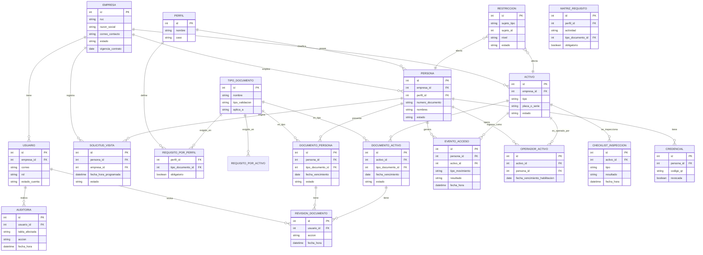

# Especificación de desarrollo — Sistema Integral de Control de Accesos, Terminal Monte Azul Mollendo (TMAM)

> **Versión 3 — alcance completo, sin fases.** Este documento cubre exclusivamente lo necesario para **construir la plataforma**: arquitectura, roles, perfiles y reglas de negocio, flujos funcionales, modelo de datos, seguridad y APIs. Cubre de una sola vez el alcance ampliado solicitado por OTP ("Problemática y Alcance del Sistema Integral de Control de Accesos MAS", OTP-SSMA.PR-16, RE-098, RE-108, RE-109 y la matriz de 12 perfiles). La gestión del proyecto (entregables documentales, etapas de implementación, fuera de alcance y puntos pendientes con el cliente) se documenta aparte, en `Gestion_Proyecto_Control_Acceso_Mollendo.md`.

---

## 1. Stack tecnológico

| Capa | Tecnología |
|---|---|
| Backend / API | NestJS (Node.js) con TypeScript |
| Frontend (portal externo + portal interno + panel de garita) | Next.js (React) con TypeScript |
| Base de datos | PostgreSQL |
| ORM | Prisma |
| Contenedores | Docker (Azure/Hostinger + servidor local de contingencia) |
| Sistema operativo del servidor | Ubuntu Server LTS |
| Autenticación | JWT + MFA para roles críticos |
| Comunicación con equipos físicos | API REST / SDK del fabricante (lector DNI/código de barras/QR, alcoholímetro, molinete) |
| Almacenamiento de documentos | Disco del propio servidor; se evalúa object storage si el volumen de evidencias lo justifica |
| Documentación de API | Swagger/OpenAPI autogenerado por NestJS, expuesto en `/api/docs` |
| Pruebas | Jest (unitarias, especialmente sobre el motor de validación) + pruebas e2e de los flujos de ingreso/salida |
| Migraciones | Prisma Migrate, versionadas junto con el código |
| Logs y monitoreo | Registro de errores en producción (Sentry o equivalente), para detectar fallas de integración con los equipos físicos |
| Correo (SMTP) | Proveedor de prueba durante desarrollo (Mailtrap/Ethereal), configurable por variable de entorno |
| Repositorio | Git, trunk-based o Git flow simplificado (`main` + `develop` + ramas de feature) |
| Entornos | desarrollo / staging / producción, cada uno con su propio `.env` (nunca credenciales en el repositorio) |

---

## 2. Principios obligatorios de la solución

Tomados directamente del documento de alcance del cliente — gobiernan el diseño de todo el sistema:

- **Expediente único:** cada persona, empresa, vehículo y equipo tiene información consolidada, versionada y trazable.
- **Reglas por perfil:** los requisitos cambian según tipo de persona, actividad, zona, riesgo y activo asociado.
- **Aprobación expresa:** cargar un documento nunca autoriza el ingreso por sí solo; OTP debe revisar y aprobar.
- **Revalidación en garita:** el sistema comprueba nuevamente vigencias y restricciones en el momento exacto del acceso, no solo al aprobar el expediente.
- **Bloqueo automático:** la falta o el vencimiento de un requisito crítico impide el ingreso sin intervención manual.
- **Trazabilidad:** toda carga, revisión, cambio, autorización, bloqueo, ingreso y salida queda registrado.
- **Configuración sin código:** OTP puede modificar requisitos, vigencias, aprobadores y alertas desde la interfaz, sin depender de un despliegue.
- **Continuidad:** la solución cuenta con respaldo, recuperación y procedimiento documentado para fallas de equipos o comunicaciones.

---

## 3. Roles y permisos

| Rol | Quién lo usa | Permisos principales |
|---|---|---|
| **Solicitante externo** | Empresa proveedora/cliente/visitante | Registra personas, activos y solicitudes; adjunta documentos; guarda borradores; responde observaciones; consulta estado del expediente |
| **Visitado / responsable OTP** | Personal de OTP que recibe una visita | Crea invitaciones (enlace para que el visitante complete sus datos), justifica fecha/actividad/área/acompañamiento |
| **SSMA** (supervisor + prevencionistas) | Área SSMA de OTP | Revisa, aprueba, observa o rechaza documentos y expedientes; administra matriz de requisitos; aplica y levanta sanciones; verifica SCTR al inicio de cada mes |
| **Operaciones** | Gerente/Supervisor de Operaciones | Valida programación (PAD), actividad, zonas operativas; autoriza ingresos fuera de horario/turno |
| **Atención al Cliente** | Personal de Atención al Cliente | Valida documentación de mayoristas y cisternas (OSINERGMIN, cubicación, revisión técnica) antes de emitir orden de despacho |
| **OPIP** | Oficial de Protección de la Instalación Portuaria | Controles de protección portuaria, atención a autoridades (OSINERGMIN, OEFA, APN, Capitanía) |
| **Vigilancia** | Personal en garita | Panel en tiempo real, identificación física, modo contingencia, registro de excepciones |
| **Administrador funcional** | Personal de OTP designado | Configura perfiles, requisitos, vigencias, alertas, áreas y flujos aprobados, sin desarrollo adicional |
| **Auditor** | Personal designado (interno o externo) | Consulta expedientes, decisiones, eventos y evidencias; no modifica nada |
| **Sistemas** | TI de OTP | Administra infraestructura, integraciones, accesos técnicos y continuidad |

**Cambio de fondo respecto al modelo original:** antes la empresa proveedora aprobaba sus propios documentos. Ahora **la aprobación la ejecuta OTP** (SSMA y, según el requisito, Operaciones/Atención al Cliente/OPIP) — la empresa solo carga y subsana lo observado.

Bandejas de trabajo (portal interno): filtrables por estado, fecha, empresa, perfil, responsable, área y nivel de riesgo — para que cada rol vea solo lo que le corresponde revisar.

---

## 4. Perfiles cubiertos (matriz de casos completa)

La matriz de casos del cliente define 12 perfiles con sus propias validaciones, vigencia/condición y regla de bloqueo automático. Se transcriben completos porque son la base directa de `requisito_por_perfil`, `requisito_por_activo` y `matriz_requisito`.

### 4.1. Perfiles de personas

| Perfil | Validaciones que debe validar el sistema | Vigencia / condición | Bloqueo automático |
|---|---|---|---|
| **1. Visitas** | DNI/CE; empresa; persona visitada; motivo; fecha/hora de ingreso; SCTR salud y pensión; inducción SSMA; EPP básico; autorización del responsable; inclusión en lista de visitas; pase temporal | Documentos vigentes. Solicitud antes de las 15:00 del día hábil anterior. Visita ordinaria: horario administrativo (lunes a viernes 08:00–17:00) | Falta DNI, SCTR, inducción, autorización o no figura en lista |
| **2. Personal propio OTP/MAS** | DNI; fotocheck; inducción SSMA; habilitación laboral/SCTR según corresponda; área; cargo; turno programado; EPP; autorización para ingreso fuera de horario | Fotocheck e inducción vigentes; ingreso conforme al turno/rol | Fotocheck, inducción o turno no conforme |
| **3. Contratistas** | DNI/CE; SCTR salud; SCTR pensión; inducción OTP; CAMO; PETS; IPERC; Plan de Contingencias; Matriz de Aspectos e Impactos Ambientales; Plan/Procedimiento de Residuos; EPP; programación PAD; autorización SSMA | SCTR y CAMO vigentes. Documentación técnica aprobada antes de iniciar actividad | Cualquier requisito obligatorio faltante/vencido o actividad no incluida en PAD |
| **4. Subcontratistas / proveedores** | Mismos requisitos del contratista, más: contratista principal, servicio asociado y responsable OTP | Mientras dure el servicio autorizado | No vinculado a contrato, sin responsable, sin habilitación SSMA |
| **5. Clientes y mayoristas (personal)** | DNI; inducción; SCTR; CAMO cuando aplique; fotocheck; empresa; horario | Programación y zonas autorizadas | Documento vencido, fuera de horario o restricción |

### 4.2. Perfiles de activos (vehículos, maquinaria y equipos) + operadores

| Perfil | Validaciones principales | Condición | Bloqueo automático |
|---|---|---|---|
| **6. Maquinaria de obra civil** | Tipo de equipo; marca/modelo; placa/serie; certificado de operatividad; mantenimiento vigente; certificación/homologación del operador; checklist preoperacional; póliza RC/TREC; guía de ingreso; autorización SSMA; operador habilitado | Certificados de equipo y operador no mayores a 1 año; checklist diario | Equipo vencido, sin mantenimiento, sin checklist, operador no certificado |
| **7. Manlift / plataforma elevadora** | Todo lo de maquinaria + certificación del equipo; operador autorizado; CAMO apto para altura; capacitación de trabajo en altura; AST/IPERC; PETS; Permiso de Trabajo; inspección de equipo y accesorios; sistema de protección contra caídas | Trabajo sobre 1.5 m tratado como trabajo en altura, con capacitación formal y certificación correspondiente | Operador sin certificación, equipo sin inspección, CAMO no apto o PDT no autorizado |
| **8. Camión grúa** | SOAT; revisión técnica; tarjeta de propiedad; póliza RC/TREC; certificado de operatividad; certificado de mantenimiento; certificación/homologación de operador; certificación de rigger; checklist; tabla/diagrama de carga; manual del fabricante; capacidad máxima rotulada; extintor; autorización SSMA | Certificaciones vigentes; equipo de izaje conforme ANSI/ASME; inspección preuso | Falta certificación grúa/operador/rigger, documentos vehiculares vencidos o checklist no conforme |
| **9. Grúa móvil** | Certificación de equipo de izaje; operatividad; mantenimiento; registro de inspecciones/pruebas; checklist diario; homologación operador; certificación rigger; diagrama de carga; manual; capacidad de carga rotulada; póliza RC; extintor ABC; autorización SSMA | Certificación basada en ANSI/ASME B30; operatividad, mantenimiento y homologación vigentes | Certificado vencido, operador/rigger no habilitado, inspección no conforme |
| **10. Andamios** | Certificación/conformidad del andamio; guía de ingreso; personal montajista entrenado y certificado como andamiero; capacitación trabajo en altura; CAMO para altura; IPERC; PETS; PDT; sistema anticaídas | Montaje/desmontaje solo por personal con entrenamiento documentado | Andamio o personal no certificado; permiso pendiente |
| **11. Cisternas de combustible** | Unidad y conductor previamente autorizados; DNI; SCTR; inducción/capacitación OTP; licencia A-III y especial para mercancías peligrosas; Registro OSINERGMIN; tarjeta de cubicación; revisión técnica cisterna y tracto; SOAT; tarjeta de propiedad; póliza RC; certificado de bonificación; checklist de inspección de la unidad (extintores, kit antiderrame, prueba Skully, conos, tacos) | Conductor habilitado por OTP por 1 año; documentación vigente al despacho | Unidad/conductor no incluidos en listado autorizado, o cualquier documento crítico vencido |
| **12. Vehículos menores** | Empresa; placa; conductor; SOAT; revisión técnica; tarjeta de propiedad; inspección SSMA; permiso de ingreso; autorización; checklist cuando corresponda | Solo vehículos previamente inspeccionados y autorizados | SOAT/RT vencidos, sin autorización o inspección rechazada |
| **13. Camionetas** | Placa; SOAT; revisión técnica; tarjeta de propiedad; póliza RC/TREC; licencia del conductor; SCTR conductor; inducción/capacitaciones; checklist; extintor PQS; conos; llanta de repuesto; autorización vehicular | Para zona operativa, motor diésel según Manual; conductor habilitado | Vehículo no autorizado, documentos vencidos, checklist no conforme o conductor no habilitado |
| **Autoridades** (OSINERGMIN, OEFA, APN, Capitanía) | Identificación; entidad; motivo; registro; comunicación inmediata a OPIP/Gerente de Operaciones/SSMA | Atención programada o inopinada según protocolo | Aplicar protocolo especial y acompañamiento definido por OTP |

---

## 5. Zonas y código de colores de fotocheck

El procedimiento vigente identifica a cada persona por el color de su fotocheck físico, según la zona a la que puede acceder. Se modela como catálogo (`zona_acceso`) para que la matriz de requisitos y la credencial digital puedan referenciarlo:

| Color | Zona / alcance | Perfil típico |
|---|---|---|
| Corporativo (según empresa) | Toda la instalación del terminal, incluye patios de tanques (áreas restringidas) | Personal OTP / MAS |
| Amarillo | Zona administrativa (no incluye áreas operativas) | Clientes / oficina administrativa de mayoristas |
| Naranja | Zona o área específica de trabajo, con fecha de expiración impresa | Contratistas |
| Verde | Áreas exteriores operativas, para recorrido | Visitas (pase temporal) |

El fotocheck físico se sigue emitiendo como hoy en un inicio; el sistema registra a qué `zona_acceso` corresponde el perfil/expediente aprobado. La credencial digital (§6.13) codifica las zonas autorizadas directamente en el QR, como evolución natural que reemplaza el color impreso.

---

## 6. Arquitectura general

### 6.1. Vista de componentes

| Componente | Función | Responsable |
|---|---|---|
| **Portal externo** | Aplicación web (Next.js) donde cada empresa/visitante se registra, carga personal/activos y documentos, y hace seguimiento de su expediente | Este desarrollo |
| **Portal interno OTP** | Aplicación web (Next.js) con bandejas de trabajo por rol (SSMA, Operaciones, Atención al Cliente, OPIP, Admin. funcional, Auditor) para revisar, aprobar, observar o rechazar | Este desarrollo |
| **Panel de garita** | Interfaz web para Vigilancia: identificación, resultado del motor de validación, ocupación en tiempo real, modo contingencia | Este desarrollo |
| **Backend / API** | NestJS: expone la API REST, aloja el motor de validación (reglas de perfil, documentos, activos, restricciones) y orquesta las integraciones físicas | Este desarrollo |
| **Base de datos** | PostgreSQL: expedientes, documentos, activos, eventos, auditoría | Este desarrollo |
| **Terminal de identificación + Alcoholímetro** | Terminal biométrico **ZKTeco G4 Pro**: identifica a la persona por reconocimiento facial (previamente enrolada y vinculada a su `numero_documento` en `persona`) — código de barras del DNI o QR quedan como método de respaldo/enrolamiento. Un sensor de alcoholímetro conectado por USB ejecuta la prueba en el mismo punto. El evento viaja hacia el software del fabricante, **ZKBio CVSecurity**, que el backend consume vía su API/webhook | Proveedor (ZKTeco) / integrador |
| **Molinete / torniquete** | Recibe la orden de apertura solo cuando todas las condiciones son conformes; confirma el paso físico por sensor; aplica antipassback | Proveedor / integrador (a definir) |
| **Controlador** | Intermedia comunicaciones/señales entre el backend y los equipos físicos de garita | Proveedor / integrador |
| **PC de vigilancia (garita)** | Hardware ya existente: corre el panel de garita y actúa como nodo de contingencia local | Cliente (equipo existente) |
| **Servidor local de contingencia** | Réplica del entorno Docker; copia de expedientes vigentes; cola de eventos offline | Este desarrollo / cliente (infraestructura) |
| **Módulo de activos** | Registro y validación conjunta de vehículos/maquinaria/equipos + operadores, checklists digitales | Este desarrollo |
| **Motor de matriz configurable** | Evalúa `matriz_requisito` en tiempo real para decidir qué documentos exige cada combinación perfil/actividad/zona | Este desarrollo |
| **Módulo de reportes** | Genera y exporta los reportes (§10) | Este desarrollo |
| **API pública documentada** | Punto de integración para sistemas externos futuros (AD, RR.HH., cámaras) | Este desarrollo |

### 6.2. Vista en capas

```
┌───────────────────────────────────────────────────────────────┐
│  Presentación   Portal externo · Portal interno OTP · Panel   │
│                 de garita          (Next.js / React)          │
├───────────────────────────────────────────────────────────────┤
│  API            REST /api/v1 (Swagger) + canal WS /ws/eventos │
├───────────────────────────────────────────────────────────────┤
│  Aplicación     Motor de validación · Gestión de expedientes  │
│                 Matriz configurable · Reportes                │
│                              (NestJS / TypeScript)             │
├───────────────────────────────────────────────────────────────┤
│  Integración    Adaptadores: lector · alcoholímetro · molinete │
│                              (API REST / SDK del fabricante)   │
├───────────────────────────────────────────────────────────────┤
│  Datos          PostgreSQL (Prisma) + almacenamiento de       │
│                 documentos (disco del servidor)               │
└───────────────────────────────────────────────────────────────┘
```

El **motor de validación** es la pieza central: no es un componente aparte, sino el módulo del propio backend que aplica en cada ingreso las reglas de §7.3 (expediente habilitado, documentos vigentes, restricciones, resultado de alcohol) y decide AUTORIZADO/DENEGADO. Es la lógica con mayor cobertura de pruebas unitarias exigida (§1, Jest).

### 6.3. Vista de despliegue

```
Portal externo ──┐
                   ├─→ Backend (NestJS, Docker) ──→ PostgreSQL
Portal interno ───┘         │
Panel de garita ────────────┤
                             ├─→ API alcoholímetro (ZKBio CVSecurity)
                             ├─→ API/SDK molinete
                             ├─→ Módulo de activos (vehículos/maquinaria/equipos/operadores)
                             ├─→ Módulo de checklists (cisternas RE-098, maquinaria, manlift, andamios)
                             ├─→ Módulo de sanciones/restricciones
                             ├─→ Matriz configurable de requisitos (admin funcional)
                             ├─→ API pública documentada (integraciones futuras: AD, RR.HH., cámaras)
                             ├─→ Módulo de reportes/indicadores
                             └─→ Credencial digital QR
```

- **Servidor central:** backend + base de datos en Azure o Hostinger (contenedores Docker).
- **Servidor local de contingencia:** réplica del mismo entorno Docker, copia local de expedientes vigentes, cola de eventos offline, sincroniza al recuperar conexión, con pruebas documentadas de restauración y alimentación eléctrica de respaldo (UPS) para los componentes críticos de garita.
- **Punto de ingreso:** lector de identidad (DNI, código de barras o QR), alcoholímetro con reconocimiento facial, molinete bidireccional con antipassback y apertura de emergencia — tres equipos independientes conectados directo a la red, sin depender de una PC local.
- **PC de vigilancia (garita):** panel administrativo en tiempo real + dispositivo local de contingencia.
- Entornos separados de desarrollo, staging y producción.

### 6.4. Comunicación entre componentes

- **Portal externo / interno / panel de garita → Backend:** REST sobre HTTPS, autenticado con JWT.
- **Panel de garita ↔ Backend:** además del REST, un canal WebSocket (`/ws/eventos`) para reflejar ingresos/denegaciones sin recargar la pantalla.
- **Backend → Terminal ZKTeco G4 Pro / Molinete:** API REST o SDK del fabricante, a través del Controlador de garita; protocolos documentados como parte del entregable de integración.
- **ZKBio CVSecurity (software del G4 Pro) → Backend:** webhook o consulta a su API que reporta identificación facial + resultado de alcohol ya vinculados, sin digitación manual por Vigilancia. Si el SDK de ZKBio CVSecurity no expone webhook nativo, se evalúa un adaptador que haga polling periódico contra su base/API — a confirmar en el levantamiento técnico con el proveedor.
- **Servidor local de contingencia ↔ Servidor central:** sincronización de cola de eventos offline al recuperar conexión; `GET /health` permite la detección automática de caída del servidor central.
- **API pública:** expuesta para integraciones futuras (Active Directory, RR.HH., cámaras, sistemas de despacho), documentada en `/api-docs`.

---

## 7. Flujos funcionales

**7.1. Portal externo — alta de empresa y registro de personal**
1. Administración/SSMA registra RUC y correo de contacto de la empresa proveedora/cliente.
2. El sistema genera un enlace único de activación y lo envía por correo.
3. El representante activa su cuenta (crea contraseña) e inicia sesión.
4. Registra y actualiza los datos de la empresa y sus representantes.
5. Registra personas, selecciona el perfil de ingreso — el sistema muestra automáticamente los requisitos aplicables según `requisito_por_perfil`.
6. Adjunta documentos con sus fechas de emisión y vencimiento; puede guardar en borrador antes de enviar.
7. Envía el expediente (estado `enviado`).

**7.2. Portal interno OTP — revisión y aprobación**
1. SSMA (u otro rol según el requisito) recibe el expediente en su bandeja de trabajo.
2. Visualiza cada documento y sus datos de vigencia.
3. Aprueba, observa o rechaza documentos individualmente, registrando observación cuando corresponde (tabla `revision_documento`).
4. Si hay observación, el expediente vuelve al solicitante con el detalle exacto de qué corregir (estado `pendiente_subsanacion`); al resubir, no se pierde el historial de versiones anteriores.
5. Al aprobar el expediente completo, se genera una habilitación con fecha de inicio, fecha de fin, horario y condiciones (estado `habilitado`).
6. Si un documento crítico vence antes o durante el periodo aprobado, la habilitación se suspende automáticamente (pasa a `vencido`).

**7.3. Ingreso (flujo físico diario)**
1. La persona se identifica (DNI o rostro) y realiza la prueba de alcohol en el mismo punto.
2. El sistema recupera el expediente y revalida en el momento: expediente `habilitado` (no `restringido`/`vencido`/`rechazado`), documentos vigentes, perfil/actividad/horario correctos.
3. Si el expediente está `restringido` → denegado de inmediato, mensaje específico, sin evaluar alcohol ni documentos (prioridad sobre los demás motivos).
4. Si está habilitado: se ejecuta la prueba de alcohol vinculada a la identidad (cuando el perfil la exige).
5. Con todos los controles conformes → AUTORIZADO, se envía la orden de apertura al molinete (un único paso, con temporización).
6. Si falla alguno → DENEGADO, mostrando el motivo o los motivos a la vez (alcohol y/o documentos y/o restricción).
7. El sensor del molinete confirma el paso; solo entonces se registra el ingreso.
8. Registro en auditoría: resultado, hora, responsable.

**7.4. Salida**
1. La persona (o el conductor del activo) presenta su identificación en el mismo molinete.
2. El sistema valida si existe un registro de ingreso previo (control anti-passback).
3. Si existe → abre y cierra el ciclo de acceso (estado `salida_registrada`, luego `cerrado`). Si no existe → no abre y alerta al personal de seguridad.
4. Registro en auditoría.

**7.5. Invitación de visitas**
1. El responsable OTP crea una invitación vinculada a anfitrión, motivo, fecha, horario y zonas autorizadas.
2. El visitante recibe un enlace para completar sus datos, adjuntar documentos y aceptar las condiciones de ingreso.
3. Sigue el mismo flujo de revisión/aprobación del 7.2.

**7.6. Modo contingencia (sin internet)**
1. El servidor local mantiene copia de expedientes vigentes y una cola de eventos offline.
2. Al recuperar conexión, sincroniza con el servidor central.
3. `GET /health` permite que el servidor local/PC de vigilancia detecte automáticamente cuándo el servidor central no responde y active el modo contingencia.

**7.7. Registro y validación conjunta de activos**
1. La empresa registra el activo (vehículo/maquinaria/equipo) con tipo, placa/serie, marca, modelo.
2. Adjunta los documentos del activo (SOAT, revisión técnica, certificado de operatividad, mantenimiento, póliza) — mismo flujo de revisión/aprobación que un documento de persona.
3. Vincula el operador/conductor habilitado (`operador_activo`).
4. **Regla de negocio clave:** el sistema no habilita el ingreso del activo si el operador vinculado no está habilitado, ni viceversa — la habilitación de uno no sustituye la del otro.

**7.8. Checklist digital de inspección**
1. Antes del ingreso, personal de vigilancia (o el rol que corresponda) completa el checklist según el tipo de activo — para cisternas, digitaliza exactamente los ítems de OTP-SSMA.RE-098 (ver §7.9).
2. El resultado (`conforme`/`no_conforme`) queda vinculado al activo con fecha, hora y responsable.
3. Un checklist `no_conforme` bloquea el ingreso/carga/despacho según la regla configurada.

**7.9. Checklist de cisternas (RE-098) — ítems a digitalizar**

*Unidad cisterna:* extintor UL de 12 kg o 30 lbs (prueba hidrostática/inspección/mantenimiento vigente); tubo de escape, silenciador y matachispas en buen estado; tacos de seguridad; conos de seguridad; parabrisas y ventanas en buen estado; faros delanteros y posteriores operativos y sellados; llantas (cocada ≥ 3 mm); operatividad del sensor de sobrellenado; certificado de cubicación vigente; sistema de recuperación de vapores operativo; limpieza (sin residuos de combustible/trapos húmedos); carrocería en buen estado con rotulaciones actualizadas; encendido operativo; cableado eléctrico y bornes revestidos; válvulas con cierre hermético sin goteos; manifold de válvulas con tapa e identificación; empaquetaduras y mangueras en buen estado; flecha de nivel de combustible bien soldada; rombo NFPA del producto y señales de seguridad.

*Kit antiderrame:* paños absorbentes oleofílicos (15), salchichas de absorción (5), bolsas rojas (5), guantes de nitrilo (1 par), traje descartable tyvek (1), lentes claros de seguridad (1), bandeja antiderrame (1).

*Conductor:* DNI/CI; inducción de seguridad vigente; licencia de conducir; SCTR; EPP básicos (lentes, zapatos de seguridad, casco, chaleco, ropa 100% algodón); respirador con filtros para gases/vapores orgánicos.

**7.10. Matriz configurable de requisitos**
1. El administrador funcional define, por perfil/actividad/zona/nivel de riesgo, qué documentos son obligatorios/condicionales/informativos.
2. Define vigencia, anticipación de alerta y responsable de revisión.
3. Define si el incumplimiento genera observación, bloqueo temporal o bloqueo definitivo.
4. Configura requisitos adicionales para trabajos en altura, izaje, mercancías peligrosas y otras actividades especiales.
5. Todo esto sin desarrollo adicional; se mantiene historial de cambios de configuración y fecha de entrada en vigencia.

**7.11. Sanciones y restricciones**

Tomado directamente de la tabla de sanciones del cliente (conductores y unidades cisterna, generalizable a otros perfiles/activos):

| Sujeto | Incumplimiento | Nivel | Acción | Estado en el sistema |
|---|---|---|---|---|
| Conductor | Uso de celular en área operativa — primera vez | Observación | Advertencia y registro | `observado` |
| Conductor | Reincidencia en uso de celular tras advertencia | Grave | Retiro y restricción de nuevo ingreso | `restringido` (bloqueo temporal hasta levantamiento formal) |
| Conductor | Fumar o fuego abierto dentro del Terminal | Muy grave | Prohibición de ingreso | Bloqueo definitivo, sujeto a decisión formal de OTP |
| Conductor | Agresión física/verbal grave | Muy grave | Retiro y prohibición de ingreso | Bloqueo definitivo |
| Conductor | Acto doloso (hurto, soborno) | Muy grave | Retiro y prohibición de ingreso | Bloqueo definitivo |
| Conductor | Adulteración/falsificación de documentos | Muy grave | Prohibición de ingreso | Bloqueo definitivo |
| Conductor | SCTR vencido | Crítico documental | No permitir ingreso | No habilitado hasta renovación |
| Conductor | Inducción/habilitación OTP vencida | Crítico documental | No permitir proceso de carga | No habilitado |
| Conductor | Licencia A-III / especial vencida o no válida | Crítico documental | No permitir ingreso/carga | No habilitado |
| Conductor | No figura en listado virtual autorizado | Crítico | No permitir ingreso | No autorizado |
| Conductor | Incumplimiento de EPP obligatorio | Mayor | No permitir ingreso hasta subsanar | Observado / bloqueo temporal |
| Conductor | Negativa a inspección o control de seguridad | Mayor/Grave | Retiro o no ingreso según evaluación | Bloqueo temporal + revisión SSMA |
| Unidad cisterna | SOAT vencido | Crítico documental | No permitir ingreso | No habilitada |
| Unidad cisterna | Revisión técnica de cisterna/tracto vencida | Crítico documental | No permitir ingreso | Bloqueo automático |
| Unidad cisterna | Tarjeta de propiedad no conforme | Crítico documental | No permitir ingreso | Bloqueo automático |
| Unidad cisterna | Registro OSINERGMIN no vigente | Crítico regulatorio | No permitir despacho/ingreso | No habilitada |
| Unidad cisterna | Tarjeta de cubicación vencida | Crítico operativo | No generar orden de despacho | Bloqueo de despacho |
| Unidad cisterna | Póliza RC vencida | Crítico documental | No permitir ingreso | Bloqueo automático |
| Unidad cisterna | Prueba Skully no conforme | Crítico operativo | No permitir carga | Bloqueo de carga |
| Unidad cisterna | Extintor ausente/vencido/no conforme | Mayor | No permitir ingreso operativo hasta corregir | Observado / bloqueo temporal |
| Unidad cisterna | Kit antiderrame incompleto | Mayor | No permitir ingreso hasta subsanar | Observado / bloqueo temporal |
| Unidad cisterna | Falta de conos/tacos | Mayor | No permitir ingreso hasta subsanar | Observado / bloqueo temporal |
| Unidad cisterna | Persona no autorizada/polizón en cabina | Grave | No permitir ingreso y reportar | Bloqueo inmediato + alerta |
| Unidad cisterna | Checklist preoperacional no conforme | Mayor/Crítico según hallazgo | No permitir operación hasta corregir | Bloqueo temporal |
| Unidad cisterna | Unidad no incluida en listado autorizado | Crítico | No permitir ingreso | No autorizada |

Cada restricción registra motivo, evidencia, responsable, fecha de inicio/fin y quién puede levantarla (tabla `restriccion`, §8).

**7.12. Notificaciones y alertas**
- Solicitudes recibidas, observadas, subsanadas, aprobadas o rechazadas.
- Documentos próximos a vencer y vencidos.
- Inducciones, cursos y habilitaciones próximas a vencer.
- Solicitudes pendientes de revisión próximas al horario límite (15:00 del día hábil anterior).
- Intentos de ingreso bloqueados y pruebas de alcohol no conformes.
- Personas con permanencia superior al periodo autorizado o sin salida registrada.
- Equipos físicos fuera de línea, con mantenimiento o calibración pendiente.

**7.13. Control de equipos electrónicos personales (PR-16 §4.2)**
1. Al ingreso, laptops, tabletas y otros equipos electrónicos se registran en un formulario con tipo de equipo, marca y número de serie, vinculado al `evento_acceso` de la persona.
2. Drones, cámaras de fotos, filmadoras, celulares y cualquier otro equipo eléctrico/electrónico no intrínsecamente seguro quedan **prohibidos por defecto**; su ingreso solo se registra si hay una autorización explícita de SSMA.
3. Para áreas operativas restringidas, el sistema exige que el equipo esté marcado como intrínsecamente seguro y autorizado por SSMA antes de habilitar el ingreso.

**7.14. Control de materiales (PR-16 §11)**
1. Todo material o insumo que ingresa al terminal requiere un pase de materiales (expedido por Vigilancia) y una guía de remisión validada por el responsable (mantenimiento, operaciones o SSMA).
2. El sistema registra el pase y la guía de remisión en el equivalente digital del cuaderno de ocurrencias, con fecha, responsable y, cuando corresponda, vínculo al `evento_acceso` o al `activo` que transporta el material.
3. Insumos químicos requieren además la hoja de seguridad y el formato de solicitud firmado por SSMA, adjuntos como documento del evento.

**7.15. Credencial digital e identificación**
1. Tras la aprobación, el sistema genera una credencial asociada a una sola persona, con código QR (identificador seguro, sin datos personales sensibles visibles).
2. La credencial tiene fecha y horario de vigencia; su revocación o vencimiento la invalida de inmediato.
3. Cuando OTP lo determine, la identidad se contrasta con fotografía u otro dato visual.

**7.16. Integración con alcoholímetro (detalle técnico)**
- El sistema inicia y recibe electrónicamente la prueba, vinculándola con la identidad ya validada.
- OTP configura qué perfiles/horarios/actividades/niveles de riesgo requieren prueba obligatoria (incluida la opción de aplicarla a todos).
- Registra fecha, hora, punto de acceso, equipo, resultado y persona evaluada.
- Acepta resultados: conforme, no conforme, inválido, no realizado, equipo no disponible.
- Impide la digitación o modificación manual del resultado por Vigilancia.
- Evita que una prueba sea reutilizada o asignada a otra persona.
- Controla calibración, mantenimiento y disponibilidad del equipo.

**7.17. Integración con molinete (detalle técnico)**
- Recibe la orden de apertura solo cuando todas las condiciones son conformes.
- Habilita un único paso y caduca tras el tiempo configurado.
- Confirma mediante sensor que la persona atravesó el molinete; el ingreso se registra solo tras esa confirmación física.
- Aplica antipassback (impide dos ingresos consecutivos sin salida).
- Registra intentos denegados, aperturas manuales y excepciones.
- Permite liberación segura para evacuaciones y emergencias, según el procedimiento aprobado.

**7.18. Registro de ocupación en tiempo real**
- Cada movimiento registra persona, empresa, fecha, hora, garita, dispositivo, sentido, autorización utilizada y resultado.
- La salida cierra la permanencia abierta y actualiza de inmediato la relación de personas dentro de la planta.
- Alertas por personas sin salida registrada; consulta de ocupación actual por empresa/área/perfil/zona; relación rápida para emergencias y evacuación.

**7.19. Reportes y auditoría**

Visualizables en pantalla y exportables a Excel/PDF. Cada modificación crítica conserva identidad del usuario, fecha, hora, dirección de origen, operación, valor anterior y valor nuevo.

| Grupo | Reportes mínimos |
|---|---|
| Operación | Personas y vehículos dentro de planta; ingresos y salidas; permanencias abiertas; accesos denegados |
| Preacreditación | Solicitudes por estado, empresa, perfil, responsable, fecha y tiempo de atención |
| Documentación | Documentos vencidos, próximos a vencer, observados, rechazados y pendientes |
| SSMA | Inducciones, SCTR, CAMO, permisos, sanciones, incidentes y requisitos por actividad |
| Cisternas | Conductores y unidades habilitados, checklist, documentos, carga o despacho bloqueado |
| Equipos | Vehículos, maquinaria, inspecciones, mantenimiento, certificados y operadores vinculados |
| Alcoholímetro | Pruebas realizadas, estado de equipos, pruebas inválidas y resultados no conformes con acceso restringido |
| Auditoría | Altas, modificaciones, revisiones, aprobaciones, bloqueos, excepciones y aperturas manuales |

### Reglas de negocio (transversales, trazadas a su implementación)

Las 13 reglas de negocio del documento de alcance, cada una con la parte de esta especificación donde se implementa:

1. Solicitudes ordinarias hasta las 15:00 del día hábil anterior, salvo excepción aprobada por OTP → `solicitud_visita`/expediente en estado `enviado`, validado contra `matriz_requisito` (§7.10).
2. Solicitudes de sábado/domingo/feriado se procesan según calendario laboral configurado → regla de negocio en el motor de validación, configurable por `admin_funcional`.
3. Visitas ordinarias dentro del horario administrativo (lunes a viernes 08:00–17:00) → validado en §7.3 al revalidar en garita.
4. Una aprobación antigua no debe mantener habilitado un expediente cuyo requisito crítico venció → estado `vencido` automático (§8.3), revalidado en cada ingreso (§7.3 paso 2).
5. El contratista mantiene actualizada su nómina y comunica altas/reemplazos/retiros → portal externo, §7.1, con historial de versiones.
6. Ingreso fuera de horario/turno requiere autorización adicional del rol competente → campo de autorización en `evento_acceso`/`restriccion`, validado por Operaciones (§3).
7. Persona restringida no reingresa hasta que la medida sea levantada formalmente → `restriccion.levantada_por_id`/`levantada_en` (§8.4), prioridad en §7.3 paso 3.
8. La habilitación de un vehículo/equipo no sustituye la del conductor/operador, ni viceversa → `operador_activo`, regla explícita en §7.7.
9. Equipos y materiales sujetos a control cuentan con guía y autorización cuando corresponda → `guia_remision`, §7.14.
10. El acceso a zonas operativas/restringidas depende del perfil, color/categoría de pase y acompañamiento requerido → `zona_acceso`, §5.
11. Resultado no conforme de alcoholemia impide la apertura del molinete y genera incidencia → §7.3 paso 4-6, `evento_acceso.denegado_por_alcohol`.
12. La apertura manual o excepcional registra responsable, motivo, evidencia, fecha y hora → excepciones de `evento_acceso` e integración de molinete (§7.17).
13. Durante una emergencia, se aplica el procedimiento de evacuación y se suspenden accesos no relacionados con su atención → liberación segura del molinete (§7.17), a definir el protocolo exacto con OTP (ver documento de gestión del proyecto).

---

## 8. Modelo de datos completo

### 8.1. Diagrama entidad-relación



### 8.2. Resumen de entidades

| Entidad | Propósito |
|---|---|
| `empresa` | Proveedor/cliente (incluye OTP/MAS como una empresa más del portal) |
| `usuario` | Acceso al portal, con `rol` (solicitante_externo, ssma, operaciones, atencion_cliente, opip, vigilancia, admin_funcional, auditor, sistemas) |
| `perfil` | Catálogo de perfiles por caso |
| `persona` | Trabajador, visita, contratista, conductor u operador |
| `tipo_documento` | Catálogo de documentos (SCTR, CAMO, inducción, PETS, IPERC, SOAT, revisión técnica, etc.), con `aplica_a` (persona / activo) |
| `requisito_por_perfil` | Matriz perfil × documento obligatorio |
| `documento_persona` | Documento cargado por persona, historial completo |
| `revision_documento` | Aprobación/observación/rechazo de OTP sobre un documento (persona o activo) |
| `solicitud_visita` | Visita agendada / invitación |
| `evento_acceso` | Cada ingreso/salida, de persona o de activo |
| `auditoria` | Quién creó/modificó/aprobó cada registro |
| `activo` | Vehículo, maquinaria o equipo |
| `documento_activo` | Documento cargado por activo (SOAT, revisión técnica, certificado de operatividad, etc.) |
| `operador_activo` | Vínculo activo–persona habilitada para operarlo/conducirlo |
| `checklist_inspeccion` | Checklist digital (cisternas RE-098, maquinaria, manlift, andamios) |
| `requisito_por_activo` | Matriz tipo de activo × documento obligatorio |
| `restriccion` | Sanción/bloqueo sobre persona o activo, con nivel y responsable |
| `matriz_requisito` | Configuración de requisitos por perfil/actividad/zona (administrable sin código) |
| `zona_acceso` | Catálogo de zonas y su color de fotocheck (PR-16 §4.1) |
| `equipo_personal_ingreso` | Registro de laptops/tabletas/equipos electrónicos que ingresan con una persona (PR-16 §4.2) |
| `guia_remision` | Pase de materiales y guía de remisión de todo material/insumo que ingresa (PR-16 §11) |
| `credencial` | Credencial digital con QR asociada a una persona, codifica las zonas autorizadas |

### 8.3. Catálogo de estados de expediente/acceso

`borrador → pendiente_documentos → enviado → en_revision → observado ⇄ pendiente_subsanacion → subsanado → aprobado → habilitado → (vencido | restringido) → dentro_de_planta → salida_registrada → cerrado`, con `rechazado` como salida posible desde `en_revision`. Aplica a `persona.estado`, `activo.estado`, `documento_persona.estado`, `documento_activo.estado` y `solicitud_visita.estado`.

### 8.4. Script SQL (PostgreSQL)

```sql
-- =====================================================================
-- Modelo de datos — Sistema de Control de Accesos, Terminal Monte Azul
-- Mollendo (TMAM). PostgreSQL.
-- =====================================================================

CREATE TYPE estado_expediente AS ENUM (
    'borrador', 'pendiente_documentos', 'enviado', 'en_revision',
    'observado', 'pendiente_subsanacion', 'subsanado', 'aprobado',
    'habilitado', 'vencido', 'restringido', 'rechazado',
    'dentro_de_planta', 'salida_registrada', 'cerrado'
);

-- ---------------------------------------------------------------------
-- EMPRESA (proveedor / cliente, incluye OTP/MAS)
-- ---------------------------------------------------------------------
CREATE TABLE empresa (
    id                          SERIAL PRIMARY KEY,
    ruc                         VARCHAR(11) NOT NULL UNIQUE,
    razon_social                VARCHAR(200) NOT NULL,
    correo_contacto             VARCHAR(150) NOT NULL,
    telefono_contacto           VARCHAR(20),
    estado                      VARCHAR(20) NOT NULL DEFAULT 'activa'
                                    CHECK (estado IN ('activa', 'inactiva')),
    contrato_vigencia_inicio    DATE,
    contrato_vigencia_fin       DATE,
    creado_en                   TIMESTAMP NOT NULL DEFAULT now(),
    actualizado_en              TIMESTAMP NOT NULL DEFAULT now()
);

-- ---------------------------------------------------------------------
-- USUARIO (acceso al portal externo o interno)
-- rol: solicitante_externo | ssma | operaciones | atencion_cliente |
--      opip | vigilancia | admin_funcional | auditor | sistemas
-- ---------------------------------------------------------------------
CREATE TABLE usuario (
    id                  SERIAL PRIMARY KEY,
    empresa_id          INTEGER REFERENCES empresa(id), -- NULL para roles internos de OTP
    correo              VARCHAR(150) NOT NULL UNIQUE,
    password_hash       VARCHAR(255),
    rol                 VARCHAR(30) NOT NULL
                            CHECK (rol IN ('solicitante_externo', 'ssma', 'operaciones',
                                'atencion_cliente', 'opip', 'vigilancia', 'admin_funcional',
                                'auditor', 'sistemas')),
    estado_cuenta       VARCHAR(20) NOT NULL DEFAULT 'invitado'
                            CHECK (estado_cuenta IN ('invitado', 'activo', 'baja')),
    token_invitacion    VARCHAR(255),
    token_expira        TIMESTAMP,
    mfa_habilitado      BOOLEAN NOT NULL DEFAULT false,
    creado_en           TIMESTAMP NOT NULL DEFAULT now()
);

CREATE INDEX idx_usuario_empresa ON usuario(empresa_id);
CREATE INDEX idx_usuario_rol ON usuario(rol);

-- ---------------------------------------------------------------------
-- PERFIL (catálogo por caso)
-- caso: visita | personal_propio | contratista | subcontratista |
--       cliente_mayorista | conductor | operador | autoridad
-- ---------------------------------------------------------------------
CREATE TABLE perfil (
    id      SERIAL PRIMARY KEY,
    nombre  VARCHAR(100) NOT NULL,
    caso    VARCHAR(30) NOT NULL
                CHECK (caso IN ('visita', 'personal_propio', 'contratista',
                    'subcontratista', 'cliente_mayorista', 'conductor',
                    'operador', 'autoridad')),
    UNIQUE (nombre, caso)
);

-- ---------------------------------------------------------------------
-- ZONA_ACCESO (catálogo de zonas y color de fotocheck, PR-16 §4.1)
-- ---------------------------------------------------------------------
CREATE TABLE zona_acceso (
    id              SERIAL PRIMARY KEY,
    nombre          VARCHAR(100) NOT NULL UNIQUE, -- ej. "Toda la instalación", "Zona administrativa"
    color           VARCHAR(20) NOT NULL
                        CHECK (color IN ('corporativo', 'amarillo', 'naranja', 'verde')),
    descripcion     VARCHAR(300)
);

ALTER TABLE perfil ADD COLUMN zona_acceso_default_id INTEGER REFERENCES zona_acceso(id);

-- ---------------------------------------------------------------------
-- PERSONA
-- ---------------------------------------------------------------------
CREATE TABLE persona (
    id                          SERIAL PRIMARY KEY,
    empresa_id                  INTEGER NOT NULL REFERENCES empresa(id),
    perfil_id                   INTEGER REFERENCES perfil(id),
    tipo_documento_identidad    VARCHAR(10) NOT NULL
                                    CHECK (tipo_documento_identidad IN ('DNI', 'CE', 'PASAPORTE')),
    numero_documento            VARCHAR(20) NOT NULL,
    nombres                     VARCHAR(150) NOT NULL,
    apellidos                   VARCHAR(150) NOT NULL,
    area                        VARCHAR(100),
    estado                      estado_expediente NOT NULL DEFAULT 'borrador',
    creado_en                   TIMESTAMP NOT NULL DEFAULT now(),
    UNIQUE (tipo_documento_identidad, numero_documento)
);

CREATE INDEX idx_persona_empresa ON persona(empresa_id);
CREATE INDEX idx_persona_perfil ON persona(perfil_id);
CREATE INDEX idx_persona_documento ON persona(numero_documento);
CREATE INDEX idx_persona_estado ON persona(estado);

-- ---------------------------------------------------------------------
-- TIPO_DOCUMENTO
-- aplica_a: persona | activo | ambos
-- ---------------------------------------------------------------------
CREATE TABLE tipo_documento (
    id                  SERIAL PRIMARY KEY,
    nombre              VARCHAR(100) NOT NULL UNIQUE,
    tipo_validacion     VARCHAR(30) NOT NULL
                            CHECK (tipo_validacion IN ('fecha_vencimiento', 'si_no', 'vigente_por_actividad')),
    aplica_a            VARCHAR(10) NOT NULL DEFAULT 'persona'
                            CHECK (aplica_a IN ('persona', 'activo', 'ambos'))
);

-- ---------------------------------------------------------------------
-- REQUISITO_POR_PERFIL (matriz perfil × documento)
-- ---------------------------------------------------------------------
CREATE TABLE requisito_por_perfil (
    perfil_id           INTEGER NOT NULL REFERENCES perfil(id),
    tipo_documento_id   INTEGER NOT NULL REFERENCES tipo_documento(id),
    obligatorio         BOOLEAN NOT NULL DEFAULT true,
    PRIMARY KEY (perfil_id, tipo_documento_id)
);

-- ---------------------------------------------------------------------
-- DOCUMENTO_PERSONA (historial completo, nunca se borra)
-- ---------------------------------------------------------------------
CREATE TABLE documento_persona (
    id                  SERIAL PRIMARY KEY,
    persona_id          INTEGER NOT NULL REFERENCES persona(id),
    tipo_documento_id   INTEGER NOT NULL REFERENCES tipo_documento(id),
    fecha_emision       DATE,
    fecha_vencimiento   DATE,
    archivo_url         VARCHAR(500),
    estado              estado_expediente NOT NULL DEFAULT 'enviado',
    version             INTEGER NOT NULL DEFAULT 1,
    creado_en           TIMESTAMP NOT NULL DEFAULT now()
);

CREATE INDEX idx_documento_persona_persona ON documento_persona(persona_id);
CREATE INDEX idx_documento_persona_estado
    ON documento_persona(persona_id, tipo_documento_id, estado);

-- ---------------------------------------------------------------------
-- ACTIVO (vehículo | maquinaria | equipo)
-- ---------------------------------------------------------------------
CREATE TABLE activo (
    id              SERIAL PRIMARY KEY,
    empresa_id      INTEGER NOT NULL REFERENCES empresa(id),
    tipo            VARCHAR(30) NOT NULL
                        CHECK (tipo IN ('cisterna', 'maquinaria', 'manlift', 'camion_grua',
                            'grua_movil', 'andamio', 'vehiculo_menor', 'camioneta', 'equipo')),
    placa_o_serie   VARCHAR(30) NOT NULL,
    marca           VARCHAR(100),
    modelo          VARCHAR(100),
    estado          estado_expediente NOT NULL DEFAULT 'borrador',
    creado_en       TIMESTAMP NOT NULL DEFAULT now(),
    UNIQUE (tipo, placa_o_serie)
);

CREATE INDEX idx_activo_empresa ON activo(empresa_id);
CREATE INDEX idx_activo_estado ON activo(estado);

-- ---------------------------------------------------------------------
-- DOCUMENTO_ACTIVO (SOAT, revisión técnica, certificado de operatividad,
-- mantenimiento, póliza, etc.)
-- ---------------------------------------------------------------------
CREATE TABLE documento_activo (
    id                  SERIAL PRIMARY KEY,
    activo_id           INTEGER NOT NULL REFERENCES activo(id),
    tipo_documento_id   INTEGER NOT NULL REFERENCES tipo_documento(id),
    fecha_emision       DATE,
    fecha_vencimiento   DATE,
    archivo_url         VARCHAR(500),
    estado              estado_expediente NOT NULL DEFAULT 'enviado',
    version             INTEGER NOT NULL DEFAULT 1,
    creado_en           TIMESTAMP NOT NULL DEFAULT now()
);

CREATE INDEX idx_documento_activo_activo ON documento_activo(activo_id);

-- ---------------------------------------------------------------------
-- REVISION_DOCUMENTO (aprobación/observación/rechazo por OTP)
-- ---------------------------------------------------------------------
CREATE TABLE revision_documento (
    id                  SERIAL PRIMARY KEY,
    documento_persona_id INTEGER REFERENCES documento_persona(id),
    documento_activo_id  INTEGER REFERENCES documento_activo(id),
    usuario_id          INTEGER NOT NULL REFERENCES usuario(id),
    accion              VARCHAR(20) NOT NULL
                            CHECK (accion IN ('aprobar', 'observar', 'rechazar')),
    observacion         VARCHAR(500),
    fecha_hora          TIMESTAMP NOT NULL DEFAULT now(),
    CHECK (
        (documento_persona_id IS NOT NULL)::int +
        (documento_activo_id  IS NOT NULL)::int = 1
    )
);

CREATE INDEX idx_revision_usuario ON revision_documento(usuario_id);

-- ---------------------------------------------------------------------
-- OPERADOR_ACTIVO (vínculo activo–persona habilitada)
-- el ingreso del activo no se autoriza si el operador vinculado
-- no está habilitado, y viceversa (regla de negocio, no solo dato)
-- ---------------------------------------------------------------------
CREATE TABLE operador_activo (
    id                              SERIAL PRIMARY KEY,
    activo_id                       INTEGER NOT NULL REFERENCES activo(id),
    persona_id                      INTEGER NOT NULL REFERENCES persona(id),
    tipo_habilitacion               VARCHAR(50) NOT NULL, -- ej. "conductor cisterna", "operador manlift"
    fecha_vencimiento_habilitacion  DATE,
    creado_en                       TIMESTAMP NOT NULL DEFAULT now(),
    UNIQUE (activo_id, persona_id, tipo_habilitacion)
);

CREATE INDEX idx_operador_activo_persona ON operador_activo(persona_id);

-- ---------------------------------------------------------------------
-- CHECKLIST_INSPECCION (checklist digital, ej. RE-098 cisternas)
-- items_json guarda el detalle punto por punto del checklist original
-- ---------------------------------------------------------------------
CREATE TABLE checklist_inspeccion (
    id              SERIAL PRIMARY KEY,
    activo_id       INTEGER NOT NULL REFERENCES activo(id),
    tipo            VARCHAR(30) NOT NULL
                        CHECK (tipo IN ('cisterna_re098', 'maquinaria', 'manlift', 'andamio')),
    resultado       VARCHAR(20) NOT NULL
                        CHECK (resultado IN ('conforme', 'no_conforme')),
    items_json      JSONB NOT NULL,
    responsable_id  INTEGER NOT NULL REFERENCES usuario(id),
    fecha_hora      TIMESTAMP NOT NULL DEFAULT now()
);

CREATE INDEX idx_checklist_activo ON checklist_inspeccion(activo_id, fecha_hora);

-- ---------------------------------------------------------------------
-- REQUISITO_POR_ACTIVO (matriz tipo de activo × documento)
-- ---------------------------------------------------------------------
CREATE TABLE requisito_por_activo (
    tipo_activo         VARCHAR(30) NOT NULL,
    tipo_documento_id   INTEGER NOT NULL REFERENCES tipo_documento(id),
    obligatorio         BOOLEAN NOT NULL DEFAULT true,
    PRIMARY KEY (tipo_activo, tipo_documento_id)
);

-- ---------------------------------------------------------------------
-- RESTRICCION (sanciones y bloqueos, sobre persona o activo)
-- ---------------------------------------------------------------------
CREATE TABLE restriccion (
    id                  SERIAL PRIMARY KEY,
    sujeto_tipo         VARCHAR(10) NOT NULL CHECK (sujeto_tipo IN ('persona', 'activo')),
    sujeto_id           INTEGER NOT NULL, -- referencia persona.id o activo.id según sujeto_tipo
    nivel               VARCHAR(20) NOT NULL
                            CHECK (nivel IN ('observacion', 'grave', 'muy_grave', 'critico_documental')),
    tipo_bloqueo        VARCHAR(20) NOT NULL
                            CHECK (tipo_bloqueo IN ('ninguno', 'temporal', 'ingreso', 'carga',
                                'despacho', 'definitivo')),
    motivo              VARCHAR(500) NOT NULL,
    evidencia_url       VARCHAR(500),
    responsable_id      INTEGER NOT NULL REFERENCES usuario(id),
    fecha_inicio        TIMESTAMP NOT NULL DEFAULT now(),
    fecha_fin           TIMESTAMP, -- NULL = indefinida hasta levantamiento formal
    levantada_por_id    INTEGER REFERENCES usuario(id),
    levantada_en        TIMESTAMP
);

CREATE INDEX idx_restriccion_sujeto ON restriccion(sujeto_tipo, sujeto_id);

-- ---------------------------------------------------------------------
-- MATRIZ_REQUISITO (configuración administrable sin código,
-- por perfil / actividad / zona / nivel de riesgo)
-- ---------------------------------------------------------------------
CREATE TABLE matriz_requisito (
    id                          SERIAL PRIMARY KEY,
    perfil_id                   INTEGER NOT NULL REFERENCES perfil(id),
    actividad                   VARCHAR(100),
    zona                        VARCHAR(100),
    tipo_documento_id           INTEGER NOT NULL REFERENCES tipo_documento(id),
    obligatorio                 BOOLEAN NOT NULL DEFAULT true,
    vigencia_dias                INTEGER,
    anticipacion_alerta_dias    INTEGER DEFAULT 15,
    accion_incumplimiento       VARCHAR(20) NOT NULL DEFAULT 'bloqueo_temporal'
                                    CHECK (accion_incumplimiento IN
                                        ('observacion', 'bloqueo_temporal', 'bloqueo_definitivo')),
    vigente_desde                DATE NOT NULL DEFAULT CURRENT_DATE,
    creado_por_id                INTEGER REFERENCES usuario(id)
);

CREATE INDEX idx_matriz_requisito_perfil ON matriz_requisito(perfil_id, actividad, zona);

-- ---------------------------------------------------------------------
-- EQUIPO_PERSONAL_INGRESO (laptops/tabletas/electrónicos, PR-16 §4.2)
-- ---------------------------------------------------------------------
CREATE TABLE equipo_personal_ingreso (
    id                  SERIAL PRIMARY KEY,
    persona_id          INTEGER NOT NULL REFERENCES persona(id),
    evento_acceso_id    INTEGER REFERENCES evento_acceso(id),
    tipo_equipo         VARCHAR(50) NOT NULL, -- laptop, tablet, dron, camara, filmadora, celular, otro
    marca               VARCHAR(100),
    numero_serie        VARCHAR(100),
    requiere_autorizacion BOOLEAN NOT NULL DEFAULT false,
    autorizado_por_id   INTEGER REFERENCES usuario(id),
    fecha_hora          TIMESTAMP NOT NULL DEFAULT now()
);

CREATE INDEX idx_equipo_personal_persona ON equipo_personal_ingreso(persona_id);

-- ---------------------------------------------------------------------
-- GUIA_REMISION (pase de materiales, PR-16 §11)
-- ---------------------------------------------------------------------
CREATE TABLE guia_remision (
    id                  SERIAL PRIMARY KEY,
    tipo                VARCHAR(20) NOT NULL
                            CHECK (tipo IN ('equipo', 'material', 'insumo_quimico')),
    descripcion         VARCHAR(300) NOT NULL,
    numero_guia         VARCHAR(50),
    hoja_seguridad_url  VARCHAR(500), -- obligatorio si tipo = insumo_quimico
    evento_acceso_id    INTEGER REFERENCES evento_acceso(id),
    activo_id           INTEGER REFERENCES activo(id),
    validado_por_id     INTEGER NOT NULL REFERENCES usuario(id),
    fecha_hora          TIMESTAMP NOT NULL DEFAULT now()
);

CREATE INDEX idx_guia_remision_evento ON guia_remision(evento_acceso_id);

-- ---------------------------------------------------------------------
-- SOLICITUD_VISITA (registrada por la empresa o por invitación
-- de un responsable OTP)
-- ---------------------------------------------------------------------
CREATE TABLE solicitud_visita (
    id                      SERIAL PRIMARY KEY,
    persona_id              INTEGER NOT NULL REFERENCES persona(id),
    empresa_id              INTEGER REFERENCES empresa(id),
    responsable_otp_id      INTEGER REFERENCES usuario(id),
    motivo                  VARCHAR(300) NOT NULL,
    fecha_hora_programada   TIMESTAMP NOT NULL,
    estado                  estado_expediente NOT NULL DEFAULT 'enviado',
    creado_en               TIMESTAMP NOT NULL DEFAULT now()
);

CREATE INDEX idx_solicitud_visita_persona ON solicitud_visita(persona_id);
CREATE INDEX idx_solicitud_visita_fecha ON solicitud_visita(fecha_hora_programada);

-- ---------------------------------------------------------------------
-- EVENTO_ACCESO (ingreso / salida por molinete, de persona o activo)
-- ---------------------------------------------------------------------
CREATE TABLE evento_acceso (
    id                  SERIAL PRIMARY KEY,
    persona_id          INTEGER NOT NULL REFERENCES persona(id),
    activo_id           INTEGER REFERENCES activo(id),
    tipo_movimiento     VARCHAR(10) NOT NULL
                            CHECK (tipo_movimiento IN ('ingreso', 'salida')),
    resultado           VARCHAR(20) NOT NULL
                            CHECK (resultado IN ('autorizado', 'denegado')),
    denegado_por_restriccion    BOOLEAN NOT NULL DEFAULT false, -- prioridad sobre alcohol/documentos
    denegado_por_alcohol        BOOLEAN NOT NULL DEFAULT false,
    denegado_por_documentos     BOOLEAN NOT NULL DEFAULT false,
    denegado_sin_ingreso_previo BOOLEAN NOT NULL DEFAULT false, -- solo aplica a salida
    fecha_hora          TIMESTAMP NOT NULL DEFAULT now(),
    molinete_id         VARCHAR(50)
);

CREATE INDEX idx_evento_acceso_persona_fecha ON evento_acceso(persona_id, fecha_hora);

-- ---------------------------------------------------------------------
-- AUDITORIA
-- ---------------------------------------------------------------------
CREATE TABLE auditoria (
    id                  SERIAL PRIMARY KEY,
    usuario_id          INTEGER REFERENCES usuario(id),
    tabla_afectada      VARCHAR(50) NOT NULL,
    registro_id         INTEGER NOT NULL,
    accion              VARCHAR(20) NOT NULL
                            CHECK (accion IN ('crear', 'modificar', 'aprobar', 'eliminar')),
    fecha_hora          TIMESTAMP NOT NULL DEFAULT now()
);

CREATE INDEX idx_auditoria_tabla_registro ON auditoria(tabla_afectada, registro_id);

-- ---------------------------------------------------------------------
-- CREDENCIAL (digital, con código QR)
-- ---------------------------------------------------------------------
CREATE TABLE credencial (
    id                  SERIAL PRIMARY KEY,
    persona_id          INTEGER NOT NULL REFERENCES persona(id),
    codigo_qr           VARCHAR(255) NOT NULL UNIQUE,
    fecha_inicio         TIMESTAMP NOT NULL,
    fecha_fin            TIMESTAMP NOT NULL,
    revocada             BOOLEAN NOT NULL DEFAULT false,
    creado_en            TIMESTAMP NOT NULL DEFAULT now()
);

CREATE INDEX idx_credencial_persona ON credencial(persona_id);
CREATE INDEX idx_credencial_qr ON credencial(codigo_qr);
```

---

## 9. Modelo de seguridad y requisitos no funcionales

### 9.1. Seguridad
- HTTPS/TLS en todos los canales.
- Credenciales de integración cifradas; contraseñas con hash; bloqueo tras intentos fallidos; recuperación de contraseña.
- JWT + MFA para roles críticos (SSMA, Administrador funcional, Sistemas).
- Control de acceso por rol, empresa, sede, módulo, operación y nivel de información.
- Registro de sesiones, intentos fallidos, cambios de permisos y operaciones críticas.
- Protección frente a carga de archivos maliciosos y vulnerabilidades web comunes; validación de extensión, tamaño e integridad de archivos.
- Separación de ambientes dev/staging/producción.
- Informe de pruebas de seguridad y corrección de hallazgos críticos antes de la conformidad.

### 9.2. Disponibilidad y continuidad
- Monitoreo de aplicación, base de datos, integraciones y dispositivos.
- Copias de seguridad automáticas de base de datos, configuraciones y documentos, con retención en ubicación separada del servidor principal.
- Prueba documentada de restauración antes de la puesta en producción.
- Procedimiento de contingencia ante fallas de red, servidor, lector, alcoholímetro o molinete.
- Alimentación eléctrica de respaldo (UPS) para los componentes críticos de garita.

### 9.3. Rendimiento y escalabilidad
- Declaración de usuarios concurrentes, transacciones esperadas y tiempo máximo de respuesta.
- La arquitectura permite incorporar nuevas garitas, sedes, empresas, perfiles y dispositivos sin rediseño.
- Las búsquedas de habilitación en garita responden en un tiempo compatible con el flujo de personas (objetivo: bajo 2 segundos).
- El almacenamiento se dimensiona considerando documentos, evidencias, imágenes y años de retención.

### 9.4. Interoperabilidad
- API documentada para integraciones futuras (citas, Active Directory, RR. HH., sistemas de despacho, cámaras).
- Protocolos documentados para lectores, controladores, alcoholímetro y molinete.
- Propiedad de OTP sobre código, configuraciones, base de datos y documentación entregada.
- Exportación de información en formatos abiertos, para evitar dependencia exclusiva del proveedor.

---

## 10. APIs

Todas bajo `/api/v1`, documentadas con Swagger/OpenAPI.

| Método | Endpoint | Descripción |
|---|---|---|
| POST | `/auth/login` | Login del portal (empresa) o panel (OTP/vigilancia) |
| POST | `/auth/activar-cuenta` | Activación de cuenta desde el enlace de invitación |
| POST | `/auth/recuperar-password` / `/auth/reset-password` | Recuperación de contraseña |
| POST | `/auth/refresh-token` | Renueva el token JWT |
| POST/GET/PATCH | `/empresas`, `/empresas/:id` | Alta, listado, detalle, edición |
| POST | `/empresas/:id/invitar` | Genera y envía el enlace de invitación |
| POST/GET/PATCH | `/personas`, `/personas/:id` | Alta, listado, detalle, edición |
| PATCH | `/personas/:id/estado` | Cambia el estado de expediente (incluye restricción) |
| GET/POST | `/tipos-documento` | Catálogo de documentos |
| GET/POST | `/perfiles`, `/perfiles/:id/requisitos` | Catálogo de perfiles y su matriz de requisitos |
| GET/POST | `/zonas-acceso` | Catálogo de zonas y color de fotocheck |
| POST/GET | `/personas/:id/documentos` | Subir/renovar documento (nueva versión) / historial |
| PATCH | `/documentos/:id/revision` | SSMA aprueba/observa/rechaza |
| POST/GET/PATCH | `/solicitudes-visita` | Registro y gestión de visitas |
| POST | `/invitaciones-visita` | Responsable OTP genera invitación con enlace |
| POST | `/eventos-acceso/ingreso` | Recibe DNI/facial + resultado de alcohol, aplica el motor de validación |
| POST | `/eventos-acceso/salida` | Valida anti-passback |
| GET | `/eventos-acceso` | Historial filtrable |
| POST | `/eventos-acceso/:id/equipos-personales` | Registra equipo electrónico personal |
| POST | `/eventos-acceso/:id/guias-remision` | Registra pase de materiales / guía de remisión |
| POST | `/integraciones/alcoholimetro/webhook` | Recibe resultado de ZKBio CVSecurity |
| POST | `/integraciones/molinete/comando` | Envía orden de apertura |
| GET | `/panel/resumen` | Denegaciones del día, alcohol no conforme, documentos vencidos |
| GET | `/auditoria` | Filtrable por tabla/registro |
| WS | `/ws/eventos` | Canal en tiempo real para el panel de vigilancia |
| GET | `/health` | Estado del servidor, usado para activar contingencia |
| POST/GET/PATCH | `/activos`, `/activos/:id` | Alta y gestión de vehículos/maquinaria/equipos |
| POST/GET | `/activos/:id/documentos` | Documentos del activo |
| POST | `/activos/:id/operadores` | Vincula operador habilitado |
| POST/GET | `/activos/:id/checklist` | Registra/consulta checklist de inspección |
| GET/POST/PATCH | `/matriz-requisitos` | Consulta/edición de la matriz configurable (admin funcional) |
| POST | `/restricciones` | Aplica sanción/bloqueo |
| PATCH | `/restricciones/:id/levantar` | Levanta una restricción |
| GET | `/restricciones` | Historial filtrable por sujeto/nivel/estado |
| GET | `/notificaciones` | Alertas activas por usuario/rol |
| GET | `/reportes/operacion` \| `/reportes/preacreditacion` \| `/reportes/documentacion` \| `/reportes/ssma` \| `/reportes/cisternas` \| `/reportes/equipos` \| `/reportes/alcoholimetro` \| `/reportes/auditoria` | Reportes exportables a Excel/PDF |
| POST | `/credenciales/:persona_id` | Genera credencial digital QR |
| PATCH | `/credenciales/:id/revocar` | Revoca credencial |
| GET | `/api-docs` | Documentación de API pública para integraciones |
