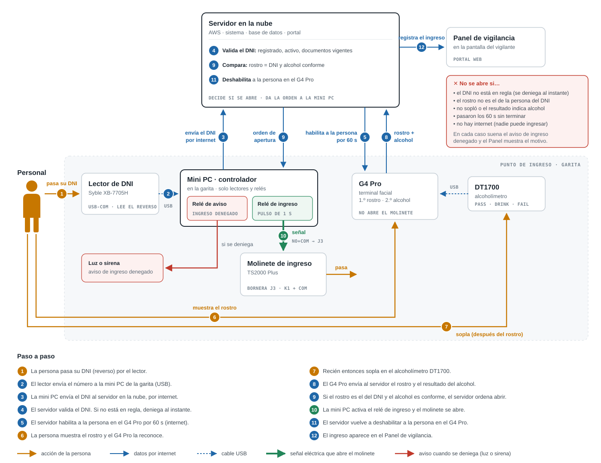
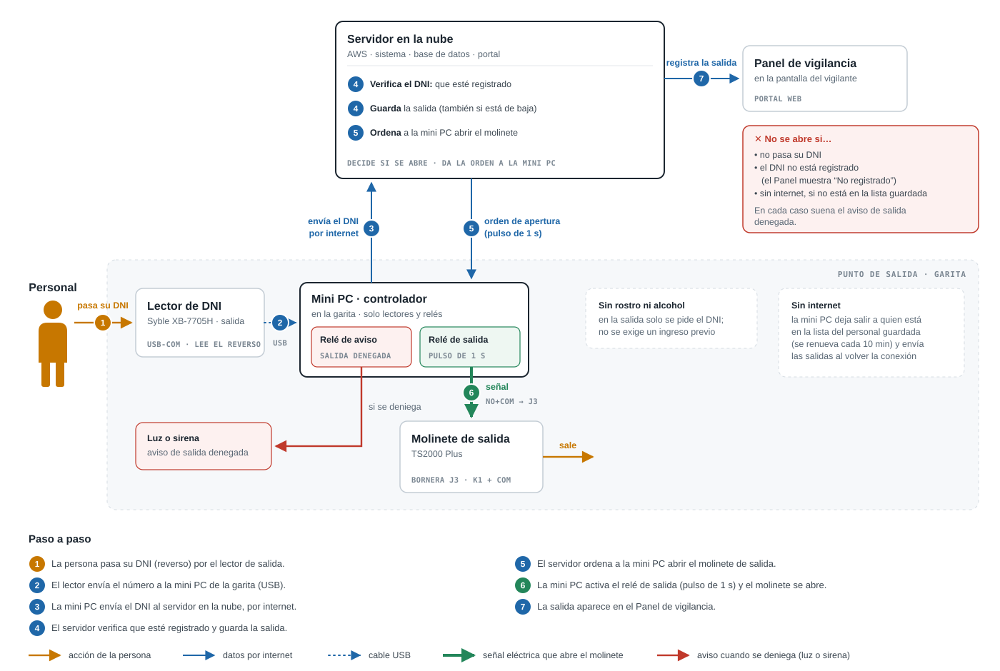

# Integración de equipos: ingreso y salida

Proyecto: Sistema de Control de Accesos · Terminal Monte Azul Mollendo (TMAM) · Alcance base
Fecha: 27/09/2026

Este documento explica cómo se conectan los equipos físicos (lectores de DNI, terminal facial ZKTeco G4 Pro, alcoholímetro DT1700, molinetes y relé de red) con el sistema, cómo funcionan el ingreso y la salida paso a paso, qué se necesita comprar, configurar y programar, y qué pruebas hay que hacer con el equipo real.

---

## 1. Contexto

### 1.1. Los equipos

| Equipo | Modelo | Función |
|---|---|---|
| Lectores de DNI (2) | Syble **XB-7705H** | Uno en el molinete de **ingreso** y otro en el de **salida**. Leen el código de barras del DNI y lo envían por USB a la mini PC. |
| Terminal facial | ZKTeco **G4 Pro** | En el ingreso. Reconoce el rostro, luego habilita la prueba de alcohol con el DT1700, y envía el resultado a la mini PC (ya no abre el molinete él mismo — ver actualización 02/oct/2026 abajo). Se alimenta con 12 V DC 3 A o por PoE (802.3af/at). |
| Alcoholímetro | ZKTeco **DT1700** | Prueba de aliento. Se conecta **por USB Type-A al G4 Pro** (no a la red). Da tres resultados: verde **Pass**, amarillo **Drink** y rojo **Fail**. |
| Molinetes (2) | ZKTeco **TS2000 Plus** | Uno de **ingreso** y otro de **salida**. Se abren al recibir un contacto seco (sin voltaje) en la bornera **J3** de su placa de control: **K1** o **K2** con **COM** ("Right Open" / "Left Open"). Tienen entrada de alarma contra incendios (**J2**), salida de 12 V (**J11**) y contadores de paso (**J17**/**J18**). |
| Relés de red (2) | Por comprar | Uno para cada molinete (ingreso y salida). La mini PC los activa por la red para abrirlos. |
| Mini PC | Ya existe | Junto a los molinetes. Tiene **todo el sistema**: backend, base de datos y portal web. |

### 1.2. Decisiones tomadas

- **Todo es local, sin internet.** El sistema completo corre en la **mini PC** junto a los molinetes. En este documento, "servidor" es esa mini PC.
- **No se usa ZKBio CVSecurity**, sino el **SDK del proveedor**: el protocolo **PUSH / ADMS** de ZKTeco (documento oficial: *Attendance PUSH Communication Protocol 20260422*).
- **En el ingreso y en la salida, la persona primero se identifica con su DNI.**
- **Ingreso:** el DNI **habilita** a la persona (si está en regla), pero **el molinete solo se abre cuando el G4 Pro reconoce su rostro y la prueba de alcohol es conforme**. Lo abre la mini PC, con el relé de ingreso, una vez que recibe y confirma el resultado del G4 Pro (actualizado 02/oct/2026 — antes lo abría el G4 Pro directo con su propio relé, ver sección 5).
- **Salida:** solo DNI. Si no se identifica con un DNI registrado, **no se abre**. Una persona dada de baja **sí puede salir**. Lo abre la mini PC con el relé de salida.
- Los lectores de DNI los lee **el backend directamente** (modo USB-COM). No se usa el portal para leerlos, porque dependería de una ventana del navegador abierta y con el foco.

### 1.3. Cómo se comunican

| Conexión | Medio | Para qué |
|---|---|---|
| Lector de DNI → mini PC | USB (puerto serie virtual) | Enviar el texto leído del DNI. Cada lector aparece como un puerto distinto (por ejemplo COM3 = ingreso, COM4 = salida). |
| G4 Pro ↔ mini PC | Red local, protocolo PUSH (HTTP) | La mini PC le envía las personas, sus fotos y quién está habilitado; el G4 Pro le envía cada ingreso. |
| DT1700 → G4 Pro | USB | Resultado de la prueba de alcohol. |
| Mini PC → relé de ingreso → molinete de ingreso | Red local + 2 cables: relé (NO + COM) → J3 K1 (o K2) + COM | Señal de apertura del molinete de ingreso (actualizado 02/oct/2026 — antes iba directo del G4 Pro). |
| Mini PC → relé de salida → molinete de salida | Red local + 2 cables: relé (NO + COM) → J3 K1 (o K2) + COM | Señal de apertura del molinete de salida. |

En el protocolo PUSH **es el G4 Pro el que se conecta a la mini PC**, en tres direcciones:

| Dirección | Para qué la usa el terminal |
|---|---|
| `/iclock/cdata` | Presentarse y enviar datos (registros de ingreso, fotos, etc.) |
| `/iclock/getrequest` | Preguntar cada pocos segundos: "¿tienes órdenes para mí?" |
| `/iclock/devicecmd` | Avisar el resultado de una orden que ejecutó |

En el G4 Pro el menú se llama *"Cloud service settings"*, pero ahí solo se escribe la **IP local de la mini PC** (por ejemplo `192.168.1.10`). No se usa ninguna nube.

---

## 2. Proceso completo (resumen)

**Antes de todo — registro (una sola vez, en el portal):** el administrador registra a la persona con su DNI, foto y documentos. El sistema la carga en el G4 Pro **deshabilitada**: el G4 Pro puede reconocer su rostro, pero no la deja pasar hasta que pase su DNI (sección 4).

### 2.1. Ingreso

**Cómo leer los diagramas:** naranja = lo que hace la persona · azul continuo = datos por la red local · azul punteado = cable USB · verde grueso = señal eléctrica que abre el molinete. Los números siguen el orden de los pasos de la tabla.



| # | Qué pasa | Dónde |
|---|---|---|
| 1 | La persona **pasa su DNI** (reverso) por el lector de ingreso. | Persona → lector |
| 2 | El lector envía el número de DNI a la mini PC. | Lector → mini PC (USB) |
| 3 | El sistema revisa que el DNI **esté registrado, no esté dado de baja, tenga al menos un documento y ninguno vencido**. Si falla algo, **se deniega aquí mismo** con el motivo en el Panel. | Mini PC |
| 4 | Si está conforme, el sistema **habilita a esa persona en el G4 Pro** por un tiempo corto (por ejemplo 60 s). | Mini PC → G4 Pro (red) |
| 5 | La persona se para frente al G4 Pro, que **reconoce su rostro**. | Persona → G4 Pro |
| 6 | **Recién entonces** el G4 Pro le permite **soplar en el alcoholímetro**. | Persona → DT1700 → G4 Pro (USB) |
| 7 | El G4 Pro envía el resultado (rostro reconocido + resultado del alcohol) a la mini PC. | G4 Pro → mini PC (red) |
| 8 | La mini PC comprueba que el rostro reconocido corresponda al mismo DNI que pasó por el lector, y que el alcohol haya salido conforme. **Solo si ambas cosas se cumplen**, activa el **relé de ingreso** y el molinete se abre para un paso. **Si no sopla, el resultado indica alcohol, o el rostro no corresponde al DNI, no se abre.** (Actualizado 02/oct/2026 — antes abría el G4 Pro directo con su propio relé.) | Mini PC → relé (red) → molinete (cable a J3) |
| 9 | La mini PC **vuelve a deshabilitar** a la persona. | Mini PC |
| 10 | El ingreso aparece en el **Panel de vigilancia**. | Mini PC → Panel |

**No se abre si:**
- solo pasa el DNI (falta el rostro y el alcohol);
- solo se para frente al G4 Pro sin pasar el DNI (no está habilitado);
- el DNI no está registrado, está de baja, le faltan documentos o tiene alguno vencido;
- el rostro no es el de la persona del DNI (solo está habilitada esa persona);
- no sopla, o el alcoholímetro indica alcohol;
- se acaba el tiempo de habilitación.

### 2.2. Salida



| # | Qué pasa | Dónde |
|---|---|---|
| 1 | La persona **pasa su DNI** (reverso) por el lector de salida. | Persona → lector |
| 2 | El lector envía el número de DNI a la mini PC. | Lector → mini PC (USB) |
| 3 | El sistema revisa que el DNI **esté registrado** (incluye personas dadas de baja; no se exige ingreso previo) y guarda la salida. | Mini PC |
| 4 | La mini PC ordena al **relé de red** un pulso de 1 s. | Mini PC → relé (red) |
| 5 | El relé cierra su contacto y **el molinete de salida se abre** para un paso. | Relé → molinete (cable a J3) |
| 6 | La salida aparece en el **Panel de vigilancia**. | Mini PC → Panel |

Sin DNI o con un DNI no registrado **no se abre**. El Panel muestra "No registrado" para que el vigilante atienda el caso.

---

## 3. Esquema de conexión

```
                                         RED LOCAL (switch)
        ┌───────────────────────────────┬───────────────────────────────┬───────────────────────────────┐
        │                               │                               │                               │
┌───────┴────────┐              ┌───────┴────────┐              ┌───────┴────────┐              ┌───────┴────────┐
│    MINI PC     │              │ RELÉ DE SALIDA │              │ RELÉ DE INGRESO│              │     G4 PRO     │──── USB ──── DT1700
│ - Sistema      │              └───────┬────────┘              └───────┬────────┘              │  (en ingreso)  │             (alcohol)
│ - Base de datos│                      │ 2 cables                      │ 2 cables              └────────────────┘
│ - Portal web   │                      │                               │
└──┬──────────┬──┘              ┌───────┴─────┐                 ┌───────┴─────┐
   │ USB      │ USB              │  MOLINETE   │                 │  MOLINETE   │
┌──┴───────┐ ┌┴─────────┐        │  DE SALIDA  │                 │ DE INGRESO  │
│LECTOR DNI│ │LECTOR DNI│        │ bornera J3  │                 │ bornera J3  │
│ INGRESO  │ │ SALIDA   │        └─────────────┘                 └─────────────┘
└──────────┘ └──────────┘
```

*(Actualizado 02/oct/2026: ahora hay un relé de red por cada molinete; el G4 Pro ya no tiene cable de señal al molinete, solo manda el resultado por red a la mini PC, que es quien ordena abrir al relé de ingreso.)*

- El lector de DNI del ingreso **no está conectado al G4 Pro**, sino a la mini PC: el G4 Pro se entera de que la persona pasó su DNI porque la mini PC la habilita.
- En cada molinete, la señal de apertura entra por la bornera **J3**: **K1 + COM** o **K2 + COM**, según el sentido de paso ("Right Open" / "Left Open").
- Todo el cableado de señal va por el ducto de **baja tensión**, separado de la línea de 220 V (así lo pide la guía de instalación del molinete).

---

## 4. Personas en el G4 Pro: registro y habilitación

### 4.1. Registro (al crear o cambiar a la persona en el portal) — ❌ NO FUNCIONA, confirmado con una persona real (02/oct/2026)

> **Conclusión final, corrige una celebración prematura del 01/oct.** Se probó `DATA UPDATE BIOPHOTO` (con el formato simple de 4 campos) y el equipo respondía `return=0` — se había concluido que eso bastaba. **No es así**: se registró a una persona real (Amiel, con su foto real) por el portal, el comando se confirmó (`return=0`), pero **el equipo no lo reconoce frente a la cámara y tampoco aparece en "Administración de usuarios"** — ni siquiera agregando `RELOAD OPTIONS` después. `USERINFO` (el nombre) sigue confirmado como rechazado, de seis formas distintas. En conjunto: **ninguna de las dos formas logra que el equipo registre a alguien de verdad por control remoto**. El `return=0` de `BIOPHOTO` solo confirma que el equipo recibió los bytes, no que haya quedado un usuario funcional. Detalle completo en `Estado_Implementacion_Integracion_G4Pro.md`, sección 2.6.
>
> **Por ahora, el registro de personas se tiene que hacer físicamente, desde la pantalla del equipo** — no automáticamente desde el portal. Falta preguntarle al proveedor si existe alguna otra forma, ya con evidencia concreta de qué se probó.
>
> **Evidencia final (02/oct/2026), directo del equipo**: se le pidió al equipo su propio estado interno (comando `INFO`, capturado por tráfico de red). Confirma que `BioPhotoFun`, `VisilightFun` y el tipo de biometría usado (`Type=9`, rostro de luz visible) están todos correctamente habilitados — no es un problema de configuración ni de formato. Aun así, **`UserCount=0`, `FaceCount=0` y `UserPhotoCount=0`**, incluso después de varios `DATA UPDATE BIOPHOTO` y un `DATA UPDATE USERPIC` con `return=0`: nada se guarda nunca, porque no hay un usuario (`USERINFO`, bloqueado) al cual adjuntarlo. Detalle completo en `Estado_Implementacion_Integracion_G4Pro.md` sección 2.8.

El diseño original (no probado todavía cuando se escribió) era que el G4 Pro necesita tener a cada persona (DNI + foto) para reconocer su rostro, y que el sistema la enviaría automáticamente, **con una fecha de validez ya vencida**, para que quede deshabilitada:

```
DATA UPDATE USERINFO PIN=45678912  Name=Luis Quispe  StartDatetime=2000-01-01T00:00:00
                     EndDatetime=2000-01-01T00:00:01  Expires=1
DATA UPDATE BIOPHOTO PIN=45678912  Type=9  Format=0  Size=...  Content=<foto JPG en base64>
```

- `PIN` = número de DNI.
- `StartDatetime` / `EndDatetime` + `Expires=1` = periodo en que la persona puede pasar. Requiere activar `UserValidTimeFun=1` en el terminal.
- `Type=9` = rostro de luz visible (el tipo del G4 Pro).

| Qué pasa en el portal | Orden al G4 Pro |
|---|---|
| Se registra una persona | `DATA UPDATE USERINFO` (deshabilitada) + `DATA UPDATE BIOPHOTO` |
| Se cambia la foto | `DATA UPDATE BIOPHOTO` |
| Se da de baja | `DATA DELETE USERINFO` |
| Se reactiva | `DATA UPDATE USERINFO` (deshabilitada) + `DATA UPDATE BIOPHOTO` |
| Se renueva, agrega o elimina un documento | Ninguna: lo evalúa la mini PC cuando la persona pasa su DNI |

### 4.2. Habilitación temporal (cada vez que la persona pasa su DNI)

```
Al pasar el DNI y estar en regla:
DATA UPDATE USERINFO PIN=45678912  StartDatetime=<ahora>  EndDatetime=<ahora + 60 s>  Expires=1

Al recibir su ingreso, o al acabarse el tiempo:
DATA UPDATE USERINFO PIN=45678912  StartDatetime=2000-01-01T00:00:00  EndDatetime=2000-01-01T00:00:01  Expires=1
```

- Así **solo el dueño del DNI** puede abrir: aunque otra persona se pare frente al G4 Pro, está deshabilitada.
- Si dos personas pasan su DNI seguidas, las dos quedan habilitadas a la vez; cada una solo con su propio rostro.
- Estas órdenes están **bien documentadas** en el protocolo (son las mismas del registro).
- **Riesgo 1 — demora:** el G4 Pro recoge las órdenes preguntando cada cierto tiempo (parámetro `Delay` del protocolo; el fabricante recomienda de 2 a 60 s y permite bajarlo cuando se necesita respuesta rápida). Con `Delay=2`, la persona quedaría habilitada unos 2 s después de pasar el DNI, lo que alcanza a cubrir el tiempo que tarda en caminar al G4 Pro. Hay que medirlo.
- **Riesgo 2 — precisión de la fecha de validez:** el protocolo PUSH (versión 2026) acepta fecha **y hora** (`YYYY-MM-DDTHH:MM:SS`), pero el manual del G4 Pro (versión ACC 2022) dice que la validez en pantalla es **por días** (de 00:00 a 23:59). Si el firmware solo respeta días, la habilitación de 60 s no sirve y hay que usar una alternativa (sección 5.3). Es la prueba más importante.
- **El reloj del G4 Pro debe estar sincronizado con el de la mini PC**, porque la habilitación se basa en fecha y hora.

---

## 5. Ingreso paso a paso

### 5.1. Diagrama

Ver el diagrama de la sección 2.1.

Orden confirmado: **primero el rostro, luego el alcoholímetro**. Si la persona no sopla o el resultado indica alcohol, el G4 Pro no abre.

### 5.2. Qué ve el Panel de vigilancia

| Caso | Quién lo detecta | Motivo en el Panel |
|---|---|---|
| DNI no registrado, de baja, sin documentos o con documento vencido | Mini PC al leer el DNI | El motivo exacto (p. ej. "SCTR vencido") |
| Ingreso completo | G4 Pro (envía el registro) | Autorizado |
| Rostro o alcohol no conforme | G4 Pro (si envía el intento rechazado; a confirmar) o la mini PC al acabarse el tiempo | "Alcohol no conforme" si llega el dato; si no, "No completó el ingreso en el terminal" |
| El rostro de otra persona | G4 Pro no abre (no está habilitada) | Según lo que envíe el G4 Pro |

### 5.3. Alternativas si la habilitación temporal no funciona bien

> **Actualización (30/set/2026): la habilitación temporal YA SE PROBÓ con el equipo real y falló — ver pendiente #1 actualizado en la sección 9.** De las dos alternativas de abajo, la 1 también quedó descartada (ver recuadro).
>
> ~~**Corrección importante**: esto NO significa que haya que pasar a la Alternativa 2... El G4 Pro se queda abriendo el ingreso con su propio relé...~~ **Superado, ver la actualización de abajo.** En su momento se decidió no hacía falta la Alternativa 2 porque el vigilante presente cubría el riesgo que esta buscaba resolver — pero el cliente luego decidió igual ir con la Alternativa 2 (ver actualización 02/oct/2026), por una razón distinta a la original (no quedó registrado cuál).
>
> **Actualización (02/oct/2026): el cliente confirmó que sí va con la Alternativa 2.** El ingreso queda igual que el diseño de abajo: el G4 Pro ya no abre nada, solo manda el resultado; la mini PC comprueba rostro = DNI y alcohol conforme, y abre con el **relé de ingreso**. Con una diferencia: son **dos relés de red separados** (uno de 1 canal para cada molinete), no uno solo de 2 canales como decía originalmente la sección 5 (ya actualizada). Las secciones 1 a 3 de este documento ya reflejan este cambio. Queda pendiente el modelo exacto de cada relé y, cuando se tenga, actualizar el código de `molinete.abrir` para el ingreso (hoy asume que abre el G4 Pro solo, con su propio relé).

Si la prueba muestra que la espera para habilitar es demasiado larga, o que el G4 Pro no respeta la fecha de validez:

| | **Alternativa 1: verificación en el servidor — ❌ DESCARTADA (30/set/2026)** | **Alternativa 2: relé de red también para el ingreso** |
|---|---|---|
| Cómo funciona | Al reconocer el rostro, el G4 Pro **pregunta** a la mini PC "¿lo dejo pasar?" (*Background Verification*, `PostVerifyData`, sección 12.8.3 del protocolo). La mini PC responde según el DNI leído. El G4 Pro hace la prueba de alcohol y abre con su relé. | El G4 Pro no abre: reconoce el rostro, hace la prueba de alcohol y envía el resultado. La mini PC comprueba rostro = DNI y alcohol conforme, y abre con el **relé de ingreso**. |
| Quién abre | El G4 Pro (se mantiene la regla: rostro + alcohol) | La mini PC |
| Requisito | ~~Que la función esté disponible y se entienda su formato (poco documentada).~~ **Descartado**: se implementó el lado del servidor (responde `OK` correctamente al `POST /iclock/cdata?type=PostVerifyData`, confirmado con una llamada simulada), pero el equipo real nunca lo invoca. Se revisó el manual de usuario completo del G4 Pro (`G4PRO_MANUAL.txt`) y la lista oficial de opciones del menú *Access Control* (sección 5.1: Door lock delay, Gate mode, Door sensor delay/type, Verification mode, Door valid time zone, Normally open time zone, Master device, Auxiliary input, Alarm) — **esta función no existe en ningún menú de este equipo**. Es un recurso del protocolo pensado para relojes de asistencia simples (confirmado en el comentario de la librería de referencia: firmware ZAM180-NF), no para esta línea ACC. | Que **el resultado del alcohol llegue a la mini PC** (el protocolo no lo menciona, pero **ya se confirmó por otra vía**: ver Hallazgo de `table=rtlog` en `Analisis_Control_Acceso_Mollendo.md` sección 6.1 — el alcohol SÍ llega a la mini PC). Falta el relé de ingreso (hardware, por comprar — ver actualización 02/oct/2026 arriba). |

---

## 6. Salida paso a paso

Ver el diagrama de la sección 2.2.

- El molinete **solo se abre con un DNI registrado**. Sin DNI o con un DNI no registrado, no se abre.
- Una persona **dada de baja sí puede salir**: la baja solo bloquea el ingreso.
- **No hay antipassback** en el alcance base: no se exige haber registrado un ingreso.

---

## 7. Si falla algo

| Situación | Ingreso | Salida |
|---|---|---|
| **Se cierra o se cuelga solo el programa** | El sistema se instala como **servicio que se reinicia automáticamente** en segundos. | Igual. |
| **La mini PC se apaga o se cuelga** | Nadie puede habilitarse con su DNI: **el molinete no se abre**. | **El molinete no se abre.** |
| **Se cae el G4 Pro** | No hay reconocimiento ni prueba de alcohol: **el molinete no se abre**. | No afecta. |
| **Falla el lector de DNI o el DNI no se lee** | La persona no puede habilitarse: **el molinete no se abre**. El vigilante puede buscarla en el Panel por su DNI. | Igual. |
| **Emergencia** (incendio, evacuación) | El molinete tiene una entrada de alarma contra incendios (**J2**, contacto sin voltaje): al activarse, **el brazo cae** y el paso queda libre. Es cableado y no depende del sistema. | Igual. |
| **Corte de energía** | El brazo del molinete **cae automáticamente**. Al volver la energía hay que esperar más de 6 s antes de levantar el brazo a mano (manual del molinete). | Igual. |

Recomendaciones:
- **UPS** (batería de respaldo) para la mini PC, el switch, el relé y el G4 Pro.
- **Respaldos automáticos de la base de datos** a otro lugar (disco externo o memoria USB): si la mini PC se daña, se pierde toda la información.

**No hay apertura manual.** Según la documentación del molinete, fuera del sistema el brazo solo cae si se **corta la energía del molinete** o si se activa su **entrada de alarma contra incendios (J2)**; en ambos casos el paso queda libre para todos. Por eso hay que **definir con el cliente cómo se atiende una falla** (mini PC, G4 Pro o lector caídos, o un DNI que no se lee): qué hace el vigilante y por dónde pasa la persona. Esto es lo más importante en la **salida**, para que nadie quede encerrado.

---

## 8. Qué se necesita

### 8.1. Equipos a comprar

| Equipo | Cantidad | Características mínimas |
|---|---|---|
| **Módulo de relé de red** (Ethernet) | **2** (uno para la salida, otro para el ingreso — confirmado 02/oct/2026, dos cajitas separadas de 1 canal, no una de 2) | Puerto Ethernet RJ45 · control por **HTTP** (preferible) o Modbus TCP · relés con salida **NO y COM** (contacto seco) · al menos 1 A a 30 V DC · alimentación 12 V DC o PoE · IP fija configurable · de preferencia con **usuario y contraseña** |
| **UPS** | 1 | Para la mini PC, el switch, los relés y el G4 Pro |
| **Alimentación del G4 Pro** | 1 | Un puerto **PoE** (802.3af/at) en el switch, o un adaptador de **12 V DC 3 A** (confirmar si vino con el equipo) |
| Cable de red (Cat 5e o 6) | 2 | De cada relé al switch |
| Cable de señal (2 hilos) | 2 tramos | Relé de ingreso → molinete de ingreso, y relé de salida → molinete de salida |
| Puntos de red libres en el switch | 2 | Relé y G4 Pro |

La mini PC, los dos lectores de DNI, el G4 Pro, el DT1700 y los molinetes **ya están**.

### 8.2. Configuración

| Dónde | Qué se configura |
|---|---|
| **Lectores de DNI (2)** | Modo **USB-COM** (puerto serie virtual) en lugar de USB-HID ("teclado"); la ficha técnica confirma que lo soporta. Se cambia escaneando un código de programación del **manual de configuración del fabricante, que no está en la carpeta de equipos: hay que pedírselo al proveedor**. Activar **PDF417** (y **Code 128** si algún DNI lo usa). Anotar qué puerto COM es el de ingreso y cuál el de salida. Se alimentan por el mismo USB (5 V, 210 mA). |
| **G4 Pro** | *System Settings > Cloud service settings*: IP de la mini PC y puerto del servidor PUSH (el manual indica 8088 por defecto). *Access Control*: **Gate mode = ON** (modo molinete: pulso de 0,8 s en lugar de "Door lock delay") y **Verification mode = Face**. *Access control record settings*: activar **User validity settings**. Hora sincronizada con la mini PC (*Sync cloud server*). Prueba de alcohol **obligatoria** para abrir. Relé "Lock" (NO + COM) conectado a J3 del molinete de ingreso. Desde la mini PC: `Realtime=1` (envío de registros al instante) y `Delay` bajo (2 s). |
| **Relé de red** | IP fija, cambiar la contraseña de fábrica y probar el canal desde el navegador. |
| **Molinetes** | Bornera **J3** de la placa de control: señal de apertura en **K1 + COM** o **K2 + COM**, según el sentido de paso. **J2**: señal de alarma contra incendios (contacto sin voltaje). Interruptores DIP: **KE-1 a KE-3** = tiempo que el molinete espera el paso después de abrir (5 s por defecto, hasta 60 s); **KE-6 (Memory Swipe) = OFF**, para que dos aperturas seguidas no acumulen pasos; **KE-8** = alarma por paso forzado (activar si se quiere). |
| **Mini PC** | El sistema como **servicio que arranca solo** y se reinicia si se cierra. Respaldos automáticos de la base de datos. Suspensión y actualizaciones automáticas de Windows desactivadas o programadas fuera de horario. |
| **Sistema** | Registrar cada molinete: tipo (ingreso o salida), puerto del lector; para la salida, IP del relé, canal y duración del pulso; para el ingreso, el número de serie del G4 Pro y el tiempo de habilitación. |

### 8.3. Desarrollo en el sistema

| Parte | Qué hay que programar |
|---|---|
| **Protocolo PUSH** (nuevo) | Endpoints `/iclock/cdata`, `/iclock/getrequest`, `/iclock/devicecmd`, **más `/iclock/registry` (debe responder `RegistryCode=<algo>`, no `OK`) y `/iclock/push` (sesión con `SessionID`) — confirmado con el equipo real que sin esto nunca manda datos, ver pendiente 5**. Reemplazan el webhook provisional de ZKBio (`/integraciones/zkbio/webhook`). El alcohol llega por `table=rtlog` y el estado de puerta/relé por `table=rtstate` — ninguna de las dos está en el protocolo oficial documentado. |
| **Cola de órdenes al G4 Pro** (nuevo) | Registrar (deshabilitada), actualizar y eliminar personas y enviar fotos, cada vez que cambia algo en el portal (sección 4.1). Guardar si cada persona quedó sincronizada. |
| **Habilitación temporal** (nuevo) | Al leer un DNI en regla: habilitar a la persona en el G4 Pro por el tiempo configurado. Al recibir su ingreso o al acabarse el tiempo: deshabilitarla. Las habilitaciones deben tener prioridad en la cola. |
| **Conversión de la foto** (nuevo) | Llevar la foto al formato que exige el G4 Pro (JPG ≤ 20 KB, 358×441 a 1080×1920). |
| **Lectura de los lectores de DNI** (nuevo) | Leer los dos puertos serie, extraer el número de DNI y enviarlo al flujo de ingreso o de salida según el puerto. |
| **Flujo de ingreso** (cambia) | Paso 1 al leer el DNI: regla de documentos (ya existe en el motor de validación) y habilitación. Paso 2 al llegar el registro del G4 Pro: guardar el ingreso. Nuevo motivo: "No completó el ingreso en el terminal" (tiempo agotado). |
| **Controlador del relé** (nuevo) | Reemplaza la apertura simulada (`molinete.abrir`, hoy solo log) para la salida: envía el pulso por HTTP o Modbus según el modelo. |
| **Registro de salida** (ya existe) | La lógica actual se reutiliza; solo hay que indicar qué molinete abrir. |
| **Panel de vigilancia** (ya existe) | Mostrar los nuevos motivos y un aviso cuando el G4 Pro o el relé no respondan. |

---

## 9. Temas pendientes

1. **Demora de la habilitación — RESUELTO, con resultado NEGATIVO (30/set/2026):** se probó con el equipo real, mandando exactamente el comando que documenta el protocolo oficial (`DATA UPDATE USERINFO PIN=1 StartDatetime=... EndDatetime=... Expires=1`, con el PIN real de un usuario enrolado, "Amiel", ID 1). **El equipo lo rechazó explícitamente**, dos veces (al habilitar y al deshabilitar), con el código de error `return=-629`. No fue un problema de red ni de formato del comando. Se intentó también la causa más probable según el propio protocolo (que indica *"the main switch parameter UserValidTimeFun must be set to 1"*): se mandó `SET OPTION UserValidTimeFun=1` + `RELOAD OPTIONS` (comando oficial, sección 12.4.1), el equipo lo aceptó (`return=0`), y **se repitió la prueba — mismo rechazo (`return=-629`) otra vez**. Dos intentos independientes, mismo resultado: **la habilitación temporal, tal como está diseñada en la sección 4.2, no es viable con este equipo**.
   >
   > ~~**Esto NO cambia el diseño de apertura**: se decidió que el G4 Pro se queda abriendo el ingreso con su propio relé...~~ **Superado (02/oct/2026):** el cliente decidió la Alternativa 2 de la sección 5.3. El G4 Pro ya no abre el molinete: la mini PC lo abre con el relé de ingreso, tal como muestra el diagrama de la sección 2.1.
2. ~~**Fecha de validez por usuario:** confirmar que el G4 Pro respeta `StartDatetime` / `EndDatetime` al segundo (no solo por día).~~ — **Ya no aplica**: el punto 1 confirma que el comando se rechaza por completo, antes siquiera de poder medir la precisión de la validez.
3. **Alcohol — RESUELTO EN PARTE (30/set/2026):** se conectó el equipo físico real (G4 Pro + DT1700, SN `HSR3263100192`) a un servidor PUSH de prueba y se confirmó que **el dato de alcohol sí llega por el protocolo ADMS**, en tiempo real, apenas se completa la prueba. No llega en `ATTLOG`/`OPERLOG` (las tablas que documenta el protocolo oficial) sino en una tabla propia del firmware, **no documentada en ningún manual**: `table=rtlog`, con el campo `Concentration`. Evento real capturado:
   ```
   time=2026-09-30 18:22:37  pin=0  event=0  verifytype=15  Concentration=0  ...
   ```
   `Concentration=0` fue un resultado **Pass** (verde). **Todavía falta**: provocar un resultado **Drink** y **Fail** para ver qué valor manda `Concentration` en esos casos (probablemente > 0, pero no confirmado), y si el nombre del evento o algún otro campo cambia cuando el equipo bloquea el paso.
4. **Intentos rechazados — parcialmente resuelto:** se descubrió que el evento de apertura física (sensor/relé/puerta) viaja en **una tabla aparte**, también no documentada: `table=rtstate` (campos `sensor=`, `relay=`, `door=`). En la prueba exitosa llegaron ambos: primero `rtlog` (la verificación) y, un segundo después, dos `rtstate` (relé se activa y luego se desactiva). La hipótesis a confirmar con una prueba real de rechazo: si el alcohol no es conforme o la persona no está habilitada, debería llegar el `rtlog` (o no llegar nada) **sin** el `rtstate` de apertura correspondiente — eso sería la forma de detectar un rechazo desde el backend. Falta la prueba real para confirmarlo.
5. **Hallazgo nuevo, no anticipado — requisito de "confianza" del equipo con el servidor:** se descubrió que el G4 Pro **no manda datos reales a ningún servidor que no responda exactamente de cierta forma**, algo que no aparece en ningún manual de ZKTeco:
   - `/iclock/registry` tiene que responder **`RegistryCode=<algo>`** (un código estable por equipo, no necesariamente uno específico) — si responde `OK` a secas (la respuesta "obvia" siguiendo el protocolo documentado), el equipo se queda conectado con normalidad (sigue hablando por `/iclock/getrequest`) pero **nunca manda `rtlog`/`rtstate` ni ningún dato real**, sin ningún error.
   - Además hace falta implementar un endpoint no documentado, **`/iclock/push`**, que responda con una sesión (`SessionID`, etc.).
   - **Esto es crítico para la sección 8.3** ("Protocolo PUSH (nuevo)"): si el desarrollo dentro de `mollendo-api` no implementa este comportamiento exacto, el síntoma en el sitio va a ser "el equipo se conecta pero nunca manda nada" — indistinguible de un problema de red, y muy difícil de diagnosticar sin saber que existe este requisito.
5. **Firmware del G4 Pro:** el protocolo revisado es el de **asistencia (ATT)**. El manual de la carpeta de equipos es de la variante de **control de acceso (ACC)**, que puede usar otro protocolo. Hay que confirmar qué firmware tiene y que se conecta al servidor PUSH.
6. **Texto que entrega el lector de DNI:** el código de barras del DNI peruano puede contener más datos que el número. Hay que leer varios DNI reales (azul y electrónico) para saber cómo extraer el número de 8 dígitos.
7. **Personas con CE o pasaporte:** su documento puede no tener un código de barras que el lector entienda. Hay que definir cómo se identifican.
8. **Formato de la foto:** el G4 Pro exige JPG de 20 KB como máximo, entre 358×441 y 1080×1920 píxeles, fondo blanco, rostro de frente y sin mascarilla. El formulario debería mostrar estas indicaciones.
9. **Relé:** modelo exacto que se compre (para programar su protocolo), duración del pulso (se empieza con 1 s) y sentido de paso de cada molinete (K1 o K2). Si se alimenta desde la salida de 12 V del molinete (J11), confirmar cuánta corriente entrega.
10. **Documentación no confiable:** 4 archivos de la carpeta de equipos fueron generados con ReportLab el 20/09/2026 y no son del fabricante: las dos guías (G4 Pro + DT1700 y Syble) y los dos planes de instalación (G4 Pro y TS2000 Plus). No deben usarse como referencia (por ejemplo, la guía del Syble dice que tiene contactos NO/NC/COM; su ficha técnica real indica que solo tiene USB o RS232). La "LockerPad G4 Pro Quick Start Guide" es de otro producto.
11. **Manual de configuración del lector Syble:** no está en la carpeta; sin él no se puede pasar a modo USB-COM ni activar PDF417. Pedirlo al proveedor.
12. **Controladora del molinete:** la ficha del TS2000 Plus indica que la controladora de acceso (C3-200 o InBio 260 Pro) es **opcional**. Revisar si los molinetes comprados la traen: si la traen, tiene red y relés propios y podría reemplazar al relé de red en la salida; si no, las señales van directo a J3 como está en este documento.
13. **Salida "Lock" del G4 Pro:** el manual no trae el diagrama de conexión en texto; confirmar en la etiqueta del equipo que es un contacto seco (NO / COM) y no una salida con voltaje.
14. **Cómo enrolar caras en el equipo — CONFIRMADO SIN SOLUCIÓN REMOTA (02/oct/2026):** `DATA UPDATE USERINFO` rechazado (seis pruebas, incluido el ejemplo exacto del manual del fabricante). `DATA UPDATE BIOPHOTO` solo (formato de 4 campos) responde `return=0`, pero **probado con una persona real (foto real, PIN real) el equipo no la reconoce y no aparece en "Administración de usuarios"** — tampoco cambia agregando `RELOAD OPTIONS` después. El `return=0` no significa que haya quedado un usuario funcional. Detalle en `Estado_Implementacion_Integracion_G4Pro.md` sección 2.6. **El enrolamiento de caras, por ahora, solo se puede hacer físicamente desde la pantalla del equipo** — no hay forma remota confirmada. Falta: preguntarle al proveedor si existe otro mecanismo, con esta evidencia concreta.

---

## 10. Pruebas con el equipo real

Con el G4 Pro, el DT1700 y el **PushDemo** del proveedor (servidor PUSH de prueba, ya funcionando en Docker):

| # | Prueba | Cómo | Qué confirma |
|---|---|---|---|
| 1 | **Conexión** — ✅ **hecha (30/set/2026), y repetida en producción el 01/oct/2026** | En el G4 Pro, *Cloud service settings*: IP y puerto de la PC con el PushDemo. Verificar que el terminal aparece. | Confirmado: el equipo real (firmware `4.1.109-OCM-4101-3`) sí habla el protocolo PUSH, pero **solo si el servidor responde `RegistryCode=` en `/iclock/registry` y expone `/iclock/push`** (ver pendiente 5) — con una respuesta `OK` simple el equipo se conecta pero nunca manda datos reales. El 01/oct se repitió contra `mollendo-api` real (no el PushDemo), desplegado en AWS: el equipo se conectó solo y mandó un `rtlog`/`rtstate` real — ver `Estado_Implementacion_Integracion_G4Pro.md` sección 2.2. |
| 2 | **Registro deshabilitado** | Registrar una persona con su foto y con una fecha de validez pasada. Comprobar que el G4 Pro la reconoce pero **no abre**. | Que la persona queda deshabilitada |
| 3 | **Habilitación temporal** — ✅ **hecha (30/set/2026), resultado NEGATIVO** | Enviar la orden de habilitar por 60 s y medir cuánto tarda el G4 Pro en aceptarla. Comprobar que abre dentro del tiempo y **no abre** después. | **Rechazada por el equipo** (`return=-629`) — ver pendiente 1 actualizado en la sección 9. Pasar directo a la prueba 9. |
| 4 | **Alcohol** — ✅ **hecha parcialmente (30/set/2026), solo resultado Pass** | Con la persona habilitada: rostro sin soplar, resultado **Drink** (amarillo), resultado **Fail** (rojo) y resultado **Pass** (verde). Revisar cuándo abre y qué llega al PushDemo (`ATTLOG`, `OPERLOG`, fotos). | Confirmado con un resultado **Pass**: el dato llega por `table=rtlog` (no `ATTLOG`/`OPERLOG`), campo `Concentration=0`. **Falta**: repetir con Drink y Fail para ver esos valores (pendiente 3). |
| 5 | **Baja** | Enviar `DATA DELETE USERINFO` y comprobar que ya no la reconoce. | Que la baja funciona |
| 6 | **Foto** | Enviar fotos de distintos tamaños y formatos. | Qué acepta el terminal |
| 7 | **Lectores de DNI** | Leer varios DNI reales en la mini PC en modo USB-COM y revisar el texto recibido. | Pendiente 6 |
| 8 | **Relé** | Activar el canal desde su página web y ver si el molinete de salida se abre. | Cableado y duración del pulso |
| 9 | **Verificación en el servidor** — ✅ **hecha (30/set/2026), resultado NEGATIVO** | Buscar en el terminal cómo activarla y revisar si llega una consulta `PostVerifyData` antes de abrir, y qué respuesta espera. | Se implementó el lado del servidor (responde `OK` correctamente, confirmado con una llamada simulada), pero **la función no existe en el menú de este equipo** — se revisó el manual de usuario completo y la lista oficial del menú *Access Control*, sin rastro de ella. **Alternativa 1 descartada.** Se adoptó la Alternativa 2 (02/oct/2026): el G4 Pro ya no abre; la mini PC abre con el relé de ingreso — ver sección 5.3. |

Con el sistema ya integrado:

| # | Prueba | Resultado esperado |
|---|---|---|
| 10 | Ingreso completo: DNI en regla + rostro + alcohol conforme | Abre el ingreso y aparece en el Panel |
| 11 | Solo pasar el DNI, sin ir al G4 Pro | No abre; al acabarse el tiempo, el Panel lo muestra |
| 12 | Solo pararse frente al G4 Pro, sin pasar el DNI | No abre |
| 13 | DNI con un documento vencido | Deniega al leer el DNI, con el motivo; el G4 Pro no abre |
| 14 | DNI de una persona y rostro de otra | No abre |
| 15 | DNI en regla + rostro + alcohol no conforme | No abre |
| 16 | Salida con DNI registrado (incluida una persona de baja) | Abre la salida |
| 17 | Salida con DNI no registrado o sin DNI | No abre; el Panel muestra "No registrado" |
| 18 | Cerrar el programa del sistema a propósito | Se reinicia solo en segundos |
| 19 | Apagar la mini PC | Los molinetes no se abren; aplicar el procedimiento de falla que se defina con el cliente (sección 7) |
| 20 | Activar la señal de emergencia del molinete | El brazo cae |

---

## 11. Resumen de la propuesta

1. **Identificación con DNI en los dos molinetes**, leída por el backend en la mini PC.
2. **Ingreso:** DNI en regla → la mini PC habilita a la persona en el G4 Pro → el G4 Pro reconoce el rostro y toma la prueba de alcohol → **la mini PC abre con el relé de ingreso solo si el rostro es el del DNI y el alcohol es conforme**.
3. **Salida:** DNI registrado → la mini PC abre con el relé de salida.
4. **El G4 Pro no abre ningún molinete**: los dos se abren desde la mini PC, cada uno con su propio relé de red de 1 canal.
5. **Respaldo ante fallas:** UPS, reinicio automático del sistema y respaldos de la base de datos. No hay apertura manual: el procedimiento ante una falla se define con el cliente (sección 7).

La primera tarea es la **prueba 3 (habilitación temporal)**, junto con la **4 (alcohol)**, porque confirman que el ingreso puede funcionar así.

---

## 12. Revisión de la documentación de los equipos

Revisión de los documentos reales de la carpeta *DOC TECNICA DE LOS EQUIPOS* contra este documento:

| Equipo | Documento real | Qué confirma | Qué falta o no coincide |
|---|---|---|---|
| **G4 Pro** | Ficha técnica 2024 · Manual de usuario ACC v1.2 (2022) | Salida de relé "Lock", entrada de botón de salida, Wiegand, RS485, USB host · alimentación 12 V 3 A o PoE · *Cloud service settings* (servidor ADMS/PUSH) · **Gate mode** para molinetes · validez por usuario · soporta **PUSH SDK** | El manual es de 2022 y **no menciona el alcoholímetro**. Dice que la validez por usuario es **por días**, lo que pone en duda la habilitación de 60 s (sección 4.2). Es firmware **ACC**; el protocolo revisado es el de **ATT**. |
| **DT1700** | Ficha técnica 2026 | Conexión **USB Type-A** al G4 Pro · resultados Pass / Drink / Fail · batería propia de 24 h | No hay manual de integración real con el G4 Pro. |
| **Lector Syble XB-7705H** | Ficha técnica · página del producto | Interfaces **USB-HID, USB-COM y RS232** · lee **PDF417** y Code 128 · 5 V por USB · **no tiene relé ni salida de red** | Falta el **manual de configuración** (códigos para cambiar a USB-COM). |
| **Molinete TS2000 Plus** | Manual de usuario · Guía de instalación 2024 · Ficha técnica | Apertura por contacto seco en **J3 (K1/K2 + COM)** · incendio en **J2** · 12 V de salida en **J11** · contadores **J17/J18** · el brazo cae sin energía o con señal de incendio · DIP KE-1 a KE-8 · separar cables de fuerza y de señal | La controladora de acceso es **opcional**: confirmar si vino. |
| **Protocolo PUSH** | *Attendance PUSH Communication Protocol* 2026 | `USERINFO` con `StartDatetime`/`EndDatetime` y `Expires` · `BIOPHOTO` · `Delay` 2–60 s · `Realtime` · `AC_UNLOCK` | No documenta el dato del alcohol. |

**Documentos que no se deben usar** (generados con ReportLab el 20/09/2026, no son del fabricante): *Guia_Integracion_G4Pro_DT1700*, *Guia_de_Instalacion_y_Configuracion_Syble_XB-7705H*, *Plan_de_Instalacion_ZKTeco_G4_Pro* y *Plan_de_Instalacion_TS2000_Plus*. La *LockerPad G4 Pro Quick Start Guide* es de otro producto (casilleros).

**Dato adicional:** el G4 Pro trae un lector de códigos propio (QR y PDF417), pero según su ficha solo se puede usar para leer el DNI con una aplicación Android a medida (LCDP), no con el firmware PUSH. Por eso se mantiene el lector Syble en el ingreso.
