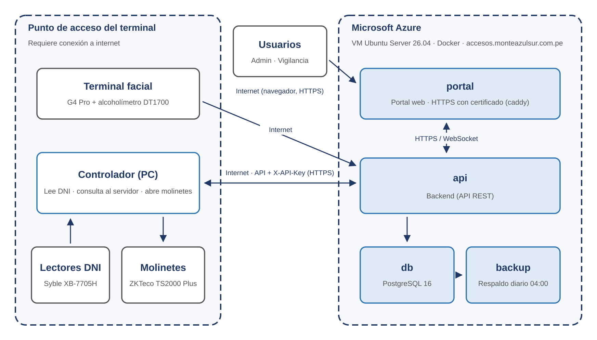

# Documento funcional - Sistema de Control de Accesos

**Terminal Monte Azul Mollendo (TMAM) · Alcance base**

Versión 1.3 · 25 de octubre de 2026

| Versión | Fecha | Descripción |
|---|---|---|
| Final | 02/10/2026 | Versión final. |
| 1.1 | 21/10/2026 | Integración con el terminal facial y el alcoholímetro, orden del ingreso, contingencias, Presentes ahora, aviso de fallas y HTTPS. |
| 1.2 | 23/10/2026 | Usuarios, período de autorización, tarjeta de acceso y avisos del Panel. |
| 1.3 | 25/10/2026 | Cuenta de soporte. |

## Contenido

1. [Introducción](#1-introducción)
2. [Descripción general del sistema](#2-descripción-general-del-sistema)
3. [Usuarios y roles](#3-usuarios-y-roles)
4. [Funcionalidades](#4-funcionalidades)
5. [Reglas de negocio](#5-reglas-de-negocio)
6. [Integración con los equipos del punto de acceso](#6-integración-con-los-equipos-del-punto-de-acceso)
7. [Modelo de datos](#7-modelo-de-datos)
8. [Interfaces (API)](#8-interfaces-api)
9. [Seguridad](#9-seguridad)
10. [Instalación, operación y respaldos](#10-instalación-operación-y-respaldos)
11. [Requisitos no funcionales](#11-requisitos-no-funcionales)
- [Anexo A. Glosario](#anexo-a-glosario)

---

## 1. Introducción

### 1.1. Propósito del documento

Este documento describe el funcionamiento del Sistema de Control de Accesos desarrollado para el Terminal Monte Azul Mollendo (TMAM): qué hace cada módulo, quién lo usa, las reglas de negocio que aplica, cómo se integra con los equipos del punto de acceso y cómo se instala y opera. Está dirigido al cliente, a los usuarios clave (administración y vigilancia) y a quien brinde soporte técnico.

### 1.2. Alcance

Corresponde al **alcance base** acordado: una aplicación web en la que el **administrador** registra a las empresas, a su personal (con foto) y los documentos de cada persona, y un **panel de vigilancia** que muestra en tiempo real cada ingreso y salida por los molinetes, con el motivo cuando se deniega.

**Incluido en el alcance base:**

- Registro de empresas, personal (con foto) y documentos.
- Documentos sin flujo de aprobación: tienen validez desde su carga y se pueden agregar, renovar y eliminar.
- Validación del ingreso: persona no dada de baja, al menos un documento, ninguno vencido y prueba de alcohol conforme.
- Panel de vigilancia en tiempo real, Auditoría, Sistema y APIs, y Manual de uso.
- Dos tipos de cuenta: Administrador y Vigilancia.
- Instalación en un servidor en la nube (Microsoft Azure), con respaldos diarios. En el punto de acceso opera el Controlador (PC).

**Desarrollos adicionales, solicitados por el cliente:**

- Dashboard con indicadores y gráficos, y reportes en Excel o PDF.
- Perfil de la persona, carga masiva desde Excel y período de autorización.
- Antipassback y orden del ingreso **Facial + Alcohol → DNI**.
- Contingencias: verificación manual, tarjeta de contingencia y contingencia sin lector.
- Tarjeta de acceso para visitas y autoridades.
- Pantalla Usuarios.

**Fuera del alcance base:**

- Autoservicio de empresas contratistas (registro, invitación y carga de su propio personal).
- Aprobación de documentos como paso aparte, con observaciones y subsanación.
- Requisitos de documentos distintos por perfil, puesto o zona.
- Roles adicionales (por ejemplo, Auditor), creación de cuentas nuevas y recuperación de contraseña por correo.
- Solicitud y agenda de visitas, y control de equipos y materiales.
- Auditoría detallada (valor anterior y nuevo).
- Activos (vehículos, maquinaria y equipos), operadores y checklists.
- Sanciones y restricciones con niveles.
- Credencial digital con QR y colores de fotocheck.
- Alertas y notificaciones por correo.
- Autenticación de doble factor (MFA).

---

## 2. Descripción general del sistema

### 2.1. Objetivo

Controlar que solo ingrese al terminal el personal habilitado: registrado, no dado de baja, con su documentación vigente y con prueba de alcohol conforme; y dejar registro de cada ingreso, salida y cambio de datos.

### 2.2. Componentes

| Componente | Descripción |
|---|---|
| Portal web | Aplicación web para computadora, tablet y celular, para el administrador y la vigilancia. |
| Backend (API) | Aplica las reglas de negocio, guarda la información, recibe los eventos de los equipos y los envía en tiempo real al Panel. |
| Base de datos | PostgreSQL 16: empresas, personal, documentos, eventos de acceso, usuarios y auditoría. |
| Almacenamiento de archivos | Documentos (PDF, imágenes, Word) y fotos del personal. |
| Respaldos | Copia diaria automática de la base de datos y de los archivos. |
| Servidor en la nube | Máquina virtual Ubuntu Server 26.04 en Microsoft Azure. Portal en **https://accesos.monteazulsur.com.pe**. |
| Controlador (PC) | Computadora junto a los molinetes: lee el DNI, consulta al servidor y abre los molinetes. |
| Equipos del punto de acceso | Terminal facial ZKTeco G4 Pro con alcoholímetro DT1700, dos lectores de DNI Syble XB-7705H y dos molinetes ZKTeco TS2000 Plus. |

### 2.3. Arquitectura

El sistema se ejecuta en una máquina virtual Ubuntu Server 26.04 en **Microsoft Azure**, en uso desde el 16/10/2026, con HTTPS en **https://accesos.monteazulsur.com.pe**. Cada componente corre en un **contenedor Docker**.

En el punto de acceso, el **Controlador (PC)** lee los DNI, los envía al servidor por internet y abre los molinetes cuando el servidor lo ordena. El terminal facial se conecta directamente al servidor. La conexión la inicia el punto de acceso, por lo que no se abren puertos en la red del terminal.

La arquitectura es de tres capas: **portal web**, **backend** (API REST) y **base de datos**. El portal recibe los eventos en tiempo real por WebSocket y los equipos se autentican con una clave de equipo.

| Contenedor | Función |
|---|---|
| `mollendo-portal` | Portal web |
| `mollendo-api` | Backend; aplica las migraciones de la base de datos al arrancar |
| `mollendo-caddy` | Publica el portal y la API con HTTPS |
| `mollendo-db` | Base de datos PostgreSQL (solo red interna) |
| `mollendo-backup` | Respaldo diario a las 04:00 (solo red interna) |

Los contenedores se reinician solos ante una falla y se inician junto con el servidor.

### 2.4. Tecnologías

| Capa | Tecnología |
|---|---|
| Lenguaje | TypeScript |
| Portal web | Next.js 16, React 19, Tailwind CSS 4, Socket.IO, ApexCharts |
| Reportes | ExcelJS (Excel), pdfmake (PDF) y archiver (ZIP) |
| Backend | NestJS 12 sobre Node.js 22, API REST (`/api/v1`) |
| Tiempo real | Socket.IO 4 (WebSocket) |
| Acceso a datos | Prisma 7 |
| Base de datos | PostgreSQL 16 |
| Seguridad | JWT, bcrypt, class-validator y clave de equipo |
| Documentación de la API | OpenAPI / Swagger |
| Instalación | Docker y Docker Compose en Ubuntu Server 26.04 (Microsoft Azure) |

---

## 3. Usuarios y roles

El sistema tiene tres tipos de cuenta. Las empresas contratistas no tienen cuenta propia: el administrador registra su información.

| Rol | Quién es | Qué hace |
|---|---|---|
| Administrador | Personal de administración de OTP/MAS | Registra empresas, personal y documentos; administra las cuentas, las tarjetas y el sistema; consulta todo. |
| Vigilancia | Personal de vigilancia | Ve en tiempo real cada ingreso y salida; consulta al personal sin modificar nada; opera las contingencias. |
| Soporte | Equipo técnico | Revisa los equipos en Sistema y APIs, sincroniza el terminal facial y abre un molinete a mano para probarlo; consulta todo sin cambiar datos. |

### 3.1. Permisos por módulo

| Módulo | Administrador | Vigilancia | Soporte |
|---|---|---|---|
| Personal y documentos | Ver y modificar | Ver | Ver |
| Empresas | Ver y modificar | — | Ver |
| Dashboard y Reportes | Ver y descargar | — | Ver y descargar |
| Panel de vigilancia | Ver | Ver | Ver (sin operar) |
| Presentes ahora | Ver | Ver | Ver |
| Contingencias (tarjetas) | Administrar | — | — |
| Usuarios | Administrar | — | — |
| Auditoría | Ver | — | Ver |
| Sistema y APIs | Ver | — | Ver, sincronizar el terminal facial y abrir un molinete a mano |
| Manual | Ver | Ver | Ver |
| Cambiar su propia contraseña | Sí | No (se la cambia el administrador) | Sí |

### 3.2. Cuentas

- Existen tres cuentas: **admin@monteazulsur.com.pe** (Administrador), **vigilancia@monteazulsur.com.pe** (Vigilancia) y **soporte@monteazulsur.com.pe** (Soporte: equipo técnico; revisa los equipos y consulta todo, sin cambiar datos). Las contraseñas se entregan aparte, en la hoja "Accesos del sistema".
- Por ahora no se crean cuentas nuevas.

---

## 4. Funcionalidades

### 4.1. Acceso al sistema

- Inicio de sesión con correo y contraseña en **https://accesos.monteazulsur.com.pe**.
- La sesión dura 1 hora y se renueva sola hasta 7 días.
- El Administrador entra a "Personal y documentos" y Vigilancia al "Panel de vigilancia".
- El administrador cambia su contraseña desde su menú (al menos 10 caracteres, con letras y números).
- Cierre de sesión y modo claro u oscuro.

### 4.2. Personal y documentos (Administrador)

- **Lista del personal:** con ✔ si puede ingresar o ✖ con el motivo; búsqueda y filtros por perfil y empresa.
- **Nuevo personal:** perfil, empresa, documento de identidad, nombres, foto y documentos, en un solo formulario.
- **Perfil:** personal de planta, contratista, subcontratista / proveedor, conductor, visita o cliente / mayorista.
- **Documentos:** se eligen de una lista (SCTR, CAMO e Inducción SSMA), con su vencimiento y archivo; se pueden ver, renovar y eliminar.
- **Editar datos** de la persona; el terminal facial se actualiza solo.
- **Período de autorización:** fechas y motivo en que la persona puede ingresar.
- **Dar de baja / Reactivar**, con motivo obligatorio.
- **Carga masiva:** registra hasta 2000 personas desde un Excel, revisado antes de guardar.

**Empresas:** registrar, editar, activar o desactivar y eliminar empresas (solo sin personal).

### 4.3. Panel de vigilancia (Administrador y Vigilancia)

- Cada ingreso y salida en tiempo real, con foto, perfil, resultado y motivo.
- Contadores del día: accesos restringidos, alcohol positivo y documentos vencidos.
- Filtro por día y búsqueda por nombre o DNI.
- **Pase su DNI:** muestra a quien aprobó rostro y alcohol, con el tiempo que le queda para pasar su DNI.
- **Avisos:** orden del ingreso, salida sin DNI, contingencia, verificación manual y personas que no completaron la prueba.
- **Presentes ahora:** quiénes están dentro del terminal y desde hace cuánto.

### 4.4. Dashboard (Administrador)

- Indicadores: presentes actualmente, ingresos finalizados, total de ingresos y permanencia mayor a 12 horas.
- Gráficos de ingresos, salidas, motivos de denegación, documentos, personal por empresa, ingresos por perfil y horas-hombre por empresa.
- Periodo: hoy, 7 días, este mes o un rango personalizado.

### 4.5. Reportes (Administrador)

| Reporte | Contenido |
|---|---|
| Personal y empresas | Personal con su empresa, perfil, estado y si puede ingresar. |
| Documentos por persona | Cada documento con su vencimiento y estado; también en ZIP con los archivos. |
| Ingresos y salidas | Historial de movimientos con su resultado y motivo. |
| Ingresos del periodo | Cada ingreso con su salida y duración. |
| Horas-hombre | Horas dentro del terminal por empresa y por persona. |
| Personal presente | Quiénes están dentro al descargarlo. |
| Empresas por perfil | Personal activo de cada empresa por perfil. |
| Auditoría | Quién hizo cada cambio y cuándo. |

En Excel o PDF, con filtros por periodo, empresa y perfil.

### 4.6. Auditoría (Administrador)

- Registro de quién creó, modificó o eliminó cada dato y cuándo.
- Registra también inicios de sesión, descargas, archivos abiertos, aperturas sin DNI y desconexiones de equipos.
- Búsqueda y filtro por fechas.

### 4.7. Sistema y APIs (Administrador)

- **Estado** del servidor, los respaldos y los equipos (controlador, terminal facial, alcoholímetro, lectores de DNI y relés).
- **Aviso de fallas:** recuadro rojo en todas las pantallas cuando cae un equipo.
- **Sincronización** con el terminal facial (diaria o manual).
- **Orden del ingreso:** DNI → Facial + Alcohol o Facial + Alcohol → DNI.
- **Monitor del G4 Pro:** cada prueba de rostro y alcohol, en vivo.
- Documentación de las APIs de integración.

### 4.8. Manual

Guía de uso dentro del portal, por rol, con capturas numeradas de cada pantalla y el recorrido de ingreso y salida.

### 4.9. Características generales del portal

- Fechas en formato día-mes-año y hora de Lima.
- Diseño adaptable a computadora, tablet y celular.
- Mensajes de error claros con la opción "Reintentar".

### 4.10. Contingencias (Administrador)

- **Tarjetas de contingencia:** reemplazan al DNI olvidado o que el lector no lee.
- **Tarjetas de acceso:** abren el molinete a visitas y autoridades, sin prueba ni DNI.
- Crear, imprimir, cambiar vencimiento o código, desactivar y eliminar, con el historial de usos.

### 4.11. Usuarios (Administrador)

- Cambiar el correo de las cuentas y la contraseña del vigilante.
- Dar de baja, reactivar o eliminar (solo si nunca se usó) la cuenta de vigilancia.

---

## 5. Reglas de negocio

| Código | Regla |
|---|---|
| RN-01 | Ingreso autorizado solo si la persona está registrada, activa, con al menos un documento, ninguno vencido, dentro de su período de autorización y con prueba de alcohol conforme. |
| RN-02 | Una persona dada de baja se deniega de inmediato. |
| RN-03 | El ingreso combina el DNI y la prueba de rostro y alcohol del terminal facial. Orden en uso: **Facial + Alcohol → DNI**. |
| RN-03a | **DNI → Facial + Alcohol:** tras el DNI tiene 1 minuto para hacer la prueba. |
| RN-03b | **Facial + Alcohol → DNI:** tras aprobar la prueba tiene 30 segundos para pasar su DNI. |
| RN-04 | Un documento vale hasta el día de su vencimiento, incluido. |
| RN-05 | De cada documento cuenta solo la última versión. |
| RN-06 | Los documentos no requieren aprobación. |
| RN-07 | Eliminar un documento borra todas sus versiones. |
| RN-08 | La salida se permite a toda persona registrada con un ingreso previo, aunque esté de baja. |
| RN-08a | **Antipassback:** no se ingresa dos veces sin salir ni se sale sin haber entrado. |
| RN-09 | Un documento de identidad no registrado se deniega y queda en el historial. |
| RN-10 | DNI de 8 dígitos; no puede haber dos personas con el mismo documento. |
| RN-11 | Los nombres de documento se eligen de una lista fija. |
| RN-12 | Foto obligatoria (JPG, PNG o WEBP, hasta 5 MB); documentos en PDF, imagen o Word, hasta 20 MB. |
| RN-13 | Contraseñas de al menos 10 caracteres, con letras y números. |
| RN-14 | Todo cambio de datos y las acciones importantes quedan en la Auditoría. |
| RN-15 | Fechas y vencimientos con la hora de Lima. |
| RN-16 | **Verificación manual:** si falla el terminal facial o el alcoholímetro, el vigilante compara el rostro y registra el grado de un alcoholímetro de repuesto; el sistema decide. |
| RN-17 | **Tarjeta de contingencia:** reemplaza al DNI; sola no abre. En la salida, el vigilante elige al personal en el Panel. |
| RN-18 | **Contingencia sin lector:** si falla un lector de DNI, se activa sola; ingreso con rostro y alcohol y salida desde Presentes ahora. |
| RN-19 | **Período de autorización:** fuera de sus fechas la persona no ingresa; la salida siempre se permite. |

---

## 6. Integración con los equipos del punto de acceso

| Parte | Descripción |
|---|---|
| Lectores de DNI | Leen el DNI (o el QR de una tarjeta) en el ingreso y en la salida. |
| Terminal facial y alcoholímetro | Reconocen a la persona y toman la prueba de alcohol; el sistema decide con el grado. |
| Relés de los molinetes | Abren cada molinete cuando el sistema autoriza. |
| Relés de aviso | Encienden una luz o sirena cuando se deniega un ingreso o una salida. |
| Registro en el terminal facial | El personal se carga solo en el terminal con su foto y se revisa cada día. |

---

## 7. Modelo de datos

| Entidad | Contenido principal |
|---|---|
| Empresa | RUC, razón social, contacto y estado. |
| Persona | Empresa, perfil, documento de identidad, nombres, foto, estado y período de autorización. |
| Tipo de documento | Nombre, de la lista fija. |
| Documento de la persona | Tipo, vencimiento, archivo y versión. |
| Evento de acceso | Persona, ingreso o salida, resultado, motivos, fecha y hora, y cómo se verificó. |
| Tarjeta | Número, tipo (contingencia o acceso), vencimiento, estado y sus usos. |
| Usuario | Correo, rol, estado y contraseña cifrada. |
| Auditoría | Usuario, dato, acción, fecha y hora. |

---

## 8. Interfaces (API)

Todas las rutas empiezan con `/api/v1`. El portal usa un token de sesión (JWT) y los equipos una clave de equipo (`X-API-Key`).

| Grupo | Uso |
|---|---|
| `/auth` · `/cuenta` | Inicio de sesión y cambio de contraseña |
| `/usuarios` | Cuentas del sistema |
| `/empresas` · `/personas` | Empresas, personal, fotos, documentos y carga masiva |
| `/eventos-acceso` | Ingresos, salidas, verificación manual, tarjetas y contingencias |
| `/tarjetas-contingencia` | Tarjetas de contingencia y de acceso |
| `/integraciones` | Terminal facial y molinetes |
| `/panel` | Panel, Dashboard y estado del sistema |
| `/reportes` · `/auditoria` | Reportes y auditoría |
| `/iclock` | Protocolo PUSH del terminal facial |
| `/ws/eventos` | Eventos en tiempo real |

---

## 9. Seguridad

- Contraseñas cifradas (bcrypt) y bloqueo temporal tras 5 intentos fallidos.
- Sesiones (JWT) de 1 hora, renovables hasta 7 días.
- Permisos por rol aplicados en el servidor.
- Equipos identificados con su propia clave; solo se aceptan terminales faciales autorizados.
- Archivos y datos validados antes de guardarse.
- Conexión cifrada con HTTPS.
- Solo están abiertos el portal, la API y el acceso de administración (SSH con llave).
- Auditoría de todos los cambios.

---

## 10. Instalación, operación y respaldos

### 10.1. Instalación

El sistema está instalado en un servidor en la nube (Microsoft Azure) desde el 16/10/2026. En el punto de acceso está el Controlador (PC). Las direcciones, la configuración de los equipos y los procedimientos de operación están en el **Documento de Infraestructura y Operación**.

### 10.2. Actualizaciones

Antes de cada actualización se genera un respaldo. La información existente se conserva.

### 10.3. Respaldos

- Diario a las 04:00: base de datos, documentos y fotos. Se conservan 30 días.
- También antes de cada actualización.
- El estado del último respaldo se ve en Sistema y APIs.

### 10.4. Comportamiento ante fallas

| Situación | Comportamiento |
|---|---|
| Reinicio del servidor | El sistema se inicia solo. |
| Corte de luz del Controlador (PC) | El controlador se inicia solo al volver la energía. |
| Sin internet en el punto de acceso | Nadie ingresa; las salidas siguen y se registran al volver la conexión. |
| Falla del terminal facial o del alcoholímetro | Verificación manual (RN-16). |
| Falla de un lector de DNI | Contingencia sin lector (RN-18). |
| Personal sin DNI | Tarjeta de contingencia (RN-17). |
| Emergencia en los molinetes | Los brazos se liberan solos (función del equipo). |

---

## 11. Requisitos no funcionales

| Aspecto | Cómo se cumple |
|---|---|
| Disponibilidad | Servidor en la nube, reinicio automático y respaldos diarios. |
| Rendimiento | Historial y auditoría paginados e indexados. |
| Tiempo real | Los eventos llegan al Panel al instante. |
| Usabilidad | Adaptable a celular, modo claro y oscuro, y manual integrado. |
| Conectividad | El punto de acceso necesita internet para los ingresos; las salidas siguen sin él. |
| Mantenibilidad | Pruebas automáticas y guía de despliegue. |

---

## Anexo A. Glosario

| Término | Significado |
|---|---|
| Alcance base | Versión del sistema acordada. |
| Antipassback | Regla que impide ingresar dos veces sin salir. |
| Controlador (PC) | Computadora junto a los molinetes que lee los DNI y los abre. |
| Dado de baja | Persona inactiva; no puede ingresar. |
| Evento de acceso | Intento de ingreso o salida, autorizado o denegado. |
| Máquina virtual (VM) | Servidor en Microsoft Azure donde se ejecuta el sistema. |
| Modo asistencia | Modo del terminal facial: envía quién sopló y el grado, y el sistema decide. |
| Molinete | Torniquete de paso (ZKTeco TS2000 Plus). |
| Período de autorización | Fechas en que una persona puede ingresar. |
| Protocolo PUSH | Comunicación del terminal facial con el sistema. |
| Respaldo | Copia de la información para recuperarla. |
| Tarjeta de contingencia | QR que reemplaza al DNI del personal. |
| Tarjeta de acceso | QR que abre el molinete a visitas y autoridades. |
| X-API-Key | Clave con la que se identifican los equipos. |
