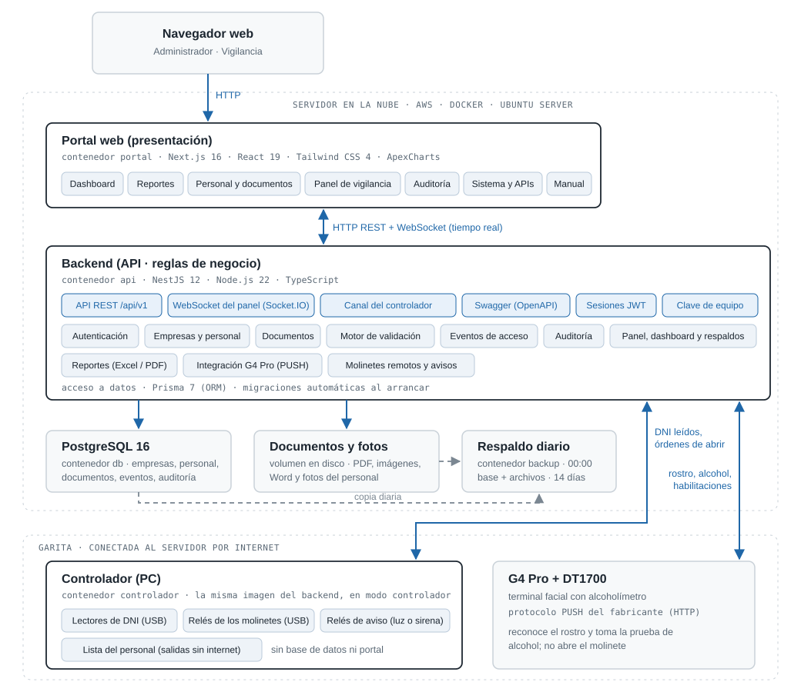

# Documento funcional - Sistema de Control de Accesos

**Terminal Monte Azul Mollendo (TMAM) · Alcance base**

Versión 1.2 · 23 de octubre de 2026

| Versión | Fecha | Descripción |
|---|---|---|
| Final | 30/09/2026 | Versión final. |
| 1.1 | 21/10/2026 | Ingreso con el terminal facial en modo asistencia y sus dos órdenes (DNI → Facial + Alcohol y Facial + Alcohol → DNI) y plazos medidos; verificación manual (con el grado del alcoholímetro de repuesto; también si falla el alcoholímetro); tarjeta de contingencia; contingencia "sin lector"; "Presentes ahora" para el vigilante; orden del ingreso y monitor del terminal en Sistema y APIs; Auditoría con desconexiones de equipos (también del alcoholímetro, revisado cada 10 segundos), aperturas del molinete sin DNI, salida sin DNI, sincronización con el terminal, descargas de reportes y archivos abiertos; aviso de fallas en vivo; HTTPS. |
| 1.2 | 23/10/2026 | Pantalla Usuarios (cuentas de vigilancia; por ahora sin cuentas nuevas) y contraseña del vigilante a cargo del administrador; período de autorización; tarjeta de acceso; tarjeta de contingencia y contingencia sin lector en los dos órdenes; avisos del Panel por su nombre (Orden del ingreso, Salida sin DNI, Contingencia, Verificación manual e Ingreso); lector con el adaptador sin respuesta; buscador de usos de las tarjetas; tabla de pantallas y de APIs al día. |

## Contenido

1. [Introducción](#1-introducción)
2. [Descripción general del sistema](#2-descripción-general-del-sistema)
3. [Usuarios y roles](#3-usuarios-y-roles)
4. [Funcionalidades](#4-funcionalidades)
5. [Reglas de negocio](#5-reglas-de-negocio)
6. [Integración con los equipos del punto de acceso](#6-integración-con-los-equipos-del-punto-de-acceso)
7. [Modelo de datos](#7-modelo-de-datos)
8. [Interfaces (API)](#8-interfaces-api)
9. [Seguridad](#9-seguridad)
10. [Instalación, operación y respaldos](#10-instalación-operación-y-respaldos)
11. [Requisitos no funcionales](#11-requisitos-no-funcionales)
- [Anexo A. Glosario](#anexo-a-glosario)

---

## 1. Introducción

### 1.1. Propósito del documento

Este documento describe el funcionamiento del Sistema de Control de Accesos desarrollado para el Terminal Monte Azul Mollendo (TMAM): qué hace cada módulo, quién lo usa, las reglas de negocio que aplica, cómo se integra con los equipos del punto de acceso y cómo se instala y opera. Está dirigido al cliente, a los usuarios clave (administración y vigilancia) y a quien brinde soporte técnico.

### 1.2. Alcance

Corresponde al **alcance base** acordado: una aplicación web en la que el **administrador** registra a las empresas, a su personal (con foto) y los documentos de cada persona, y un **panel de vigilancia** que muestra en tiempo real cada ingreso y salida por los molinetes, con el motivo cuando se deniega.

**Incluido en el alcance base:**

- Registro de empresas, personal (con foto) y documentos, en un solo formulario.
- Documentos sin flujo de aprobación: tienen validez desde su carga y se pueden agregar, renovar y eliminar.
- Validación del ingreso: persona no dada de baja, al menos un documento, ninguno vencido y prueba de alcohol conforme.
- Panel de vigilancia en tiempo real, Auditoría, Sistema y APIs, y Manual de uso.
- Dos tipos de cuenta: Administrador y Vigilancia.
- Instalación en un servidor local (mini PC) en el punto de acceso, con operación independiente de internet y respaldos diarios.

**Desarrollos adicionales al alcance base, solicitados por el cliente:**

- Dashboard con indicadores (KPI) y gráficos (sección 4.4).
- Reportes en Excel o PDF (sección 4.5).
- Perfil de la persona (sección 4.2): personal de planta, contratista, subcontratista / proveedor, conductor, visita o cliente / mayorista. Solo clasifica: no cambia la validación del ingreso ni los documentos exigidos.
- Antipassback estricto (RN-08a) y orden del ingreso **Facial + Alcohol → DNI** (RN-03).
- Contingencias del punto de acceso: verificación manual si falla el terminal facial o el alcoholímetro, tarjeta de contingencia para el personal sin DNI y contingencia "sin lector" si falla un lector de DNI (sección 4.10 y RN-16 a RN-18). El detalle está en el documento de contingencias.
- Pantalla **Usuarios** (sección 4.11): el administrador cambia el correo o la contraseña de las cuentas, las da de baja o las elimina si nunca se usaron.
- Tarjeta de acceso para visitas y autoridades (por ejemplo, una inspección): la pasa el vigilante por el lector y abre el molinete sin rostro, alcohol ni DNI, en el ingreso y en la salida; queda en el Panel y en los reportes como "Tarjeta de acceso N.º …", sin persona. La crea, imprime, vence, desactiva o le cambia el código el administrador (Contingencias → Tarjetas de acceso).

**Fuera del alcance base:**

- Autoservicio de empresas contratistas: registro, invitación y activación por correo, y carga de su propio personal y documentos.
- Aprobación de documentos como paso aparte, con observaciones y subsanación.
- Perfiles, puestos, zonas o actividades con requisitos de documentos distintos (matriz configurable de requisitos).
- Roles de usuario adicionales (por ejemplo, Auditor), creación de cuentas nuevas desde el portal y recuperación de contraseña por correo.
- Solicitud y agenda de visitas, invitaciones de visita y control de equipos personales y materiales (pase y guía de remisión).
- Auditoría detallada (valor anterior y nuevo, historial de aprobaciones).
- Activos (vehículos, maquinaria y equipos), operadores y checklists.
- Sanciones y restricciones con niveles.
- Credencial digital con QR y colores de fotocheck.
- Panel de vigilancia avanzado y modo contingencia sin conexión.
- Alertas y notificaciones por correo.
- Autenticación de doble factor (MFA).

---

## 2. Descripción general del sistema

### 2.1. Objetivo

Controlar que solo ingrese al terminal el personal habilitado: registrado, no dado de baja, con su documentación vigente y con prueba de alcohol conforme; y dejar registro de cada ingreso, salida y cambio de datos.

### 2.2. Componentes

| Componente | Descripción |
|---|---|
| Portal web | Aplicación web para computadora, tablet y celular. Utilizada por el administrador y el personal de vigilancia desde el navegador. |
| Backend (API) | Aplica las reglas de negocio, almacena la información, recibe los eventos de los equipos y envía los eventos en tiempo real al Panel de vigilancia. |
| Base de datos | PostgreSQL 16. Almacena empresas, personal, documentos, eventos de acceso, usuarios y auditoría. |
| Almacenamiento de archivos | Documentos (PDF, imágenes, Word) y fotos del personal. |
| Respaldos | Copia diaria automática de la base de datos y de los archivos. |
| Equipos del punto de acceso | Terminal facial ZKTeco G4 Pro con alcoholímetro DT1700, dos lectores de DNI Syble XB-7705H, dos molinetes ZKTeco TS2000 Plus. |

### 2.3. Arquitectura

El sistema se ejecuta en un servidor local (**mini PC ubicada junto a los molinetes**), dentro de la red local del terminal, de modo que su operación no depende de la conexión a internet. Cada componente se despliega en un **contenedor Docker**, lo que mantiene los servicios aislados entre sí y del sistema operativo del servidor.

La arquitectura es de tres capas: el **portal web** (presentación), el **backend** (reglas de negocio y API REST) y la **base de datos**. El portal se comunica con el backend por HTTP y recibe los eventos de ingreso y salida en tiempo real por WebSocket. Los equipos del punto de acceso envían los eventos al backend por su API, autenticados con una clave de equipo.

| Contenedor | Función | Acceso |
|---|---|---|
| `portal` | Portal web | Puerto 3000 (navegador) |
| `api` | Backend. Aplica las migraciones de la base de datos al arrancar | Puerto 3001 (equipos y documentación de la API) |
| `db` | Base de datos PostgreSQL | Solo red interna |
| `backup` | Respaldo diario a las 04:00 (base de datos y archivos) | Solo red interna |

Los contenedores se reinician automáticamente ante una falla y se inician junto con el servidor. Acceso: por la red local (`http://192.168.0.165:3000`) o por Tailscale (`http://100.78.153.33:3000`).

**Modalidad con servidor en la nube.** El sistema también puede instalarse con el portal, el backend y la base de datos en un servidor en la nube. **Es la modalidad en uso desde el 16/10/2026, con un servidor en Azure de TMAM** (portal en **https://accesos.monteazulsur.com.pe**, con certificado de seguridad que se renueva solo). En esa modalidad, la mini PC trabaja como **Controlador (PC)**:

- lee los DNI y los envía al servidor por internet, con la clave de equipos;
- recibe del servidor la orden de abrir cada molinete y activa su relé;
- informa al servidor el estado de los lectores y los relés, visible en "Sistema y APIs" (tarjeta "Controlador").

El terminal facial se conecta directamente al servidor en la nube. La conexión entre el punto de acceso y el servidor la inicia el punto de acceso, por lo que no se abren puertos en la red del terminal. Si la conexión se interrumpe, se restablece sola. El comportamiento sin conexión se describe en la sección 10.4.

### 2.4. Tecnologías

| Capa | Tecnología |
|---|---|
| Lenguaje | TypeScript (portal y backend) |
| Portal web | Next.js 16, React 19, Tailwind CSS 4, cliente Socket.IO, ApexCharts (gráficos del Dashboard) |
| Reportes | ExcelJS (Excel), pdfmake (PDF) y archiver (ZIP con los archivos de documentos), generados en el backend |
| Backend | NestJS 12 sobre Node.js 22, API REST versionada (`/api/v1`) |
| Tiempo real | Socket.IO 4 (WebSocket) |
| Acceso a datos | Prisma 7 (ORM y migraciones versionadas) |
| Base de datos | PostgreSQL 16 |
| Seguridad | JWT (Passport), contraseñas cifradas con bcrypt, validación de datos con class-validator, clave de equipo para las APIs de integración |
| Documentación de la API | OpenAPI / Swagger |
| Instalación | Docker y Docker Compose en Ubuntu Server 26.04 |

---

## 3. Usuarios y roles

El sistema tiene dos tipos de cuenta. Las empresas contratistas no tienen cuenta propia: el administrador registra su información.

| Rol | Quién es | Qué hace |
|---|---|---|
| Administrador | Personal de administración de OTP/MAS | Registra empresas, personal y documentos; da de baja o reactiva; administra las cuentas de vigilancia: les cambia el correo o la contraseña, las da de baja o las elimina si nunca se usaron (Usuarios; por ahora no se crean cuentas nuevas); cambia el correo de su propia cuenta; consulta el Panel de vigilancia, la Auditoría y el estado del sistema. |
| Vigilancia | Personal de vigilancia | Visualiza en tiempo real cada ingreso y salida y el motivo de las denegaciones; consulta el estado (vigente o vencido) de los documentos de una persona, sin abrir los archivos; consulta quiénes están dentro ("Presentes ahora"). En las contingencias: activa la verificación manual y decide cada ingreso, pasa la tarjeta de contingencia y abre la salida si el lector de salida está desconectado. Consulta Personal y documentos sin modificar nada. Su contraseña se la cambia el administrador. No puede modificar los datos del personal. |

### 3.1. Permisos por módulo

| Módulo | Administrador | Vigilancia |
|---|---|---|
| Personal y documentos | Ver y modificar | Ver (sin abrir los archivos de los documentos) |
| Dashboard | Ver | — |
| Reportes (Excel y PDF) | Descargar | — |
| Panel de vigilancia | Ver | Ver |
| Presentes ahora | Ver (desde el Dashboard) | Ver (en su menú) y abrir la salida si el lector de salida está desconectado |
| Documentos de una persona (desde el Panel) | Ver | Ver |
| Contingencias → Tarjetas de contingencia y de acceso | Ver y administrar | — |
| Usuarios (cuentas de vigilancia) | Cambiar el correo o la contraseña, dar de baja y eliminar (solo si nunca se usó). Por ahora no se crean cuentas nuevas: solo las dos del sistema | — |
| Auditoría | Ver | — |
| Sistema y APIs | Ver | — |
| Manual | Ver | Ver |
| Cambiar su propia contraseña | Sí | No (se la cambia el administrador) |

### 3.2. Cuentas

- Al instalar el sistema se crean dos cuentas: **admin@monteazulsur.com.pe** (Administrador) y **vigilancia@monteazulsur.com.pe** (Vigilancia), con contraseñas iniciales generadas en la instalación. Las contraseñas se entregan aparte, en la hoja **"Accesos del sistema"** (confidencial), y deben cambiarse en el primer ingreso: la del administrador, desde su menú (Cambiar contraseña); la de vigilancia, el administrador desde Usuarios.
- Por ahora no se crean cuentas nuevas: solo existen esas dos. El administrador cambia el correo o la contraseña de la cuenta de vigilancia en **Usuarios** (sección 4.11). Si el administrador olvida su contraseña, la restablece el soporte técnico (no hay recuperación por correo).

---

## 4. Funcionalidades

### 4.1. Acceso al sistema y cuenta

**Inicio de sesión**

- El acceso se realiza en la pantalla **Iniciar sesión** (`/iniciar-sesion`, por ejemplo `http://192.168.0.165:3000/iniciar-sesion`), con correo electrónico y contraseña. Si las credenciales son incorrectas o la cuenta está dada de baja, se informa el motivo. Al abrir cualquier pantalla sin sesión, el portal lleva a esta.
- La sesión tiene una duración de 1 hora y se renueva automáticamente, hasta un máximo de 7 días: también al volver al portal después de un rato sin usarlo (por ejemplo, tras cerrar la pestaña), sin pedir de nuevo la contraseña. Al expirar los 7 días, o si la cuenta se da de baja o cambia su contraseña, el portal redirige al inicio de sesión. Si el servidor no responde por un momento (por ejemplo, durante una actualización), la sesión no se cierra.
- Con la sesión abierta, la pantalla de inicio de sesión no se muestra: el portal lleva directamente a la pantalla de inicio de cada perfil.
- Al iniciar sesión, el Administrador accede a "Personal y documentos" y Vigilancia al "Panel de vigilancia".
- Direcciones de cada pantalla:

| Pantalla | Dirección | Perfil |
|---|---|---|
| Iniciar sesión | `/iniciar-sesion` | Todos |
| Personal y documentos | `/` | Administrador |
| Personal y documentos (solo consulta) | `/personal` | Vigilancia |
| Empresas | `/empresas` | Administrador |
| Dashboard | `/dashboard` | Administrador |
| Panel de vigilancia | `/vigilancia` | Administrador y Vigilancia |
| Presentes ahora | `/dashboard/presentes` (Administrador) · `/presentes` (Vigilancia) | Administrador y Vigilancia |
| Tarjetas de contingencia | `/contingencias/tarjetas` | Administrador |
| Tarjetas de acceso | `/contingencias/tarjetas-acceso` | Administrador |
| Reportes | `/reportes` | Administrador |
| Usuarios | `/usuarios` | Administrador |
| Auditoría | `/auditoria` | Administrador |
| Sistema y APIs | `/sistema` | Administrador |
| Monitor del terminal facial | `/sistema/monitor` | Administrador |
| Manual | `/manual` | Administrador y Vigilancia |

**Cambio de contraseña**

- Solo el administrador cambia su propia contraseña: desde el menú de usuario (esquina superior derecha), opción "Cambiar contraseña", ingresa la actual y la nueva por duplicado (al menos 10 caracteres, con letras y números, distinta de la actual). Cada campo permite mostrar u ocultar el texto ingresado. La contraseña del vigilante se la cambia el administrador en Usuarios (sección 4.11).
- Al cambiarla, **se cierran las sesiones abiertas en otros equipos**; la sesión actual se mantiene.
- El cambio queda registrado en la Auditoría.

**Otros**

- Cierre de sesión desde el menú de usuario.
- Modo claro u oscuro, a elección de cada usuario.

### 4.2. Personal y documentos (Administrador)

Pantalla principal del administrador. Muestra a la izquierda la lista del personal de todas las empresas y a la derecha (debajo, en dispositivos móviles) la ficha de la persona seleccionada.

**Lista del personal**

- Cada persona muestra un **✔** si está habilitada para ingresar en la fecha o un **✖** con el motivo (dado de baja, sin documentos, documento vencido).
- Cada persona muestra su **perfil**; las registradas antes de que existiera el perfil figuran como "Sin perfil" (en ámbar), para completarlo desde su ficha. "Sin perfil" no es una opción de los filtros.
- Búsqueda por nombre, número de documento o empresa; filtro por **perfil** y por empresa (con un perfil elegido, el filtro de empresas muestra solo las que tienen personal de ese perfil, con cuántos); pestañas "Todos", "No pueden" y "Pueden", con la cantidad de cada una. Dentro de "No pueden" se puede separar "Documentos" (personal activo con documentos sin cargar o vencidos; podrá ingresar al regularizarlos), "Período" (personal activo fuera de su período de autorización) y "De baja"; quien tiene documentos pendientes y está fuera del período aparece en los dos.

**Registrar personal ("+ Nuevo personal")**

Un único formulario permite registrar a la persona y sus documentos:

1. **Perfil** (obligatorio): personal de planta, contratista, subcontratista / proveedor, conductor, visita o cliente / mayorista. Solo clasifica a la persona (lista, Dashboard y reportes); el molinete valida a todos por igual.
2. **Empresa:** se elige de la lista de empresas activas. Si no está, el enlace "¿No está? Regístrala en Empresas." abre esa vista en otra pestaña (sin perder lo escrito) y, al volver, la lista se actualiza sola. Con el perfil elegido, la lista muestra primero las empresas que ya tienen personal de ese perfil (con cuántos) y después las demás.
3. **Datos del personal:** tipo de documento (DNI, carné de extranjería o pasaporte), número, nombres y apellidos.
4. **Foto** (obligatoria): de frente y con buena luz; JPG, PNG o WEBP de hasta 5 MB. El sistema la envía al terminal facial, que la usa para reconocer a la persona; no es necesario registrar el rostro en el equipo.
5. **Documentos** (al menos uno): nombre del documento, elegido de una **lista fija** (desde el 22/10/2026): SCTR Salud y Pensión; Certificado de Aptitud Médico Ocupacional (CAMO); Certificado de Inducción SSMA – Visitas, – Contratistas o – Personal de Planta, fecha de vencimiento (en blanco si no tiene vencimiento; no se acepta una fecha ya pasada, porque el documento quedaría vencido al instante) y archivo (PDF, JPG, PNG, WEBP o Word, hasta 20 MB). Se pueden agregar varios.

Si ocurre un error durante el registro (por ejemplo, un archivo no válido), la información ya guardada no se duplica al corregir y volver a guardar.

**Carga masiva de personal ("Carga masiva")**

Registra a muchas personas a la vez desde un Excel (hasta 2000 por archivo, 5 MB):

1. **Plantilla:** "Descargar plantilla" entrega un Excel con la hoja "Personal" (columnas Perfil, Empresa, Tipo de documento, Número de documento, Nombres y Apellidos, y las opcionales Fecha de ingreso, Fecha de finalización y Motivo de la autorización (el período de RN-19; una plantilla anterior, sin ellas, sigue sirviendo); perfil, empresa —las activas del sistema— y tipo de documento con listas desplegables; el número de documento como texto, para no perder los ceros de adelante) y la hoja "Instrucciones".
2. **Revisión (no guarda nada):** al subir el archivo, el sistema revisa cada fila con las mismas reglas del registro uno por uno y la marca como **Lista**, **Ya registrada** (el documento ya existe, activo o dado de baja: se omite) o **Con error**, con su motivo: falta un dato, perfil o tipo de documento desconocido, DNI que no tiene 8 dígitos, empresa no registrada o inactiva (se acepta su razón social, sin importar mayúsculas, tildes ni puntos, o su RUC) o documento repetido en el mismo archivo. Las columnas se ubican por su título y las filas vacías se saltan.
3. **Registro:** solo se habilita si **ninguna fila tiene error** (mientras haya errores, la revisión se abre directamente en "Con error", el botón dice "Corrige las filas con error" y un aviso rojo dice "El archivo tiene errores. Corrígelos y vuelve a subirlo."; las filas "Ya registradas" no lo impiden, se omiten). "Registrar N personas" guarda las filas listas, una por una, igual que el formulario (queda en la auditoría y se envían al terminal facial). Si alguna cambió desde la revisión (por ejemplo, otro usuario la registró), se omite y se informa.
4. **Filas con error:** "Descargar filas con error" entrega la misma plantilla con esas filas, una columna "Motivo" y la celda de cada error pintada de rojo claro (también si está vacía), para corregirlas y volver a subir el archivo.

La carga masiva no incluye foto ni documentos (se agregan en la ficha de cada persona; sin ellos no puede ingresar) y no crea empresas: una empresa que no existe se registra primero en **Empresas**, para evitar duplicados por cómo se escribió el nombre.

**Ficha de la persona**

- Datos, empresa y foto ("Cambiar foto"). **Perfil** junto al nombre.
- **Editar datos:** corrige el perfil, la empresa, el tipo y número de documento, los nombres y los apellidos (se valida igual que al registrar: DNI de 8 dígitos y sin repetir). Si cambia el número o el nombre, el terminal facial se actualiza solo (con un número nuevo se borra el anterior y se registra el nuevo con su foto); los ingresos y salidas anteriores conservan el documento con el que se registraron. El cambio queda en la auditoría. Si no tiene foto, se advierte que no podrá identificarse en el terminal.
- Recuadro de estado: "Puede ingresar hoy (sujeto a la prueba de alcohol al ingresar)" o "No puede ingresar" con los motivos.
- **Documentos actuales:** nombre, vencimiento y estado (Vigente / Vencido), con las acciones:
  - **Ver:** abre el archivo cargado en una pestaña nueva (PDF o imagen); si es Word, lo descarga.
  - **Renovar:** registra una nueva versión del documento (nuevo vencimiento y archivo); la anterior pasa al historial.
  - **Eliminar:** elimina el documento con todas sus versiones y archivos, previa confirmación.
  - **+ Agregar documento:** agrega un documento que la persona no tenía.
- **Historial de documentos:** todas las versiones cargadas, con la marca "Reemplazado" en las anteriores; cada versión se puede ver ("Ver").
- **Dar de baja / Reactivar:** la persona dada de baja no puede ingresar, sin importar sus documentos (sí puede salir). Al dar de baja y al reactivar se escribe el **motivo** (obligatorio desde el 22/10/2026, hasta 300 caracteres). El de la baja queda con la fecha y se muestra en la ficha, en la lista ("Dado de baja: …") y en el reporte de personal; el de la reactivación se muestra en la ficha ("Reactivado el …: motivo") mientras siga activo. Los dos quedan en la Auditoría ("Dio de baja a … / Reactivó a … (DNI …). Motivo: …"). Los dos piden confirmación; al reactivar, si tiene documentos vencidos o ninguno cargado, se avisa que aun así no podrá ingresar hasta regularizarlos. Sus datos, documentos e historial se conservan.
- **Período de autorización** (RN-19): en "Nuevo personal" y, después, en el recuadro "Período de autorización" de la ficha ("Guardar período" / "Quitar período"), opcional (fecha de ingreso, fecha de finalización y motivo). La ficha muestra "Autorizado del … al …. Motivo: …"; fuera del período, "No puede ingresar — Fuera del período autorizado (del … al …)" y la lista muestra la ✖ con ese motivo.

**Empresas (menú "Empresas")**

- Tabla con razón social y RUC, contacto (correo y teléfono), **personal activo** (cuántas personas activas tiene) y estado (Activa / Inactiva); búsqueda por razón social o RUC (sin importar tildes), filtro Todas / Activas / Inactivas y 10 por página.
- **+ Nueva empresa:** RUC de 11 dígitos (sin repetir), razón social, correo de contacto y teléfono opcional. Es el único lugar donde se registran empresas.
- **Editar:** corrige RUC (sin repetir), razón social, correo o teléfono; el personal no cambia. Si no se cambió nada, avisa "No cambiaste ningún dato."
- **Desactivar / Activar** (con confirmación): una empresa inactiva no aparece al registrar o editar personal ni en la plantilla de la carga masiva. **Su personal no se da de baja** y sigue pudiendo ingresar si tiene sus documentos al día; al desactivar una empresa con personal activo se avisa cuántas personas son, para darlas de baja si ya no deben entrar.
- **Eliminar** (con confirmación): solo para empresas **sin ninguna persona** (ni dada de baja) y sin usuarios del portal, por ejemplo una registrada por error. Se borra definitivamente. Las demás no se pueden eliminar (su personal, documentos e ingresos dependen de ella): se desactivan; al pasar el mouse sobre "Desactivar" se explica.
- Todo cambio queda en la auditoría.

### 4.3. Panel de vigilancia (Administrador y Vigilancia)

- **Tiempo real:** cada ingreso o salida se muestra en la tabla en el momento en que ocurre, sin recargar la página; la fila del último evento se resalta durante unos segundos. Si la conexión en vivo se corta (internet o una actualización del servidor), el panel se reconecta solo y recupera lo que ocurrió mientras tanto; además, se pone al día cada minuto.
- **Contadores:** "Accesos restringidos hoy", "Prueba de alcohol test positivo hoy" y "Documentos vencidos" (documentos del personal activo que ya vencieron). Se actualizan automáticamente.
- **Historial:** hora, documento, persona (con su perfil), movimiento (ingreso o salida), resultado (autorizado o denegado) y motivo, paginado de 10 registros por página.
- **Filtros:** por día (por defecto **hoy**; "Hoy" y "Todos los días"; no se pueden elegir días futuros) y búsqueda por nombre, apellido o número de documento en todo el historial.
- **Motivos:** No registrado, Dado de baja, Sin documentos, Documentos, Alcohol, Ya figura dentro, No registra ingreso, Fuera del período autorizado, No completó rostro y alcohol, DNI antes del facial, No pasó su DNI a tiempo y No es quien sopló (se muestran todos los que apliquen). Al hacer clic en "Documentos ›" se abre una ventana con los documentos de la persona, indicando cuáles debe regularizar. El administrador puede además abrir cada documento ("Ver"); vigilancia solo ve su estado.
- Los intentos con un documento **no registrado** también quedan en el historial.
- **Ingreso en curso**, según el orden del ingreso (RN-03):
  - **DNI → Facial + Alcohol:** al pasar un DNI en regla aparece al instante en la primera fila con resultado **"en espera"**, su **foto**, el motivo "Esperando rostro y alcohol", el tiempo que le queda (1 minuto) y una barra que se va vaciando. Al llegar el resultado del terminal facial, la fila pasa a ser el ingreso autorizado o denegado; si no hizo la prueba, queda denegado con "No completó rostro y alcohol".
  - **Facial + Alcohol → DNI:** al decir el terminal "correcto", aparece **"Aprobó [nombre] · pase su DNI"**, con su foto y una cuenta de **30 segundos**. Si no pasa su DNI a tiempo, queda "No pasó su DNI a tiempo".
- **Marcas** junto al motivo: "Tarjeta de contingencia", "Tarjeta de acceso" (sin persona: "Tarjeta de acceso N.º …"), "Sin lector de DNI: identificado por rostro", "Salida sin lector", "Corrección manual" y la verificación manual, con quién decidió.
- **Salida sin DNI:** botón para elegir a quien sale sin DNI (solo quienes figuran dentro); después el vigilante pasa la tarjeta de contingencia por el lector de salida (RN-17). El aviso **Salida sin DNI** muestra a quién y cuánto tiempo queda (2 minutos).
- **Avisos** arriba del Panel, cada uno con su nombre y una píldora de color:
  - **Orden del ingreso:** el orden activo y qué hacer (en los dos órdenes; no se muestra durante la verificación manual).
  - **Salida sin DNI:** el personal elegido y el tiempo que queda (RN-17).
  - **Contingencia:** lector de DNI de ingreso o de salida sin conexión o con el adaptador sin respuesta (RN-18); el de salida, con el botón "Ir a Presentes ahora".
  - **Verificación manual:** activa, con desde cuándo, quién la activó y el motivo (RN-16); en verde, cuando el equipo volvió a conectarse, pregunta si volver a modo normal.
  - **Ingreso:** una persona no completó rostro y alcohol, con la hora y el botón "Activar verificación manual"; se cierra con la ✕ o solo, cuando la siguiente persona entra bien.
- **Aviso de servidor fuera de servicio:** si el servidor deja de responder, se muestra "El servidor no responde — no se están validando ingresos" (verificación cada 15 segundos).

### 4.4. Dashboard (Administrador)

Pantalla de indicadores y gráficos, calculados a partir de los ingresos y salidas registrados. Cuenta los **ingresos** autorizados de las personas (de cualquier perfil) y sus salidas. Se actualiza en tiempo real con cada ingreso o salida, y cada minuto.

| Indicador | Cálculo |
|---|---|
| Presentes actualmente | Personas cuyo último movimiento autorizado es un ingreso, sin importar cuándo entraron. Se indica cuántas ingresaron en el periodo y cuántas antes (por ejemplo, las de permanencia mayor a 12 horas).  Al presionar la tarjeta se abre la vista **Presentes ahora** (`/dashboard/presentes`) con la lista de quiénes son (persona, perfil, empresa, hora de ingreso y tiempo dentro; de mayor a menor permanencia, en naranja más de 12 horas), con buscador, filtro por perfil y descarga en Excel. El vigilante también la ve (en su menú, sin la descarga) y, con el lector de salida desconectado, abre desde ahí la salida de cada persona (RN-18) |
| Ingresos finalizados | Ingresos del periodo que ya registraron su salida. |
| Total de ingresos | Ingresos autorizados en el periodo. |
| Permanencia mayor a 12 horas | Personas que ingresaron hace más de 12 horas y no registran salida. |

- **Periodo:** hoy, últimos 7 días, este mes o un rango personalizado (hasta 366 días).
- **Gráficos:** comparativa de ingresos presentes (aún sin salida) y finalizados; distribución de presentes frente a finalizados; ingresos autorizados, denegados y salidas por día; motivos de denegación; documentos del personal activo (vigentes, por vencer en los próximos 30 días y vencidos) y personal activo por empresa; **ingresos por perfil**: ingresos autorizados del periodo según el perfil de la persona ("Sin perfil" al final); y **horas-hombre por empresa**: suma del tiempo dentro del terminal en el periodo, de cada ingreso autorizado a su salida autorizada, de mayor a menor (8 empresas y "Otras"); una visita que cruza el periodo suma solo sus horas dentro de él y solo cuentan las visitas completas (ingreso y salida por el molinete).
- **Personal registrado:** total de personas, barra con la proporción de activos y dados de baja (con sus porcentajes) y cuántas personas del personal activo están en el terminal en ese momento.
- **Lista de permanencia mayor a 12 horas:** persona, documento, empresa, fecha de ingreso y tiempo dentro; de mayor a menor permanencia, paginada de 10 registros por página.

- **Acceso:** solo el Administrador, desde la opción "Dashboard" del menú.
- **Interfaces:** `GET /panel/dashboard` (indicadores y gráficos del periodo), `GET /panel/dashboard/presentes` (todas las personas dentro ahora; también Vigilancia) y `GET /panel/dashboard/permanencia` (lista paginada de la permanencia mayor a 12 horas).

Todos entran y salen por el molinete. La única excepción es una emergencia con los brazos del molinete liberados: quienes salgan así seguirán figurando como presentes hasta que el vigilante registre su salida manual (antipassback, RN-08a).

### 4.5. Reportes (Administrador)

Descarga de la información del sistema en **Excel** o **PDF**. Se elige el reporte, sus filtros y el formato.

| Reporte | Contenido | Filtros |
|---|---|---|
| Personal y empresas | Apellidos, nombres, documento de identidad, empresa y RUC, perfil, estado, si puede ingresar (con el motivo si no puede), período autorizado y su motivo, cantidad de documentos y fecha de registro. | Empresa; perfil; activos o dados de baja. |
| Documentos por persona | Última versión de cada documento: persona, empresa, perfil, documento, versión, fecha de carga, vencimiento, días para vencer y estado (vigente, por vencer en 30 días o vencido). Primero los más urgentes. | Empresa; perfil; estado del documento. |
| Ingresos y salidas | Historial en orden cronológico: fecha y hora, movimiento, resultado, documento, persona, empresa, perfil, motivo de denegación y molinete. | Periodo; perfil; ingresos o salidas; autorizados o denegados. |
| Ingresos del periodo | Cada ingreso autorizado con su salida, duración y estado (finalizado o presente). | Periodo; perfil. |
| Horas-hombre | Por empresa: personas, ingresos y horas-hombre (en horas:minutos, por ejemplo 61:01 = 61 horas y 1 minuto). En otra hoja, el detalle por persona. Solo cuentan los ingresos con su salida por el molinete; quien sigue dentro suma cuando marca la salida. Mismo cálculo que el indicador del Dashboard. | Periodo, empresa y perfil. |
| Personal presente | Personas dentro del terminal en el momento de la descarga, con hora de ingreso, tiempo dentro y si superan las 12 horas. | Perfil. |
| Empresas por perfil | Cada empresa con cuántas personas activas tiene de cada perfil (y "Sin perfil"). Con un perfil elegido, solo las empresas que lo tienen, de más a menos. | Empresa; perfil. |
| Auditoría | Fecha y hora, usuario, acción (crear, modificar o eliminar), dato y número de registro. | Periodo. |

- **Periodo:** hoy, últimos 7 días, este mes o un rango personalizado (hasta 366 días).
- **Excel:** título, filtros y fecha de generación arriba; cabecera fija con filtros de Excel; fechas como fechas (se pueden ordenar y filtrar); totales al final; y una última hoja, **Leyenda**, con lo que significa cada columna.
- **PDF:** A4 horizontal, con la cabecera de la tabla repetida en cada página, número de página, totales y la leyenda de las columnas al final.
- **Documentos con archivos (ZIP):** el reporte de documentos también se descarga en un ZIP con el mismo Excel y los archivos de cada documento, en carpetas por empresa y persona (por ejemplo `archivos/DEMO_Transportes_del_Sur_S.A.C/Apaza_Condori_Jorge_Luis_99010001/SCTR_Salud_v1.pdf`; nombres sin espacios, tildes ni ñ para que los enlaces no fallen). Cada fila del Excel tiene un enlace "Abrir" que abre su archivo, sin conexión ni sesión, **después de descomprimir el ZIP** (clic derecho → Extraer todo) y abrir el Excel desde la carpeta extraída. Opcionalmente incluye también los documentos anteriores que fueron renovados (en el Excel figuran como "Reemplazado") y las **fotos del personal** (cada foto en la carpeta de su persona, `foto.jpg`, y una columna "Foto" con su enlace "Abrir"). Respeta los filtros de empresa y estado; hasta 2 GB de archivos por descarga.
- Hasta 100 000 filas por reporte en Excel (alcanza para un mes de movimientos con miles de personas) y hasta 20 000 en PDF y en el ZIP de documentos; si se supera, se pide acotar el periodo o los filtros.
- **Interfaz:** `GET /reportes/:tipo?formato=xlsx|pdf` con los filtros de cada reporte; `formato=zip` (con `incluirAnteriores=true` e `incluirFotos=true` opcionales) solo en documentos.

### 4.6. Auditoría (Administrador)

- Registro de solo lectura que indica qué usuario creó, modificó o eliminó cada dato y en qué fecha: personal, empresas, documentos, tipos de documento y usuarios.
- **Desconexiones de equipos** (desde el 21/10/2026): cada vez que un equipo o servicio se desconecta y cada vez que vuelve, a nombre de "Sistema", con cuánto tiempo estuvo sin conexión. Cubre el terminal facial, el alcoholímetro (desconectado del terminal), el Controlador (PC) (también un corte de internet en el punto de acceso), los lectores de DNI (con la contingencia "sin lector"), los relés de los molinetes y de aviso, la base de datos y los respaldos atrasados. Se revisa cada 5 segundos; se busca con "equipos".
- **Otras acciones** (desde el 21/10/2026), con quién y el detalle: **apertura manual** del molinete sin DNI (por la API, o "Salida sin lector" desde Presentes ahora), **Salida sin DNI** (elegir al personal y cancelar), **sincronización** con el terminal facial (simular, "Sincronizar ahora", la revisión diaria a nombre de "Sistema", y activarla o desactivarla), **descarga** de cada reporte (cuál, formato y filtros) y **consulta** del archivo de un documento (cuál y de quién).
- Búsqueda por usuario o por tipo de dato ("personal", "documento"…) y filtro por rango de fechas ("Desde" / "Hasta"), paginado de 10 registros por página.

### 4.7. Sistema y APIs (Administrador)

- **Estado:** backend y base de datos ("En línea" / "Sin conexión"), clave de los equipos ("Configurado"), **respaldos** (fecha y tamaño del último; "Al día" o "Atrasado" si transcurren más de 26 horas), **equipos** (cada terminal G4 Pro "En línea" o "Desconectado", con su última actividad), **alcoholímetro** ("Conectado" o "Desconectado" del terminal facial, con la hora de la última revisión: el servidor le pregunta al terminal cada 10 segundos si lo ve conectado; si está conectado pero no mide, no se nota aquí) y **lectores de DNI** de ingreso y salida ("Cable conectado", "Cable desconectado", "Adaptador sin respuesta" o "Sin configurar", con la hora de su última lectura; el estado corresponde al cable de datos, ya que el lector solo envía información al leer un DNI; el controlador pregunta cada 30 segundos a cada adaptador si responde y, si está trabado, lo marca sin respuesta y activa la contingencia sin lector) y **relés de los molinetes** ("Conectado" o "No conectado" para ingreso y salida, con la última apertura). Se actualiza en el momento en que un equipo se cae o vuelve (el servidor revisa cada 5 segundos) y, además, cada 15 segundos.
- **Aviso de fallas en todo el portal:** cuando algo de esta pantalla está caído (base de datos, respaldos atrasados, controlador, terminal facial, alcoholímetro, lectores de DNI o relés), aparece un aviso en la parte superior de cualquier página, **para el administrador y para el vigilante** (que así puede informarlo). Muestra un recuadro por cada tarjeta en falla de Sistema y APIs, en rojo como en esa pantalla, con su estado, qué deja de funcionar (por ejemplo, "Nadie puede ingresar") y la última vez que estuvo en línea. El administrador tiene además un enlace a Sistema y APIs. Se actualiza en el momento en que un equipo se cae o vuelve, junto con las tarjetas de esta pantalla (además, se consulta cada 30 segundos), y desaparece solo cuando todo vuelve a estar en línea. El terminal facial y el controlador figuran caídos a los ~20 segundos sin contacto; los lectores y relés, en segundos; el alcoholímetro, en unos 10 segundos. Se puede contraer; se vuelve a abrir si falla algo distinto.
- **Sincronización con el terminal facial:** un interruptor activa o desactiva la **revisión diaria** y permite elegir su hora (al activarla pide confirmación, porque borra del terminal a quien el sistema no conoce); el resultado de la última (personas agregadas, usuarios borrados, permisos quitados y usuarios del terminal que el sistema no conoce) y los botones **Simular** y **Sincronizar ahora** (con confirmación). La tarjeta del terminal muestra cuántos usuarios y rostros tiene.
- **Orden del ingreso:** dos interruptores que se excluyen, **DNI → Facial + Alcohol → Molinete** y **Facial + Alcohol → DNI → Molinete**, con los pasos de cada uno, quién lo cambió y desde cuándo (RN-03).
- **Monitor del terminal facial** (`/sistema/monitor`): cada prueba que envía el terminal (persona, grado de alcohol, hora de la prueba, hora de llegada y demora) y qué hizo el sistema con ella; por día, con búsqueda y en vivo.
- **Documentación de las APIs de integración** con ejemplos de uso y su estado ("Disponible", "Simulado" o "Por programar"), y enlace a la documentación interactiva (Swagger).

### 4.8. Manual

Guía de uso dentro del portal, con secciones para cada rol: introducción, personal y documentos, empresas, panel de vigilancia (con la tarjeta de contingencia, el lector de DNI caído y la verificación manual), presentes ahora, tarjetas, dashboard, reportes, auditoría, sistema y APIs, usuarios, y cuenta y contraseña. La introducción incluye un diagrama del recorrido de ingreso y de salida por el punto de acceso (el ingreso, en el orden activo, con el tiempo de cada paso y una línea de tiempo medida con el equipo real), y las secciones de uso diario muestran capturas de la pantalla con números que señalan cada parte y, debajo, qué hace cada una; un clic amplía la captura. Se muestra una sección a la vez, elegida en el índice (o con "Anterior" y "Siguiente"); cada sección tiene su propio enlace (por ejemplo `/manual#reportes`).

### 4.9. Características generales del portal

- Fechas en formato día-mes-año y hora de Lima.
- Diseño adaptable a computadora, tablet y celular (menú desplegable, tablas desplazables, tarjetas).
- Selector de fechas con semanas de lunes a domingo: la fecha se puede escribir (los separadores se insertan automáticamente) o seleccionar en el calendario, que se abre desde el ícono.
- Mensajes de error claros con la opción "Reintentar" cuando no se puede cargar la información.

### 4.10. Contingencias (Administrador)

Menú **Contingencias**, con dos pantallas que funcionan igual: **Tarjetas de contingencia** (en lugar del DNI del personal, RN-17) y **Tarjetas de acceso** (abren solas, para visitas y autoridades; cada tipo con su numeración). Cada tarjeta se muestra como un carné, en un carrusel, con su último uso y sus acciones:

- **Crear** con vencimiento ("No vence" o "Vence un día") e **imprimir** en tamaño carné (85,6 × 54 mm), con vista previa en el portal. El QR lleva un código al azar, sin datos de ninguna persona; no se muestra en el portal.
- **Cambiar el vencimiento**, **desactivar / activar**, **cambiar el código** (si se pierde o se copia: la impresa queda anulada) y **eliminar** (solo si nunca se usó).
- **Usos de las tarjetas:** cada vez que se pasó una tarjeta, aceptada o no, con el personal o el motivo; de 5 en 5 y con un buscador por número de tarjeta, personal (nombre o DNI) o motivo.
- La guarda el vigilante y la pasa por el lector. Todo cambio queda en la Auditoría.

### 4.11. Usuarios (Administrador)

Lista las cuentas del sistema, cada una con su tipo, su estado y la fecha en que se creó:

- **Cambiar correo**, en todas las cuentas (también la propia): se entra con el correo nuevo y la misma contraseña, y se cierran sus sesiones abiertas. Un correo que ya existe no se acepta.
- En la cuenta de vigilancia, además: **Cambiar contraseña** (se cierran sus sesiones y debe entrar con la nueva), **Dar de baja** (ya no puede entrar; su historial se conserva) o **Reactivar**, y **Eliminar**, solo si la cuenta nunca se usó.
- Por ahora **no se crean cuentas nuevas**: solo existen las dos del sistema (sección 3.2). El servidor rechaza la creación.
- Todo cambio queda en la Auditoría.

---

## 5. Reglas de negocio

| Código | Regla |
|---|---|
| RN-01 | **Ingreso autorizado** solo si la persona está registrada, no está dada de baja, tiene al menos un documento cargado, ninguno de sus documentos está vencido y la prueba de alcohol es conforme. |
| RN-02 | Una persona **dada de baja** se deniega de inmediato, sin evaluar las demás condiciones. |
| RN-03 | El ingreso se valida con el **DNI** (baja, documentos y antipassback) y con la **prueba de rostro y alcohol** del terminal facial, que informa quién sopló y el grado de alcohol (modo asistencia, desde el 19/10/2026). El **orden del ingreso** se elige en Sistema y APIs: **DNI → Facial + Alcohol** o **Facial + Alcohol → DNI** (en uso). Si todo es conforme, se abre el molinete; si el alcohol supera el umbral, se deniega por alcohol, con su nombre. |
| RN-03a | **DNI → Facial + Alcohol:** sin documentos o con alguno vencido se deniega al pasar el DNI. Si están en regla, tiene **1 minuto para hacer rostro y alcohol**; vale solo la prueba hecha después del DNI y soplada dentro del minuto, aunque el aviso del terminal llegue después (llega unos 10 a 17 segundos después del soplido). Si no la hace, se deniega con **"No completó rostro y alcohol"**. Varias personas pueden esperar a la vez. |
| RN-03b | **Facial + Alcohol → DNI:** todo el personal registrado puede hacer la prueba sin pasar antes el DNI. Al decir el terminal "correcto" (unos 20 segundos desde que mira al equipo), el Panel muestra "pase su DNI" y la persona tiene **30 segundos** para pasarlo; los documentos se revisan con el DNI. Si no lo pasa a tiempo: **"No pasó su DNI a tiempo"**; si pasa el DNI sin una prueba suya: **"DNI antes del facial"**; si sopló otra persona: **"No es quien sopló"**. Cada aprobación es de quien sopló, así que varias personas pueden esperar a la vez. |
| RN-04 | Un documento está **vigente** si no tiene fecha de vencimiento o si vence hoy o después: el día de su vencimiento sigue siendo válido todo el día. Al cargarlo o renovarlo no se acepta una fecha de vencimiento anterior a hoy. |
| RN-05 | De cada documento **cuenta solo la última versión**. Renovar crea una versión nueva y la anterior queda en el historial. |
| RN-06 | Los documentos **no requieren aprobación**: tienen validez desde su carga. Verificar que correspondan a cada persona es responsabilidad del administrador. |
| RN-07 | **Eliminar** un documento borra todas sus versiones y archivos. Si era el único, la persona queda "sin documentos" y no puede ingresar. |
| RN-08 | **Salida:** se autoriza a toda persona registrada, **incluso dada de baja**, siempre que tenga **un ingreso registrado antes** (RN-08a). |
| RN-08a | **Antipassback estricto** (decisión del cliente, 17/10/2026): no se puede **ingresar** si el último movimiento autorizado de la persona es un ingreso (motivo **"Ya figura dentro"**), ni **salir** si no lo es (motivo **"No registra ingreso"**). En ambos casos no se abre el molinete y suena el aviso de denegado. **Corrección manual:** el vigilante o el administrador, desde el movimiento denegado en el Panel de vigilancia, registra la salida ("Registrar salida manual") o el ingreso ("Registrar ingreso manual") que faltan, con un **motivo obligatorio**; no abre el molinete (después la persona vuelve a pasar su DNI). La corrección queda marcada como "Corrección manual" en la tabla, en el reporte de ingresos y salidas (columna "Verificación", con quién y el motivo) y en la auditoría, y no suma horas-hombre. **Excepción:** sin internet, el controlador deja salir con la lista del personal guardada (no puede saber quién está dentro); esas salidas se registran como autorizadas al volver la conexión. |
| RN-09 | Un documento de identidad **no registrado** se deniega, tanto en el ingreso como en la salida, y el intento queda en el historial. |
| RN-10 | **Documento de identidad:** el DNI tiene 8 dígitos; el carné de extranjería y el pasaporte, letras y números. Se guarda sin espacios y en mayúsculas. No puede haber dos personas con el mismo tipo y número. |
| RN-11 | Los **nombres de documento** se eligen de una lista fija de cinco (sección 4.2); los escritos a mano antes del 22/10/2026 siguen valiendo y se renuevan con su nombre. No distinguen mayúsculas. |
| RN-12 | **Foto** obligatoria al registrar al personal: JPG, PNG o WEBP de hasta 5 MB. **Archivos de documentos:** PDF, JPG, PNG, WEBP o Word, hasta 20 MB. |
| RN-13 | **Contraseñas** de al menos 8 caracteres. Al cambiarla se cierran las demás sesiones de esa cuenta. |
| RN-14 | Toda creación, modificación o eliminación de datos queda en la **Auditoría** con el usuario y la fecha; también los inicios de sesión, las aperturas del molinete sin DNI, la salida sin DNI, la sincronización con el terminal facial, las descargas de reportes, los archivos de documentos abiertos y cada desconexión y vuelta de los equipos (a nombre de "Sistema"). |
| RN-15 | "Hoy" y los vencimientos se calculan con la **hora de Lima**, independientemente de la configuración del servidor. |
| RN-16 | **Verificación manual** (falla del terminal facial o del alcoholímetro): la activan el vigilante o el administrador desde el Panel (en el aviso rojo del terminal o del alcoholímetro, o en el aviso Ingreso, cuando alguien no completó rostro y alcohol). Al pasar un DNI en regla, el Panel muestra su foto; el vigilante compara el rostro, toma la prueba con el alcoholímetro de repuesto y escribe el grado (mg/L), y **el sistema decide** con el mismo umbral del terminal; si el repuesto no muestra el número, el vigilante elige "Marcó apto" o "Marcó alcohol" y queda "sin número". Tiene 2 minutos. Queda marcado "Manual", con el grado y quién decidió. |
| RN-17 | **Tarjeta de contingencia** (personal sin DNI o DNI que el lector no lee): sola no abre. En el ingreso, con el orden Facial + Alcohol → DNI, el vigilante la pasa en lugar del DNI y entra quien aprobó rostro y alcohol, con sus documentos revisados (si hay dos personas esperando a la vez, no abre). Con el orden DNI → Facial + Alcohol, la tarjeta va primero, en lugar del DNI: quien hace rostro y alcohol en el minuto siguiente entra a su nombre (el terminal facial dice quién es), con sus documentos revisados; una tarjeta a la vez. En la salida, el vigilante elige al personal en el Panel ("Salida sin DNI") y tiene 2 minutos para pasarla. Desactivada, vencida o con el código cambiado, no abre y suena el aviso. Cada uso queda registrado. |
| RN-18 | **Contingencia "sin lector":** con el lector de DNI de una puerta desconectado y el controlador en línea, se activa sola y se avisa en el Panel. Ingreso (en los dos órdenes): quien aprueba rostro y alcohol entra sin pasar el DNI, con sus documentos revisados ("Sin lector de DNI: identificado por rostro"). Salida: el vigilante la abre desde "Presentes ahora" a quien figura dentro ("Salida sin lector", con quién la abrió). Termina sola al volver el lector. |
| RN-19 | **Período de autorización** (opcional, 22/10/2026): al registrar o editar a una persona se puede fijar una **fecha de ingreso**, una **fecha de finalización** (las dos incluidas) y el **motivo**; si se pone, van los tres. Fuera de ese período el ingreso se deniega ("Fuera del período autorizado"), aunque tenga sus documentos al día; la salida siempre se permite. Sin período, no hay límite de fechas. Queda en la Auditoría. |

---

## 6. Integración con los equipos del punto de acceso

| Parte | Descripción |
|---|---|
| API de ingreso y salida (con clave de equipo) | Aplica las reglas, guarda el evento y lo muestra en tiempo real. |
| Apertura de los molinetes | Un módulo de relés USB por molinete, conectado al servidor: al autorizar una salida, o un ingreso aprobado por el terminal facial, el sistema activa el relé del molinete durante 1 segundo. |
| Aviso de ingreso denegado | Un relé adicional (contacto seco) que se activa cada vez que se deniega un ingreso, por cualquier motivo: no registrado, dado de baja, documentos, alcohol o no completó la verificación facial (incluido el rostro no reconocido). Permite conectar una luz, una sirena o un tablero de vigilancia. |
| Aviso de salida denegada | Otro relé (contacto seco) que se activa cuando se pasa por la salida un DNI no registrado, también si el punto de acceso está sin conexión a internet. |
| Lectores de DNI | Dos lectores de código de barras (ingreso y salida) conectados por RS232 al Controlador (PC). Leen el código de barras del reverso del DNI (y el QR de la tarjeta de contingencia); el sistema registra el ingreso o la salida según el lector. |
| Registro del personal en el terminal facial | Al registrar o editar a una persona, el sistema la carga en el terminal con su número de documento y su nombre; al cargar o cambiar su foto, se la envía y el terminal la usa para reconocerla. Se registran con el número de su documento (DNI, carné de extranjería o pasaporte). Todos los días el sistema revisa el terminal y lo deja igual al registro: borra a quien no está registrado en el sistema y agrega a quien falte. El personal no debe registrarse directamente en el terminal. |
| Prueba de rostro y alcohol | El terminal facial trabaja en **modo asistencia** (desde el 19/10/2026): reconoce a todo el personal registrado, le toma la prueba con el alcoholímetro y envía al sistema quién sopló, la hora del soplido y el **grado de alcohol**. El sistema lo compara con el **umbral** (0,0001 g/L, el mismo configurado en el equipo) y decide según el orden del ingreso (RN-03). El terminal dice "correcto" unos 8 segundos después de medir y el aviso llega al sistema alrededor de 1 segundo después. |
| Habilitación en el terminal facial | Solo con el terminal en modo control de acceso (el usado hasta el 19/10/2026): durante su minuto de espera, solo la persona del DNI tenía permiso de paso. |

---

## 7. Modelo de datos

| Entidad | Contenido principal |
|---|---|
| Empresa | RUC (único), razón social, correo y teléfono de contacto, estado (activa / inactiva). |
| Persona (personal) | Empresa, perfil (vacío en las registradas antes de que existiera), tipo y número de documento de identidad (únicos juntos), nombres, apellidos, foto, estado (activo / dado de baja). |
| Tipo de documento | Nombre (único, sin distinguir mayúsculas), de la lista fija, por ejemplo "SCTR Salud y Pensión". |
| Documento de la persona | Persona, tipo de documento, fecha de vencimiento (opcional), archivo y número de versión. |
| Evento de acceso | Persona (vacía si no está registrada), documento leído, ingreso o salida, resultado, motivos de denegación, fecha y hora, molinete; y cómo se verificó: facial primero (con quién sopló), verificación manual o corrección manual (con quién), tarjeta de contingencia o sin lector. |
| Prueba del terminal facial | Cada aviso del terminal: hora de la prueba, grado de alcohol, hora de llegada y qué hizo el sistema con ella (monitor). |
| Tarjeta de contingencia | Número, código (solo en el QR), activa o no, vencimiento y fecha del código; y cada uso: ingreso o salida, aceptado o no, motivo y el evento que generó. |
| Usuario | Correo (único), rol, estado de la cuenta, contraseña cifrada y fecha del último cambio de contraseña. |
| Auditoría | Usuario, dato afectado, identificador del registro, acción (crear / modificar / eliminar), fecha y hora. |

---

## 8. Interfaces (API)

Todas las rutas empiezan con `/api/v1`. El portal se autentica con un token de sesión (JWT) y los equipos con la clave de equipo en la cabecera `X-API-Key`. La documentación interactiva está en `/api/docs`.

| Método y ruta | Uso | Acceso |
|---|---|---|
| `POST /auth/login` · `/auth/refresh-token` | Iniciar sesión y renovarla | Público |
| `PATCH /cuenta/password` | Cambiar la propia contraseña | Administrador |
| `GET /usuarios` · `PATCH` · `DELETE /usuarios/:id` | Cuentas: listar, cambiar el correo, la contraseña o el estado, y eliminar una que nunca se usó (`POST /usuarios` responde que por ahora no se crean cuentas nuevas) | Administrador |
| `GET` · `POST /empresas` · `GET` · `PATCH` · `DELETE /empresas/:id` | Empresas: listar (con personal activo y si se puede eliminar), registrar, ver, modificar y eliminar (solo sin personal ni usuarios) | Administrador |
| `GET /personas` · `/personas/:id` | Personal con su estado de cumplimiento | Administrador y Vigilancia |
| `POST /personas` · `PATCH /personas/:id` · `PATCH /personas/:id/estado` | Registrar, modificar, dar de baja o reactivar | Administrador |
| `GET /personas/carga-masiva/plantilla` · `POST /personas/carga-masiva/revisar` · `POST /personas/carga-masiva` · `POST /personas/carga-masiva/errores` | Carga masiva: plantilla de Excel, revisión del archivo (sin guardar), registro de las filas listas y Excel de filas con error | Administrador |
| `POST` · `GET /personas/:id/foto` | Subir y ver la foto | Subir: Administrador; ver: ambos |
| `POST` · `GET /personas/:id/documentos` | Subir un documento (o su renovación) y ver el historial | Subir: Administrador; ver: ambos |
| `GET /personas/:id/documentos/:documentoId/archivo` | Archivo de una versión del documento (PDF e imagen se abren en el navegador; Word se descarga) | Administrador |
| `DELETE /personas/:id/documentos/:tipoDocumentoId` | Eliminar un documento con todas sus versiones | Administrador |
| `GET` · `POST /tipos-documento` | Nombres de documento | Crear: Administrador |
| `POST /eventos-acceso/ingreso` · `/salida` | Registrar un ingreso o una salida | Equipos (`X-API-Key`) |
| `POST /integraciones/torniquete/comando` | Orden manual de apertura de un molinete (`ingreso` o `salida`), sin DNI: con el servidor en la nube va al controlador (PC); queda en la Auditoría | Administrador |
| `POST /integraciones/g4pro/sincronizar` | Deja el terminal facial igual al sistema: borra a quien el sistema no conoce, quita permisos sueltos y registra con foto al personal activo que falta (también se ejecuta todos los días a medianoche) | Administrador |
| `GET /eventos-acceso/en-espera` | Ingresos en curso para el Panel: DNI esperando su prueba o aprobaciones esperando el DNI | Administrador y Vigilancia |
| `GET` · `PUT /eventos-acceso/modo-ingreso` | Orden del ingreso activo y cambiarlo | Ver: ambos; cambiar: Administrador |
| `GET` · `POST` · `DELETE /eventos-acceso/verificacion-manual` · `POST /eventos-acceso/en-espera/:id/decision` | Verificación manual: estado, activar, terminar y decidir cada ingreso | Administrador y Vigilancia |
| `POST /eventos-acceso/tarjeta` | Tarjeta de contingencia leída por un lector | Equipos (`X-API-Key`) |
| `GET` · `POST` · `DELETE /eventos-acceso/salida-sin-dni` · `GET /eventos-acceso/salida-sin-dni/candidatos` | Salida sin DNI: elegir al personal que sale con la tarjeta | Administrador y Vigilancia |
| `GET /eventos-acceso/sin-lector` · `POST /eventos-acceso/salida-sin-lector` | Contingencia "sin lector": puertas con el lector desconectado y abrir una salida | Administrador y Vigilancia |
| `POST /eventos-acceso/correccion` | Corrección manual del antipassback | Administrador y Vigilancia |
| `GET` · `POST /tarjetas-contingencia` · `PATCH` · `DELETE /tarjetas-contingencia/:id` · `POST /tarjetas-contingencia/:id/cambiar-codigo` · `GET /tarjetas-contingencia/:id/qr` · `GET /tarjetas-contingencia/usos` | Tarjetas de contingencia y sus usos | Administrador |
| `GET /integraciones/g4pro/marcaciones` | Monitor del terminal facial | Administrador |
| `/iclock/*` | Protocolo PUSH del terminal facial: registro, órdenes, resultados y consultas | Terminal facial |
| `GET /eventos-acceso` | Historial paginado, con búsqueda y fechas | Administrador y Vigilancia |
| `GET /panel/resumen` | Contadores del Panel | Administrador y Vigilancia |
| `GET /panel/dashboard` | Indicadores y gráficos del Dashboard, por periodo | Administrador |
| `GET /panel/dashboard/permanencia` | Personas con permanencia mayor a 12 horas, paginado | Administrador |
| `GET /reportes/:tipo` | Reporte en Excel o PDF (`personal`, `documentos`, `movimientos`, `visitas` (Ingresos del periodo), `horas-hombre`, `presentes`, `empresas-perfil`, `auditoria`; filtro `perfil` en los de personas); documentos también en ZIP con sus archivos | Administrador |
| `GET /panel/estado-sistema` · `/health` | Estado del sistema y de los respaldos | Administrador · público |
| `GET /panel/avisos` | Equipos y servicios caídos, para el aviso de la parte superior del portal | Administrador y Vigilancia |
| `GET /auditoria` | Auditoría paginada, con búsqueda y fechas | Administrador |
| `GET` · `POST` · `PATCH /usuarios` | Cuentas de usuario (sin pantalla en el alcance base) | Administrador |
| Socket.IO `/ws/eventos` | Eventos en tiempo real para el Panel | Con sesión |

---

## 9. Seguridad

- **Autenticación** con correo y contraseña; las contraseñas se guardan cifradas (bcrypt), nunca en texto plano.
- **Límite de intentos:** tras 5 intentos fallidos en un minuto con el mismo correo, el inicio de sesión de ese correo se bloquea durante un minuto; los demás usuarios siguen ingresando con normalidad. Esto impide probar contraseñas de forma masiva.
- **Sesiones** firmadas (JWT) de 1 hora, renovables hasta 7 días; se invalidan al cambiar la contraseña o al dar de baja la cuenta, que se verifica en cada operación.
- **Permisos por rol** aplicados en el backend, no solo en las pantallas.
- **Equipos** autenticados con una clave propia (`X-API-Key`), distinta de las cuentas de usuario, y comparada de forma segura.
- **Terminal facial:** el servidor solo acepta los terminales cuyo número de serie está autorizado en su configuración; cualquier otro equipo es rechazado y queda registrado.
- **Archivos:** solo formatos y tamaños permitidos; se guardan con nombres generados por el sistema y solo después de validar la petición.
- **Datos de entrada** validados en el backend (formatos, longitudes, fechas).
- **Cabeceras de seguridad** en el portal y en la API: el portal no puede mostrarse dentro de otros sitios y el navegador no interpreta los archivos con un tipo distinto al real.
- **Documentación técnica de la API** (Swagger) disponible solo en la red local; en el servidor en la nube está desactivada.
- **Librerías** revisadas y actualizadas, sin vulnerabilidades conocidas en lo que se instala en el servidor.
- **Panel en vivo:** la conexión en tiempo real exige una sesión válida y una cuenta activa; al dar de baja una cuenta o cambiar su contraseña, se cortan también sus paneles abiertos.
- **Auditoría** de todos los cambios de datos.
- **Red:** en la mini PC, el sistema solo es accesible desde la red local del terminal o mediante la VPN Tailscale. En el servidor en la nube solo están abiertos el portal, la API y el acceso de administración (SSH, únicamente con llave); la base de datos no es accesible desde fuera. Las credenciales de producción se almacenan únicamente en el servidor.
- **Cifrado HTTPS** en el servidor en la nube (https://accesos.monteazulsur.com.pe), con certificado que se renueva solo.

---

## 10. Instalación, operación y respaldos

### 10.1. Instalación

El sistema se encuentra instalado en la mini PC (Ubuntu Server 26.04) mediante contenedores Docker. Se dispone de una guía de despliegue que detalla la instalación desde cero, las actualizaciones, la operación diaria y la solución de problemas.

### 10.2. Actualizaciones

Antes de cada actualización se genera un respaldo de la base de datos; luego se reemplaza el código, se reconstruyen los contenedores y se aplican automáticamente las migraciones de la base de datos. La información existente se conserva.

### 10.3. Respaldos

- **Diarios a las 04:00** (hora configurable), automáticos: base de datos completa y archivos (documentos y fotos) en un solo paquete.
- Se conservan **30 días** (cantidad configurable). Si al iniciar el servidor el siguiente respaldo quedaría a más de 24 horas del último, se genera uno en ese momento.
- También se genera un respaldo antes de cada actualización, y es posible generar uno completo en cualquier momento.
- El estado del último respaldo se muestra en Sistema y APIs. La restauración está documentada y probada.

### 10.4. Comportamiento ante fallas

| Situación | Comportamiento |
|---|---|
| Corte de luz o reinicio | El sistema se inicia automáticamente al encender la mini PC. Los datos guardados se conservan. |
| Falla del backend | Se reinicia automáticamente. El Panel avisa "El servidor no responde". |
| Emergencia o corte de luz en los molinetes | Los brazos de los molinetes se liberan automáticamente (función propia del equipo). |
| Sin conexión a internet (modalidad con servidor en la nube) | El controlador detecta la falta de conexión cuando el servidor no responde en 5 segundos. **Nadie puede ingresar**: se activa el aviso de ingreso denegado. **Sí se puede salir**: el Controlador (PC) guarda la lista del personal registrado (se actualiza cada 10 minutos) y deja salir a quien está en ella; quien no está, no sale y se activa el aviso de salida denegada. Al volver la conexión, las salidas realizadas se registran con su hora real. |
| Falla del alcoholímetro | Si se desconecta, el aviso de fallas lo muestra en unos 10 segundos (uno conectado pero apagado o malogrado todavía no se detecta). Se conecta el alcoholímetro de repuesto al terminal facial; nadie ingresa sin la prueba de alcohol. |
| Cambio de equipos | Para cada pieza (lector, adaptador USB, relé, terminal facial, alcoholímetro, Controlador (PC)), qué repuesto se prepara antes y qué se hace el día del cambio: documento de contingencias, sección 11. |
| Falla del terminal facial | **Verificación manual** (RN-16): el vigilante compara el rostro, toma la prueba con el alcoholímetro de repuesto y escribe el grado; el sistema decide. |
| Falla de un lector de DNI | Contingencia **"sin lector"** (RN-18), que se activa sola, mientras se conecta el lector de repuesto. |
| Personal sin DNI, o DNI que el lector no lee | **Tarjeta de contingencia** (RN-17). |

El detalle de cada contingencia está en el documento de contingencias.

---

## 11. Requisitos no funcionales

| Aspecto | Cómo se cumple |
|---|---|
| Disponibilidad | Contenedores con reinicio automático; arranque automático con el equipo; respaldos diarios. |
| Rendimiento | Historial y auditoría paginados en el servidor e indexados por fecha: mantienen tiempos de respuesta estables con miles de registros. |
| Tiempo real | Los eventos llegan al Panel al instante, sin recargar la página. |
| Usabilidad | Interfaz adaptable a celular, modo claro y oscuro, manual integrado. |
| Operación sin internet | El sistema opera íntegramente dentro de la red local del terminal. |
| Mantenibilidad | Pruebas automáticas del backend (reglas de ingreso, paginación, respaldos) y guía de despliegue. |

---

## Anexo A. Glosario

| Término | Significado |
|---|---|
| Alcance base | Versión del sistema acordada: el administrador registra empresas, personal y documentos; vigilancia consulta el panel. |
| Dado de baja | Persona inactiva en el sistema (por ejemplo, porque ya no labora en el terminal); no puede ingresar. |
| Documento vigente / vencido | Según su fecha de vencimiento respecto de hoy (RN-04). |
| Evento de acceso | Registro de un intento de ingreso o salida, autorizado o denegado. |
| Mini PC | Computadora ubicada junto a los molinetes. Fue el servidor local; desde que el sistema está en la nube trabaja como Controlador (PC). |
| Controlador (PC) | Papel de la mini PC con el servidor en la nube: lee los DNI, abre los molinetes y se conecta con el servidor. En el portal figura como "Controlador". |
| Molinete | Torniquete de paso (ZKTeco TS2000 Plus). |
| Protocolo PUSH | Protocolo de comunicación del fabricante ZKTeco entre el terminal facial y el sistema. |
| Modo asistencia | Modo del terminal facial en uso desde el 19/10/2026: reconoce a todo el personal registrado y envía quién sopló y el grado de alcohol; decide el sistema (RN-03). |
| Facial primero | Orden del ingreso Facial + Alcohol → DNI: primero la prueba, después el DNI (RN-03b). |
| Tarjeta de contingencia | Tarjeta con un QR que el vigilante pasa por el lector en lugar del DNI del personal (RN-17). |
| Sin lector | Contingencia que se activa sola cuando se desconecta un lector de DNI (RN-18). |
| Permiso de paso, habilitación y en cola | Términos del modo control de acceso del terminal facial (el usado hasta el 19/10/2026): el sistema daba permiso de paso solo a quien pasó su DNI, una persona a la vez, y las demás esperaban en cola. |
| Visita | Perfil de persona: alguien de afuera que viene de visita (no un trabajador). Hasta el 16/10/2026 el Dashboard llamaba "visita" a cada ingreso; ahora dice "ingreso". |
| Respaldo | Copia de la base de datos y de los archivos para recuperar la información. |
| Tailscale | Red privada virtual (VPN) que permite acceder a la mini PC desde fuera del terminal sin exponerla a internet. |
| X-API-Key | Clave con la que se identifican los equipos ante el sistema. |
