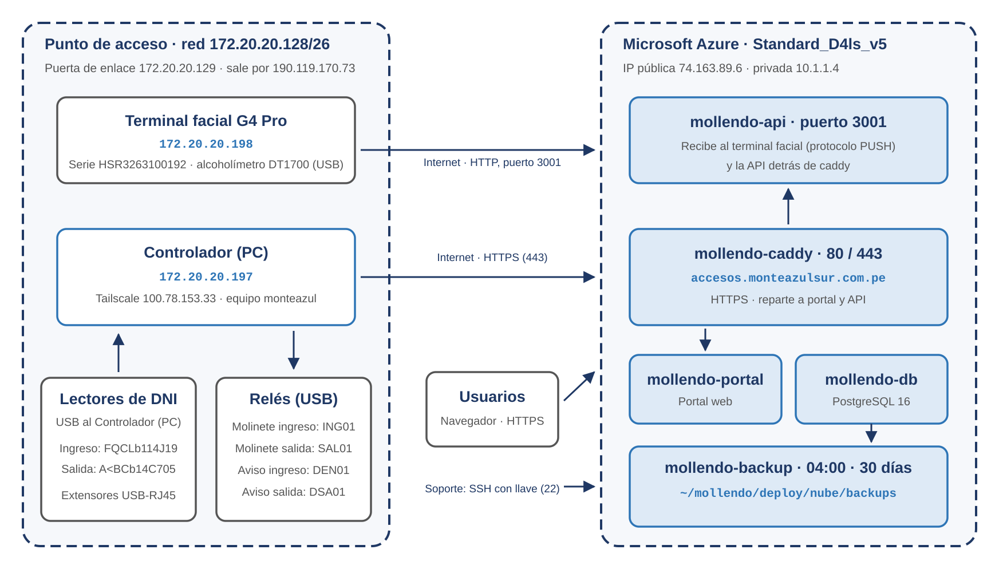

# Infraestructura y operación - Sistema de Control de Accesos

**Terminal Monte Azul Mollendo (TMAM)**

Versión 1.0 · 23 de octubre de 2026

| Versión | Fecha | Descripción |
|---|---|---|
| 1.0 | 23/10/2026 | Instalación en Azure, punto de acceso, respaldos y operación. |

Documento para soporte técnico: dónde y cómo está instalado el sistema. Lo que hace el sistema está en el Documento Funcional. Las contraseñas no se incluyen: están en la hoja "Accesos del sistema" (confidencial).

## 1. Resumen de la instalación

| Parte | Dónde está |
|---|---|
| Portal y servidor | Máquina virtual en Microsoft Azure, en **https://accesos.monteazulsur.com.pe** |
| Controlador (PC) | Computadora en el punto de acceso, junto a los molinetes |
| Terminal facial y alcoholímetro | Punto de acceso, conectado por red al servidor |
| Lectores de DNI y relés | Punto de acceso, conectados por USB al Controlador (PC) |
| Respaldos | Disco del servidor de Azure |

En uso desde el 16/10/2026.

## 2. Servidor en la nube

| Elemento | Valor |
|---|---|
| Proveedor | Microsoft Azure (máquina virtual de TMAM) |
| Tamaño | Standard_D4ls_v5: 4 vCPU, 8 GB de RAM |
| Disco | 128 GB SSD |
| Sistema operativo | Ubuntu Server 26.04 LTS, hora de Lima |
| IP pública | `74.163.89.6` (estática) |
| IP privada | `10.1.1.4` |
| Dominio | `accesos.monteazulsur.com.pe` (registro A en Cloudflare, en modo "DNS only") |
| Certificado HTTPS | Let's Encrypt, se renueva solo |
| Carpeta de instalación | `/home/atenasac/mollendo` |

**Puertos abiertos:**

| Puerto | Uso |
|---|---|
| 80 y 443 | Portal y API con HTTPS (el 80 redirige al 443) |
| 3001 | Terminal facial G4 Pro (HTTP) |
| 22 | SSH de administración, solo con llave |

La base de datos no es accesible desde fuera del servidor.

## 3. Punto de acceso

### 3.1. Red

| Elemento | Valor |
|---|---|
| Red local | `172.20.20.128/26` |
| Puerta de enlace | `172.20.20.129` |
| Salida a internet | `190.119.170.73` |

La conexión con el servidor la inicia el punto de acceso: no se abren puertos en la red del terminal.

### 3.2. Equipos

| Equipo | Dirección o conexión | Detalle |
|---|---|---|
| Controlador (PC) | `172.20.20.197` (cable) · `100.78.153.33` (Tailscale) | Nombre del equipo: monteazul. Ubuntu Server 26.04 |
| Terminal facial ZKTeco G4 Pro | `172.20.20.198` | Serie HSR3263100192. Se conecta al servidor por el puerto 3001 |
| Alcoholímetro DT1700 | USB al terminal facial | Sin configuración en el sistema |
| Lector de DNI de ingreso | USB al Controlador (PC) | Adaptador USB-serie, serie FQCLb114J19 |
| Lector de DNI de salida | USB al Controlador (PC) | Adaptador USB-serie, serie A<BCb14C705 |
| Relé del molinete de ingreso | USB al Controlador (PC) | Serie ING01 |
| Relé del molinete de salida | USB al Controlador (PC) | Serie SAL01 |
| Relé de aviso de ingreso denegado | USB al Controlador (PC) | Serie DEN01 |
| Relé de aviso de salida denegada | USB al Controlador (PC) | Serie DSA01 |
| Molinetes ZKTeco TS2000 Plus | Por sus relés | Sin conexión de red |

Los lectores llegan al Controlador (PC) con extensores USB por cable de red (unos 13 m el de ingreso y 15 m el de salida). Se recomienda cambiarlos por extensores activos.

## 4. Diagrama de red

## 5. Servicios instalados

**En el servidor** (contenedores Docker, en `/home/atenasac/mollendo/deploy/nube`):

| Contenedor | Función |
|---|---|
| `mollendo-caddy` | HTTPS y certificado; reparte el tráfico al portal y a la API |
| `mollendo-portal` | Portal web |
| `mollendo-api` | Backend; también atiende al terminal facial en el puerto 3001 |
| `mollendo-db` | Base de datos PostgreSQL 16 |
| `mollendo-backup` | Respaldo diario |

Los datos están en volúmenes de Docker: `mollendo_db_data` (base de datos) y `mollendo_documentos` (documentos y fotos). Los contenedores se reinician solos y arrancan con el servidor.

**En el Controlador (PC)** (en `~/mollendo/deploy/controlador`):

| Contenedor | Función |
|---|---|
| `mollendo-controlador` | Lee los DNI, consulta al servidor y abre los molinetes |

## 6. Respaldos y restauración

| Elemento | Valor |
|---|---|
| Ubicación | `/home/atenasac/mollendo/deploy/nube/backups` (en el servidor) |
| Respaldo diario | 04:00, archivo `mollendo-AAAAMMDD-HHMM.tar.gz`: base de datos, documentos y fotos |
| Antes de cada actualización | Archivo `antes-de-actualizar-AAAAMMDD-HHMM.sql.gz`: base de datos |
| Se conservan | 30 días |
| Tamaño actual | Unos 3,5 MB por respaldo diario |
| Estado | Se ve en Sistema y APIs |

**Restaurar:** reemplaza los datos actuales; antes se saca un respaldo de lo que hay. Se descomprime el respaldo elegido, se carga la base de datos y se copian los documentos y fotos al volumen. El paso a paso está en la guía de despliegue (sección 7.3).

**Recomendación:** hoy los respaldos están en el mismo disco del servidor. Activar Azure Backup de la máquina virtual o copiarlos a otro lugar.

## 7. Acceso de administración

| Equipo | Acceso |
|---|---|
| Servidor de Azure | SSH con llave, usuario `atenasac`, a `74.163.89.6` |
| Controlador (PC) | SSH con llave por Tailscale, usuario `ma-admin`, a `100.78.153.33` |
| Portal | Cuentas admin@monteazulsur.com.pe y vigilancia@monteazulsur.com.pe |

Las llaves y contraseñas las guarda soporte técnico; no se incluyen en este documento.

## 8. Operación diaria y actualizaciones

- **Revisar el estado:** pantalla Sistema y APIs del portal (servidor, respaldos y cada equipo).
- **Actualizar:** se sube la versión nueva al servidor, se saca un respaldo de la base, se reconstruyen los contenedores y se limpian las imágenes viejas. Las migraciones de la base se aplican solas.
- **Reiniciar el Controlador (PC):** se recupera sola y se reconecta al servidor en unos dos minutos.
- **Lector con el adaptador sin respuesta:** desconectar y volver a conectar el adaptador, o reiniciar el Controlador (PC).
- **Disco del servidor:** se revisa en cada actualización (hoy 10 % usado).

## 9. Repuestos y cambio de equipos

| Pieza | Qué preparar | El día del cambio |
|---|---|---|
| Lector de DNI | Configurarlo con los códigos de su folleto | Conectarlo al mismo adaptador |
| Adaptador USB del lector | Nada | Registrar su número de serie en el Controlador (PC) |
| Relé | Grabarle la serie del que reemplaza | Enchufarlo |
| Alcoholímetro DT1700 | Mismo modelo | Conectarlo por USB al terminal facial |
| Terminal facial G4 Pro | Configurar servidor y modo asistencia | Mientras tanto, verificación manual |
| Controlador (PC) | Dejar otra PC instalada y configurada | Pasarle los lectores y relés |

El detalle está en el documento de contingencias, sección 11.
